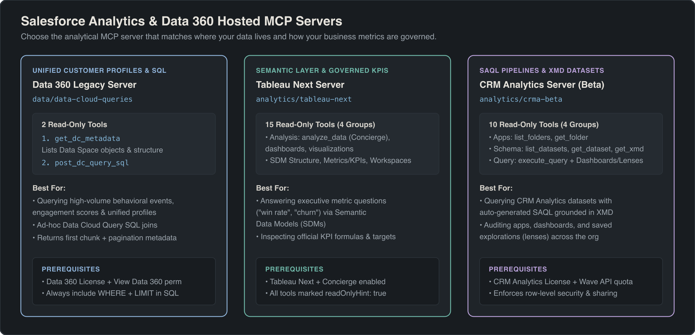
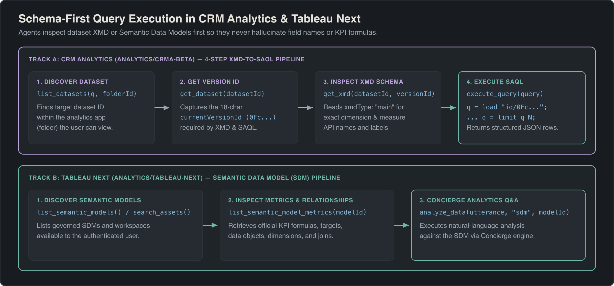
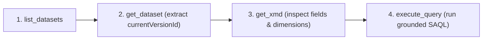

## Overview

When enterprise AI agents answer questions like *"What was our net retention rate in APAC last quarter?"* or *"Which high-value accounts have opened cases but zero website activity in 30 days?"*, standard SObject queries (`platform/sobject-reads`) fall short. The relevant data often lives in federated data lakes, unified profile graphs, or multi-gigabyte time-series analytics datasets.

Salesforce provides three specialized Hosted MCP Servers for analytical workloads:
1. **Data 360 Query Server** (`data/data-cloud-queries`): Executes federated ANSI SQL queries across unified customer profiles and data lake tables.
2. **Tableau Next MCP Server** (`analytics/tableau-next`): Interacts with governed Semantic Data Models (SDMs) and runs natural-language Concierge Analytics queries without writing raw SQL.
3. **CRM Analytics MCP Server** (`analytics/crma-beta`, Beta): Inspects Wave dataset Extended Metadata (XMD) and executes high-speed Salesforce Analytics Query Language (SAQL) calculations.



---

## Data 360 Query MCP Server (`data/data-cloud-queries`)

Organizations using **Salesforce Data 360** (formerly Data Cloud) can query Lakehouse objects, Data Model Objects (DMOs), Data Source Objects (DSOs), and Calculated Insights directly through the `data/data-cloud-queries` Hosted MCP Server.

### Server URLs
- **Standard Global Gateway:** `https://api.salesforce.com/platform/mcp/v1.0/data/data-cloud-queries`
- **My Domain Route:** `https://<my-domain>/services/mcp/v1/d/data/data-cloud-queries`

### Prerequisites
- Active **Data 360 license** provisioned in the org.
- Authenticated user or ECA Connected App assigned the **Data Cloud User** or **Data Cloud Admin** permission set, including the **View Data 360** permission.

### Tools Reference

| Tool Name | Parameters | Purpose & Execution Characteristics |
| :--- | :--- | :--- |
| `get_dc_metadata` | *(none)* | Discovers all available Data Model Objects (DMOs), Calculated Insights, and Lakehouse tables with their field names, data types, and primary/foreign keys (`readOnlyHint: true`). |
| `post_dc_query_sql` | `sql` (required String) | Executes an ANSI-compliant SQL query against Data 360. Returns the first chunk of tabular results along with a `nextBatchId` if results exceed the initial response buffer (`readOnlyHint: true`, `openWorldHint: false`). |

```sql title="Example Data 360 SQL Query via post_dc_query_sql"
SELECT 
    UnifiedIndividual__dlm.ssot__FirstName__c,
    UnifiedIndividual__dlm.ssot__LastName__c,
    UnifiedContactPointEmail__dlm.ssot__EmailAddress__c,
    Customer_LTV_Insight__cio.Lifetime_Value__c
FROM UnifiedIndividual__dlm
LEFT JOIN UnifiedContactPointEmail__dlm 
    ON UnifiedIndividual__dlm.Id__c = UnifiedContactPointEmail__dlm.PartyId__c
LEFT JOIN Customer_LTV_Insight__cio 
    ON UnifiedIndividual__dlm.Id__c = Customer_LTV_Insight__cio.Individual_Id__c
WHERE Customer_LTV_Insight__cio.Lifetime_Value__c > 50000
ORDER BY Customer_LTV_Insight__cio.Lifetime_Value__c DESC
LIMIT 100
```

> [!NOTE]
> **Data 360 Query Server vs Full Data 360 MCP Server:** The `data/data-cloud-queries` server is intentionally streamlined for SQL querying and metadata inspection. If your AI agent needs to trigger data stream refreshes, activate audience segments, or configure data ingest transforms, use the broader Data 360 Connect API endpoints via the Headless 360 MCP Server (`platform/headless-360`).

---

## Tableau Next MCP Server (`analytics/tableau-next`)

Direct SQL querying against raw tables introduces severe hallucination risks—LLMs frequently misinterpret complex revenue recognition rules or join foreign keys incorrectly. The **Tableau Next MCP Server** solves this by routing questions through governed **Semantic Data Models (SDMs)**.

Through Tableau Next and **Concierge Analytics**, business definitions (such as ARR, churn rate, or gross margin) are certified once in the semantic model. The AI agent inspects certified metrics and dimensions before requesting analytical answers.

### Server URLs
- **Standard Global Gateway:** `https://api.salesforce.com/platform/mcp/v1.0/analytics/tableau-next`
- **My Domain Route:** `https://<my-domain>/services/mcp/v1/d/analytics/tableau-next`

### All 15 Tableau Next Tools by Functional Group



#### 1. Analysis & Q&A Tools
- **`analyze_data`**: The primary conversational analytics tool. Accepts `utterance` (e.g., *"Show revenue by product family for 2026"*), `target_entity_type` (typically `"sdm"`), and `target_entity_name_or_id`. Executes natural-language Q&A backed by the governed semantic layer.
- **`list_dashboards`**: Lists all Tableau Next dashboards accessible to the authenticated user.
- **`get_dashboard`**: Retrieves metadata, layout, and component bindings for a dashboard by `dashboardIdOrApiName`.
- **`list_visualizations`**: Discovers available standalone visualizations and worksheets.
- **`get_visualization`**: Retrieves a specific visualization definition. **Note the British spelling:** The parameter name is `visualisationIdOrApiName` (with an `s`). Passing `visualizationIdOrApiName` with a `z` will throw a schema validation error.

#### 2. Semantic Model Structure Discovery
- **`list_semantic_models`**: Returns all published Semantic Data Models (SDMs) in the workspace.
- **`get_semantic_model`**: Retrieves full schema details for a model using `modelIdOrApiName`.
- **`list_semantic_model_data_objects`**: Lists physical and logical tables mapped within an SDM.
- **`list_semantic_model_relationships`**: Inspects joins, cardinalities (1:1, 1:N, N:N), and join keys configured between data objects.
- **`get_semantic_model_logical_view`**: Retrieves the logical query view for a given model and logical view name.

#### 3. Business Logic & Certified Definitions
- **`list_semantic_model_measures`**: Returns certified numerical aggregations (e.g., `SUM(Net_ARR)` or `AVG(Discount)`).
- **`list_semantic_model_dimensions`**: Returns categorical grouping attributes (e.g., `Region`, `Industry`, `Fiscal_Quarter`).
- **`list_semantic_model_metrics`**: Lists enterprise metrics defined with specific business calculation rules.
- **`get_semantic_model_metric`**: Inspects the exact formula, time-grain, and filter constraints for a specific metric by `modelIdOrApiName` and `metricIdOrApiName`.
- **`list_semantic_model_calculated_dimensions`**: Discovers dynamic dimension buckets and conditional classifications.
- **`list_semantic_model_calculated_measures`**: Discovers complex calculated measures (such as year-over-year growth percentage).

#### 4. Workspace & General Asset Discovery
- **`list_workspaces`**: Lists available analytics workspaces (`workspaceIdOrApiName` optional).
- **`list_workspace_assets`**: Enumerates models, dashboards, and lenses contained inside a specific workspace.
- **`search_assets`**: Free-text search across all analytics assets, accepting `query` and an optional `type` filter (`"dashboard"`, `"visualization"`, or `"semanticModel"`).

### Operational Tips & Troubleshooting
1. **The Initial Client Setup:** When connecting an external CLI or MCP client to Tableau Next, ensure Node.js (v18+) is installed if using standard stdio bridges.
2. **Session Inactivity Reconnect:** External Claude Desktop sessions may drop if idle for more than 15 minutes. Re-initiating the prompt automatically renews the OAuth PKCE handshake.
3. **Claude Desktop vs Agentforce Latency:** Running Tableau Next queries from Claude Desktop over external HTTPS round-trips averages ~45–60 seconds per turn due to multi-layer API proxying. In contrast, native **Agentforce Vibes** agents execute queries collocated within Salesforce Hyperforce **10 to 20 times faster**.
4. **"Unavailable for you at the moment":** If an agent receives this error on `analyze_data`, check two things:
   - Ensure the user has the **Concierge Analytics User** permission set assigned.
   - Verify in Tableau Next Setup that the target Semantic Data Model is set to **Published** and assigned to the user's workspace.

---

## CRM Analytics MCP Server (`analytics/crma-beta`)

For orgs running **CRM Analytics** (formerly Tableau CRM / Einstein Analytics), the `analytics/crma-beta` Hosted MCP Server enables AI agents to query pre-aggregated Wave datasets directly using **SAQL (Salesforce Analytics Query Language)**.

### Server URLs
- **Standard Global Gateway:** `https://api.salesforce.com/platform/mcp/v1.0/analytics/crma-beta`
- **My Domain Route:** `https://<my-domain>/services/mcp/v1/d/analytics/crma-beta`

### The 4-Step XMD-Grounded SAQL Workflow

Never let an AI client guess SAQL field names or run blind queries. CRM Analytics datasets store human-friendly labels, measure formats, and system dimension names inside their **Extended Metadata (XMD)**.

Always instruct your AI client to follow this four-step sequence:



1. **Step 1: Discover the Dataset**
   Call `list_datasets` to locate the target dataset ID (`0Fb...`).
2. **Step 2: Extract the Current Version**
   Call `get_dataset` with the dataset ID to retrieve `currentVersionId` (`0Fc...`). Because Wave dataset schemas can evolve across recipe runs, queries must target the active version.
3. **Step 3: Ground on Field Names via XMD**
   Call `get_xmd` passing the 18-character `datasetId`, `versionId`, and `xmdType` (`"main"`, `"system"`, or `"user"`). This returns certified field API names, dimension labels, and format masks.
4. **Step 4: Execute Schema-Grounded SAQL**
   Call `execute_query` with a valid SAQL query string referencing the exact dataset and version ID, always terminating with an explicit `limit` statement.

```saql title="Example Schema-Grounded SAQL Query"
-- Loaded via execute_query with explicit dataset and version IDs
q = load "0FbB00000001234KAA/0FcB00000005678MAA";
q = group q by ('Account_Owner.Name', 'Region');
q = foreach q generate 
    'Account_Owner.Name' as 'Owner',
    'Region' as 'Region',
    sum('Amount') as 'Total_Pipeline',
    count() as 'Deal_Count';
q = order q by 'Total_Pipeline' desc;
q = limit q 25;
```

### Complete Reference: All 10 CRM Analytics Tools

| Tool Name | Parameters | Description |
| :--- | :--- | :--- |
| `list_folders` | *(none)* | Enumerates CRM Analytics apps and folders where datasets and dashboards are stored. |
| `get_folder` | `folderId` (required String) | Retrieves metadata and sharing permissions for a specific CRM Analytics app folder. |
| `list_datasets` | *(none)* | Lists all accessible CRM Analytics datasets with names, IDs, and last modified dates. |
| `get_dataset` | `datasetId` (required String) | Returns detailed dataset metadata, including the critical **`currentVersionId`**. |
| `get_xmd` | `datasetId`, `versionId`, `xmdType` | Returns Extended Metadata (labels, dimensions, measures, formats) for a specific dataset version. `xmdType` can be `"main"`, `"system"`, or `"user"`. |
| `execute_query` | `query` (required String) | Executes a SAQL string and returns aggregated result rows (`readOnlyHint: true`). |
| `list_dashboards` | *(none)* | Lists all CRM Analytics dashboards accessible to the authenticated user. |
| `get_dashboard` | `dashboardId` (required String) | Retrieves the layout, widget definitions, and underlying steps of a dashboard. |
| `list_lenses` | *(none)* | Discovers saved analytical explorations (Lenses). |
| `get_lens` | `lensId` (required String) | Retrieves the saved SAQL query and visualization configuration of a Lens. |

> [!TIP]
> **Populate XMD Field Descriptions for Zero-Shot Accuracy:** Just as Object Manager field descriptions guide SOQL generation, the `description` attributes inside dataset XMD guide SAQL generation. Ensure your CRM Analytics data engineers populate clear field descriptions on all key measures and dimensions in recipes so AI clients immediately recognize which measure represents GAAP revenue versus pipeline ARR.

---

## Architectural Comparison: SObject vs Data 360 vs Tableau Next vs CRM Analytics

| Dimension | SObject Reads (`sobject-reads`) | Data 360 (`data-cloud-queries`) | Tableau Next (`tableau-next`) | CRM Analytics (`crma-beta`) |
| :--- | :--- | :--- | :--- | :--- |
| **Data Scope** | Core CRM tables (Standard & Custom SObjects) | Federated Data Lake, Unified Profiles, DMOs | Enterprise Semantic Data Models (SDMs) | Pre-aggregated Wave / CRMA datasets |
| **Query Language** | SOQL / SOSL | ANSI SQL | Natural Language (Concierge Q&A) | SAQL |
| **Schema Grounding** | `getObjectSchema` | `get_dc_metadata` | `list_semantic_model_metrics` & measures | `get_xmd` |
| **Max Record Scale** | 50,000 rows per SOQL query | Millions of lakehouse rows (cursored) | Governed aggregations (no row limits) | Hundreds of millions of pre-indexed rows |
| **Hallucination Protection** | Object descriptions & FLS | Lakehouse metadata | **Highest** (Governed metric definitions) | High (XMD field labels & formulas) |
| **Best Used For** | Operational record lookups & triage | Unified profile & cross-cloud queries | Executive KPI & revenue Q&A | High-speed slice-and-dice pipeline analysis |

