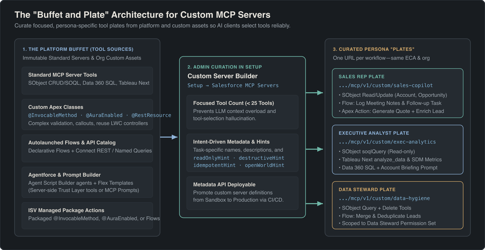
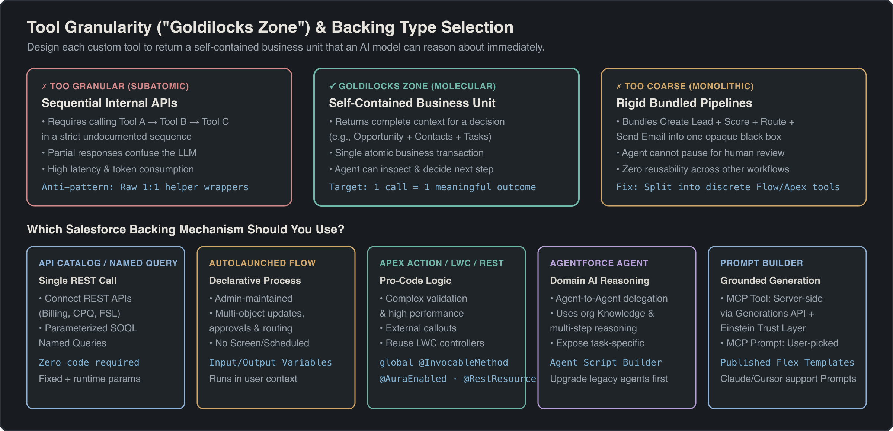

## Overview

Standard Salesforce Hosted MCP Servers ship with fixed, immutable tool sets scoped to a single product area. To expose your org's custom business logic—or to combine tools from multiple standard servers into one endpoint—you build a **Custom MCP Server** in Salesforce Setup (`Integration → Salesforce MCP Servers`).

Think of every available tool across your org as a **buffet** (standard SObject tools, Data 360 queries, Tableau Next analytics, custom Apex, Flows, and REST APIs) and a Custom MCP Server as a **curated plate** designed for a specific persona. Because AI clients lose tool-selection accuracy when presented with more than a few dozen tools, curating focused servers (such as `custom/sales-copilot` or `custom/data-hygiene`) keeps agent behavior predictable while giving each team a single server URL.



Custom MCP servers can also be deployed across environments using the **Metadata API**, allowing teams to build and test tool definitions in a sandbox before promoting them to production.

## Prerequisites

- **Hosted MCP Server authentication configured** via an External Client App with `mcp_api` and `refresh_token` scopes (see [Hosted MCP Servers Setup and Authentication](/docs/agentforce/hosted-mcp-servers-setup/)).
- **System Administrator permissions** to configure custom servers under **Setup → Integration → Salesforce MCP Servers** (or **API Catalog**).
- **Underlying platform assets deployed and active**, such as active Autolaunched Flows, compiled Apex classes, published Prompt Builder Flex templates, or Agentforce agents built in the **Agent Script Builder**.

## Choose the Right Backing Mechanism for Custom Tools

Custom MCP servers let you mix tools from standard servers with seven custom backing mechanisms. Select the backing type that matches who maintains the logic and whether the operation is deterministic or generative.



| Backing Type | Best For | Execution Mode | Key Requirement |
|---|---|---|---|
| **Apex Invocable Action** | Complex validation, multi-step transactions, external callouts | Deterministic (User context) | `global` method annotated with `@InvocableMethod` |
| **AuraEnabled Apex** | Reusing existing Lightning component controller logic | Deterministic (User context) | Method annotated with [`@AuraEnabled`](/docs/lwc/call-apex-from-lwc/) |
| **Apex REST Endpoint** | Surfacing existing custom REST APIs on the platform | Deterministic (User context) | Class annotated with `@RestResource` |
| **Autolaunched Flow** | Admin-owned declarative processes, routing, approvals | Deterministic (User context) | Active **Autolaunched Flow** with input/output variables |
| **API Catalog / Named Query** | Product Connect APIs (Billing, CPQ, FSL) or scoped SOQL | Deterministic (User context) | Endpoint registered in Salesforce API Catalog |
| **Agentforce Agent** | Delegating domain reasoning and org knowledge tasks | Generative (Server-side LLM) | Built or upgraded in the **Agent Script Builder** |
| **Prompt Builder Template** | Grounded content generation with Einstein Trust Layer | Generative (Tool or Prompt) | Published **Flex** template ( Tool) or Prompt Builder enabled |

## Expose Apex, Flows, and API Catalog Endpoints

Deterministic business processes—such as calculating tiered quotes, escalating cases, or submitting approvals—should always use Apex, Flows, or API Catalog endpoints rather than LLM-driven tools.

### Apex Actions (`@InvocableMethod`), `@AuraEnabled`, and `@RestResource`

- **Apex Invocable Actions:** Any Apex class containing a `global` static method annotated with `@InvocableMethod` can be published as an MCP tool. The method's `@InvocableVariable` input and output classes define the JSON parameter schema exposed to the MCP client.
- **`@AuraEnabled` and `@RestResource` Methods:** If your org already has LWC controllers annotated with `@AuraEnabled` or custom endpoints annotated with `@RestResource`, you can map them directly to custom MCP tools without writing wrapper code.
- **ISV Managed Package Guidance:** Managed packages cannot include Custom MCP Server configurations directly at GA. ISVs should expose package capabilities through `global @InvocableMethod` classes, `@AuraEnabled` methods, `@RestResource` endpoints, or Autolaunched Flows so subscriber admins can add them to custom servers after installation.

### Autolaunched Flows

Expose existing Flow Builder automation as an MCP tool by selecting **Flow** as the backing type and choosing an **Autolaunched Flow** with defined input and output variables.

- **User context execution:** The flow runs as the authenticated MCP user, respecting their CRUD, FLS, and sharing rules while retaining full access to platform features (Named Credentials callouts, subflows, email alerts, and approval processes).
- **Synchronous completion:** MCP tool calls do not stream intermediate progress. If a process takes more than a few seconds, design the flow to enqueue an asynchronous job and return a job tracking ID immediately.

### API Catalog and Named Queries

The Salesforce API Catalog lets admins publish standard REST endpoints, product-specific **Connect APIs** (such as Salesforce Billing invoice lookups or Field Service appointment scheduling), and **Named Queries** as MCP tools without code.

- **Fixed vs. runtime parameters:** Parameters locked by the admin at configuration time cannot be overridden by the AI agent at runtime, while open parameters become part of the tool's input schema.
- **Single-endpoint scope:** Each API Catalog tool maps to one REST call. Use an Autolaunched Flow or Apex Action when an operation must orchestrate multiple sequential calls.

## Expose Agentforce Agents and Prompt Builder Templates

When an external assistant (such as Claude, ChatGPT, or Slackbot) needs domain-specific reasoning or grounded text generation inside Salesforce, expose **Agentforce agents** or **Prompt Builder templates** on your custom server.

### Agentforce Agents and the Task-Specific Tool Pattern

Only Agentforce agents created or upgraded in the **Agent Script Builder** can be exposed as MCP tools. When an external client calls an agent-backed tool, Salesforce routes the request to the Agentforce agent, which applies its instructions, actions, and Knowledge sources in the authenticated user's context.

> [!TIP]
> **Split multi-purpose agents into task-specific MCP tools:** If a single Sales Agent both schedules customer meetings and forecasts deal close dates, create **two separate MCP tools** (`schedule_customer_meeting` and `forecast_deal_close`) that both point to the same underlying Agentforce agent. External LLMs match user intent against tool names and descriptions; specific tool names prevent the external model from skipping your agent.

### Prompt Builder: MCP Tools vs. MCP Prompts

Prompt Builder templates can be surfaced through MCP in two distinct ways:

1. **Server-Side MCP Tools (Model-Invoked):** Configured on a custom server as a tool. The external AI assistant invokes the tool autonomously during a workflow; Salesforce resolves merge fields (record fields, flows, related lists, Apex), executes the prompt server-side via the **Generations API** with the **Einstein Trust Layer** (grounding, data masking, and toxicity detection), and returns the final output.
2. **User-Initiated MCP Prompts (Prompt Recipes):** Configured from a published **Flex** template using the MCP Prompts primitive, or accessed via the two built-in prompt templates on `platform/sobject-all`:
   - `einstein_gpt__accountReviewBriefing` (**Create Executive Briefing for Account Review Meeting**)
   - `einstein_gpt__revenueReconciliationAnalysis` (**Revenue Reconciliation Analysis**)

When a user selects an MCP Prompt from their client UI (for example, clicking the `+` menu in Claude and choosing `Add from <Connector>`), Salesforce resolves the live CRM merge fields using the user's permissions and inserts the structured prompt recipe into the chat composer.

> [!WARNING]
> Client support for the **MCP Prompts** primitive varies: **Claude** and **Cursor** support user-initiated MCP prompts, whereas **ChatGPT** does not. If your users work in ChatGPT, expose Prompt Builder templates as server-side **MCP Tools** instead.

## Design Tools for Accurate LLM Selection

How you granularity-scope, name, and annotate custom tools determines whether an AI client uses them reliably.

### Hit the "Goldilocks Zone" of Tool Granularity

- **Avoid subatomic tools (too fine):** Do not map internal helper methods 1:1 if they must be called in a strict sequence (`initQuote` → `calculateTax` → `finalizeQuote`) to produce a valid result. An LLM sees a flat list of tools and will call them out of order.
- **Avoid monolithic tools (too coarse):** Do not bundle an entire multi-stage business workflow (create lead, score lead, assign territory, and send outbound email) into one opaque tool if the user needs to review intermediate results.
- **Aim for self-contained business units:** Design each tool so one call returns a complete, decision-ready unit of information (for example, an Opportunity along with its primary Contact roles and open Tasks) or performs one atomic business state transition.

### Set Explicit Tool Behavior Annotations

The MCP specification defines an `annotations` object with four boolean hints that guide client UX (such as whether to auto-run a tool or prompt the user for confirmation):

| Annotation Hint | Spec Default (If Omitted) | Recommended Setting for Custom Tools |
|---|---|---|
| `readOnlyHint` | `false` | Set `true` on any Apex, Flow, or API tool that only reads data. |
| `destructiveHint` | `true` | Set `false` on reads and non-destructive updates; `true` on deletes or irreversible actions. |
| `idempotentHint` | `false` | Set `true` if repeating the call with identical inputs has no additional side effects. |
| `openWorldHint` | `true` | Set `false` when the tool operates strictly within your closed Salesforce org domain. |

Because the MCP specification defaults unannotated tools to potentially destructive (`readOnlyHint: false`, `destructiveHint: true`), omitting annotations on a custom query tool causes clients like Claude or Cursor to prompt the user for manual confirmation on every read.

## Example

The following `global with sharing` Apex class exposes a molecular, bulk-safe `@InvocableMethod` designed specifically for a custom Sales MCP server. Notice how the `label` and `description` attributes on both the method and `@InvocableVariable` properties give the external LLM exact instructions on when to call the tool and what format to pass:

```apex title="OpportunityDealBriefAction.cls"
global with sharing class OpportunityDealBriefAction {

    global class Request {
        @InvocableVariable(
            label='Opportunity ID'
            description='The 15- or 18-character Salesforce Opportunity record ID (starts with 006).'
            required=true
        )
        global Id opportunityId;
    }

    global class Response {
        @InvocableVariable(
            label='Deal Brief JSON'
            description='Self-contained JSON summary with Opportunity details, Contact Roles, and open Tasks.'
        )
        global String dealBriefJson;
    }

    @InvocableMethod(
        label='Get Opportunity Deal Brief'
        description='Retrieves an Opportunity with its primary Contact Roles and open high-priority Tasks in a single call. Use this before drafting deal summaries or renewal recommendations.'
    )
    global static List<Response> getDealBriefs(List<Request> requests) {
        Set<Id> oppIds = new Set<Id>();
        for (Request req : requests) {
            if (req.opportunityId != null) {
                oppIds.add(req.opportunityId);
            }
        }

        Map<Id, Opportunity> oppsById = new Map<Id, Opportunity>([
            SELECT Id, Name, StageName, Amount, CloseDate, Account.Name,
                (SELECT Contact.Name, Contact.Email, Role, IsPrimary FROM OpportunityContactRoles),
                (SELECT Id, Subject, Status, Priority, ActivityDate FROM Tasks WHERE IsClosed = false ORDER BY ActivityDate ASC LIMIT 10)
            FROM Opportunity
            WHERE Id IN :oppIds
            WITH USER_MODE
        ]);

        List<Response> results = new List<Response>();
        for (Request req : requests) {
            Response res = new Response();
            Opportunity opp = oppsById.get(req.opportunityId);
            res.dealBriefJson = (opp != null) ? JSON.serialize(opp) : '{"error":"Opportunity not found or inaccessible"}';
            results.add(res);
        }
        return results;
    }
}
```

The test class verifies bulk execution and user-mode security enforcement:

```apex title="OpportunityDealBriefActionTest.cls"
@IsTest
private class OpportunityDealBriefActionTest {

    @IsTest
    static void returnsSelfContainedBriefInBulk() {
        Account acc = new Account(Name = 'Acme Industrial');
        insert acc;

        List<Opportunity> opps = new List<Opportunity>();
        for (Integer i = 0; i < 50; i++) {
            opps.add(new Opportunity(
                Name = 'Deal ' + i,
                AccountId = acc.Id,
                StageName = 'Prospecting',
                CloseDate = Date.today().addDays(30),
                Amount = 100000
            ));
        }
        insert opps;

        List<OpportunityDealBriefAction.Request> requests = new List<OpportunityDealBriefAction.Request>();
        for (Opportunity opp : opps) {
            OpportunityDealBriefAction.Request req = new OpportunityDealBriefAction.Request();
            req.opportunityId = opp.Id;
            requests.add(req);
        }

        Test.startTest();
        List<OpportunityDealBriefAction.Response> responses = OpportunityDealBriefAction.getDealBriefs(requests);
        Test.stopTest();

        Assert.areEqual(50, responses.size());
        Assert.isTrue(responses[0].dealBriefJson.contains('Acme Industrial'));
    }
}
```

## Limits and Gotchas

- **Practical client tool ceiling:** Keep custom MCP servers under **20 to 30 tools** per server URL. Beyond a few dozen tools, LLM tool-routing accuracy drops sharply.
- **Custom server URL prefix:** Custom servers always use the `custom/<server-name>` prefix (for example, `https://api.salesforce.com/platform/mcp/v1/custom/sales-copilot`).
- **Apex visibility requirement:** `@InvocableMethod` methods exposed as MCP Apex Actions must be declared `global`. If you change method parameters later, re-sync the tool configuration in Setup.
- **Prompt Builder template restrictions:** Only **published Flex templates** can be exposed as custom MCP Prompts. Sales Email or Field Generation template types are not supported for custom MCP prompt publishing, and each execution consumes credits.
- **Governor limits apply per tool call:** Flows and Apex Actions invoked via MCP execute within standard synchronous Salesforce governor limits (100 SOQL queries, 150 DML statements, 10,000 DML rows) under the authenticated user.

## Related Official Documentation

- [Manage Salesforce Hosted MCP Servers in API Catalog](https://help.salesforce.com/s/articleView?id=platform.api_catalog_manage_salesforce_hosted_mcp_servers.htm&type=5): configuring custom servers and mapping endpoints in Setup.
- [InvocableMethod Annotation](https://developer.salesforce.com/docs/atlas.en-us.apexcode.meta/apexcode/apex_classes_annotation_InvocableMethod.htm): Apex rules for invocable actions and parameter types.
- [Upgrade Agents to the New Agent Script Builder](https://help.salesforce.com/s/articleView?id=ai.agent_setup_create_upgrade.htm&type=5): migrating legacy Agentforce agents for MCP tool exposure.

