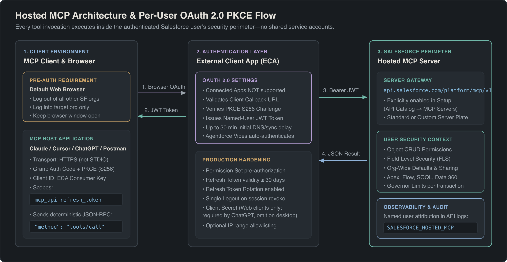
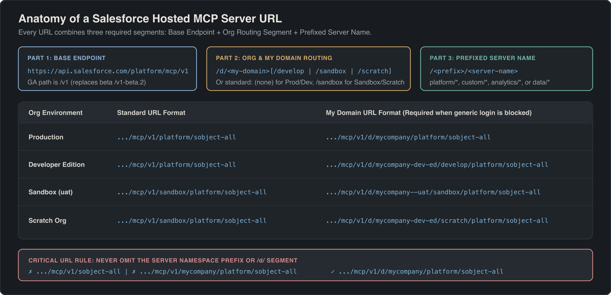

## Overview

Salesforce Hosted Model Context Protocol (MCP) Servers expose your org's data, metadata, automation, and analytics to external AI clients—including Claude, Cursor, ChatGPT, Postman, and Agentforce Vibes—through a single governed protocol. Instead of building and maintaining custom REST API middleware for every AI assistant in your stack, you configure authentication once in Salesforce and connect any MCP-compatible host over HTTPS.

Every Hosted MCP Server operates strictly inside the Salesforce security perimeter using per-user OAuth 2.0 authentication with Proof Key for Code Exchange (PKCE). When an AI agent invokes a tool, the server executes deterministic platform calls as the authenticated human user, enforcing that user's object permissions (CRUD), field-level security (FLS), and sharing rules automatically.



> [!NOTE]
> Hosted MCP Servers are intended for organizations with **Flex Credits** (or [Salesforce Foundations](https://www.salesforce.com/ca/crm/foundations/)), and server tool invocations may consume credits based on headless usage rules.

## Prerequisites

You need administrator access, an API-enabled Salesforce edition, and an MCP-compatible client before configuring a connection:

- **System Administrator permissions** (or equivalent permissions to manage External Client Apps and API Catalog settings in Setup).
- **API access enabled** on the target org (Enterprise, Unlimited, Performance, Developer Edition, or Professional Edition with API add-on).
- **Flex Credits entitlement** enabled on your contract for production usage.
- **Target MCP client details**, specifically the OAuth callback URL required by your client (Postman, Claude, Cursor, or ChatGPT).

## Enable Hosted MCP Servers in Setup

Hosted MCP Servers are disabled by default in every org and must be explicitly activated by an administrator before any client can connect. Even if a user completes OAuth authentication with valid credentials, connection requests fail until the target server is toggled on.

1. In Salesforce Setup, enter `MCP Servers` in the Quick Find box and select **MCP Servers** under **API Catalog**.
2. Review the catalog of available standard servers (such as `platform/sobject-reads` or `platform/sobject-all`) and custom servers.
3. Toggle on only the specific servers your team requires. Wait up to **2 minutes** for newly activated servers to become operational.

> [!RELEASE] Winter '27
> If you are migrating from the pilot or beta release, update three settings for General Availability (GA):
> 1. **Activate servers in Setup:** Servers are now off by default under **Setup → API Catalog → MCP Servers**.
> 2. **Update OAuth scopes:** Replace the four beta scopes (`api`, `sfap_api`, `refresh_token`, `einstein_gpt_api`) with `mcp_api` and `refresh_token`.
> 3. **Update the URL path:** Replace the beta version segment `v1-beta.2` with `v1` and reauthorize each client.

## Configure an External Client App for OAuth 2.0 PKCE

Salesforce Hosted MCP Servers require an **External Client App (ECA)** for OAuth registration. Legacy Connected Apps are not supported and will fail authentication.

> [!WARNING]
> You cannot create an External Client App directly inside a [scratch org](/docs/sf-cli/create-scratch-org/) through the Setup UI. To test MCP in a scratch org, create the External Client App in your Dev Hub org, package it, and install the package into the scratch org.

### Step-by-Step ECA Configuration

1. In Setup, enter `external client` in the Quick Find box and select **External Client App Manager**.
2. Click **New External Client App** and complete the **Basic Information** fields (App Name, API Name, Contact Email).
3. Expand **API (Enable OAuth Settings)** and select **Enable OAuth**.
4. In **Callback URL**, enter the exact redirect URI for each MCP client you plan to use (you can register multiple callback URLs on separate lines):

| MCP Client | Required Callback URL | Notes |
|---|---|---|
| **Postman (Desktop)** | `https://oauth.pstmn.io/v1/callback` | Use with HTTP transport (not STDIO). |
| **Postman (Web)** | `https://oauth.pstmn.io/v1/browser-callback` | Enable **Authorize using browser**. |
| **Claude** | `https://claude.ai/api/mcp/auth_callback` | Works for Claude.ai, Claude Desktop, and Claude Code. |
| **Cursor** | `http://localhost:8787/callback` | Also add `cursor://anysphere.cursor-mcp/oauth/callback` for older builds. |
| **ChatGPT** | *(Copy from ChatGPT Advanced Settings)* | Generated per connector in ChatGPT Developer Mode. |
| **Agentforce Vibes** | *(None required)* | Auto-enabled in VS Code using your active CLI/IDE org session. |

5. In **OAuth Scopes**, add both required scopes:
   - **Access MCP servers (`mcp_api`)**
   - **Perform requests at any time (`refresh_token`)**
6. Under **Security**, configure token generation:
   - Select **Issue JSON Web Token (JWT)-based access tokens for named users**.
   - Deselect all other optional security checkboxes that do not require Salesforce Support intervention (unless you are configuring a web-based client like ChatGPT that requires a Client Secret).
7. Click **Create**.
8. Open the **Settings** tab, expand **OAuth Settings**, and click **Consumer Key and Secret** to copy your **Consumer Key** (`CLIENT_ID`).

> [!NOTE]
> A newly created External Client App can take **up to 30 minutes** to propagate across Salesforce authentication endpoints. If your initial OAuth handshake returns an invalid client error immediately after creation, wait for propagation to finish before changing settings.

## Build Your Hosted MCP Server URL

Every Hosted MCP Server URL consists of three mandatory parts: the base endpoint (`https://api.salesforce.com/platform/mcp/v1`), an org-type or My Domain routing segment, and the **prefixed** server name (such as `platform/sobject-all` or `custom/myserver`).



Use the **Standard Format** for quick setup, or use the **My Domain Format** (`/d/<MY-DOMAIN-NAME>/...`) if your org blocks logins from generic `login.salesforce.com` or `test.salesforce.com` endpoints.

| Org Type | Standard URL Format | My Domain URL Format |
|---|---|---|
| **Production** | `https://api.salesforce.com/platform/mcp/v1/<SERVER-NAME>` | `https://api.salesforce.com/platform/mcp/v1/d/<MY-DOMAIN>/<SERVER-NAME>` |
| **Developer Edition** | `https://api.salesforce.com/platform/mcp/v1/<SERVER-NAME>` | `https://api.salesforce.com/platform/mcp/v1/d/<MY-DOMAIN>/develop/<SERVER-NAME>` |
| **Sandbox** | `https://api.salesforce.com/platform/mcp/v1/sandbox/<SERVER-NAME>` | `https://api.salesforce.com/platform/mcp/v1/d/<MY-DOMAIN>--<SANDBOX>/sandbox/<SERVER-NAME>` |
| **Scratch Org** | `https://api.salesforce.com/platform/mcp/v1/sandbox/<SERVER-NAME>` | `https://api.salesforce.com/platform/mcp/v1/d/<MY-DOMAIN>/scratch/<SERVER-NAME>` |

### Concrete URL Examples for `platform/sobject-all`

- **Production (Standard):** `https://api.salesforce.com/platform/mcp/v1/platform/sobject-all`
- **Production (My Domain `mycompany`):** `https://api.salesforce.com/platform/mcp/v1/d/mycompany/platform/sobject-all`
- **Developer Edition (`mycompany-dev-ed`):** `https://api.salesforce.com/platform/mcp/v1/d/mycompany-dev-ed/develop/platform/sobject-all`
- **Sandbox (`uat` on `mycompany`):** `https://api.salesforce.com/platform/mcp/v1/d/mycompany--uat/sandbox/platform/sobject-all`
- **Scratch Org (`mycompany-dev-ed`):** `https://api.salesforce.com/platform/mcp/v1/d/mycompany-dev-ed/scratch/platform/sobject-all`

> [!WARNING]
> Never omit the server namespace prefix (`platform/`, `custom/`, `analytics/`, or `data/`) or the `/d/` segment in My Domain URLs. A URL like `https://api.salesforce.com/platform/mcp/v1/sobject-all` will fail to route.

## Connect and Test MCP Clients

Before initiating OAuth from any MCP client, prepare your browser session to avoid multi-tenant routing conflicts.

### Mandatory Browser Pre-Authentication Step

Because the MCP specification does not natively disambiguate multi-tenant browser sessions, complete these three steps before clicking **Connect** in your client:

1. **Log out of all other Salesforce orgs** in your default web browser.
2. **Log in to the exact target org** where you enabled the MCP server and External Client App.
3. **Keep that browser window open** so the MCP client's OAuth redirect opens a tab in the same authenticated window.

### Connect Postman (Recommended First Test)

Always verify a new server in Postman before wiring up an LLM client. Because the Hosted MCP Server is deterministic, Postman lets you inspect raw JSON-RPC `tools/call` responses without an AI model interpreting or masking errors.

1. In Postman, create a new **MCP** request, switch the transport dropdown from **STDIO** to **HTTP**, and paste your server URL.
2. Open the **Authorization** tab, choose **OAuth 2.0**, and set **Add authorization data to** to **Request Headers**.
3. Configure a new token with these exact settings:
   - **Header Prefix:** `Bearer`
   - **Grant Type:** `Authorization Code (With PKCE)`
   - **Auth URL:** `https://login.salesforce.com/services/oauth2/authorize` (Production/DE) or `https://test.salesforce.com/services/oauth2/authorize` (Sandbox/Scratch), or substitute your `https://<my-domain>.my.salesforce.com` host.
   - **Access Token URL:** `https://login.salesforce.com/services/oauth2/token` (or `test.salesforce.com` / My Domain host).
   - **Client ID:** Your External Client App Consumer Key.
   - **Client Secret:** Leave blank (PKCE replaces the secret for desktop flows).
   - **Code Challenge Method:** `SHA-256`
   - **Scope:** `mcp_api refresh_token`
   - **Client Authentication:** `Send client credentials in body`
4. Click **Get New Access Token**, complete browser authorization, and click **Use Token**.

### Connect Claude, ChatGPT, and Agentforce Vibes

- **Claude (Claude.ai, Desktop, and Claude Code):** Navigate to **Customize → Connectors → Add → Add custom connector**. Enter your server URL, choose **Use your own OAuth client**, paste your ECA Consumer Key in **OAuth Client ID**, leave the secret blank, and click **Connect**. Connections configured in Claude Desktop or Web are automatically inherited by **Claude Code**.
- **ChatGPT (Developer Mode):** Navigate to **Settings → Apps → Create App**, enter your server URL, and open **Authentication → Advanced settings**. Choose **User-defined OAuth client**, copy the generated Callback URL into your Salesforce ECA, provide **both** the Consumer Key and Consumer Secret (ChatGPT marks the secret optional, but Salesforce requires it for ChatGPT's web flow), and **uncheck OIDC enabled**.
- **Agentforce Vibes (VS Code):** No External Client App is needed. Open a Salesforce DX project connected to your default org, open the **Agentforce Vibes → Toolkit → MCP Servers** panel, locate your server under **Salesforce Platform**, and toggle it on.

## Example

To connect **Cursor** to a sandbox or scratch org running the `platform/sobject-all` server, open **Cursor Settings → Tools & MCP → New MCP Server** and configure `mcp.json`:

```json title=".cursor/mcp.json"
{
  "mcpServers": {
    "Salesforce": {
      "url": "https://api.salesforce.com/platform/mcp/v1/sandbox/platform/sobject-all",
      "auth": {
        "CLIENT_ID": "3MVG9_YOUR_ECA_CONSUMER_KEY"
      }
    }
  }
}
```

Once connected in Postman or an MCP inspector, test authentication with the zero-parameter `getUserInfo` tool before running a parameterized `soqlQuery` call:

```json title="Postman MCP Message — Verify Identity (getUserInfo)"
{
  "method": "tools/call",
  "params": {
    "name": "getUserInfo",
    "arguments": {}
  }
}
```

```json title="Postman MCP Message — Execute SOQL (soqlQuery)"
{
  "method": "tools/call",
  "params": {
    "name": "soqlQuery",
    "arguments": {
      "query": "SELECT Id, Name, Type, Industry, AnnualRevenue FROM Account WHERE Name = 'Abbott Insurance' LIMIT 10"
    }
  }
}
```

## Harden Security and Troubleshoot Connections

Before rolling out Hosted MCP Servers to production users, apply defense-in-depth policies on your External Client App and establish API log monitoring.

### Production Security Checklist

- **Start with least-privilege servers:** Deploy [`platform/sobject-reads`](/docs/agentforce/sobject-and-headless-mcp-servers/) or a curated [custom MCP server](/docs/agentforce/custom-mcp-servers-and-tools/) before granting mutation or delete tools.
- **Require Permission Set pre-authorization:** By default, any org user can authenticate through an ECA. In **External Client App → OAuth Policies**, require a custom Permission Set for pre-authorization and assign it only to approved users.
- **Shorten Refresh Token lifetime:** In **OAuth Policies**, change **Refresh Token Validity** from indefinite to **30 days or less** and enable **Refresh Token Rotation** so each refresh invalidates the prior token.
- **Enable Single Logout:** In the ECA **Session Settings**, enable **Single Logout** so revoking a user's Salesforce session immediately terminates their active MCP client token.
- **Enforce Client Secrets only for web clients:** Enable **Require Secret for Web Server Flow** only for server-backed web clients (such as ChatGPT). Never embed client secrets in desktop apps where binaries can be decompiled.
- **Audit MCP traffic in API logs:** Every MCP tool execution is recorded under the authenticated user. Filter standard Salesforce API logs or Event Monitoring where `API_CLIENT_CATEGORY` equals `SALESFORCE_HOSTED_MCP`.

### Troubleshooting Matrix

| Symptom | Root Cause | Resolution |
|---|---|---|
| **404 / Connection Refused on URL** | Missing server prefix, missing `/d/` in My Domain URL, or server disabled. | Verify the URL includes `platform/` or `custom/` and confirm the server is toggled on in **Setup → API Catalog → MCP Servers**. |
| **`invalid_client_id` right after setup** | ECA metadata is still propagating or callback URL mismatches. | Wait up to 30 minutes after creating the ECA, and verify the client's callback URL matches the ECA exactly. |
| **OAuth binds to wrong org or fails** | Active browser sessions exist in multiple Salesforce orgs. | Log out of all other Salesforce orgs, log into only the target org in your default browser, and retry. |
| **ChatGPT OAuth handshake fails** | Missing Client Secret or OIDC left enabled. | Provide the ECA Consumer Secret in ChatGPT Advanced Settings and uncheck **OIDC enabled**. |
| **Tool runs fail with permission error** | Running user lacks CRUD, FLS, sharing, or feature license. | Verify the user can perform the same action in Lightning Experience and has required feature permissions (such as Prompt Builder). |

## Limits and Gotchas

- **ECA propagation time:** Up to **30 minutes** after creating or modifying an External Client App before OAuth endpoints recognize it.
- **Server activation latency:** Up to **2 minutes** after toggling an MCP server on in Setup.
- **No service accounts or headless flows:** Hosted MCP Servers enforce interactive **OAuth 2.0 Authorization Code with PKCE** exclusively. Client Credentials, JWT Bearer headless flows, and dynamic client registration are not supported.
- **IP allowlist capacity:** Some cloud-hosted AI clients use dynamic egress IP ranges that exceed Salesforce's OAuth IP allowlist capacity. Verify vendor IP stability before enabling IP restrictions on the ECA.
- **Deterministic server execution:** Hosted MCP Servers do not run an LLM for standard tool execution; they translate MCP `tools/call` requests directly into governed Salesforce platform operations.

## Related Official Documentation

- [Salesforce Hosted MCP Servers Developer Guide](https://developer.salesforce.com/docs/platform/hosted-mcp-servers/guide/setup-overview.html): official setup, authentication, and client configuration reference.
- [Salesforce MCP Servers Release Notes](https://help.salesforce.com/s/articleView?id=release-notes.rn_headless360_mcp_servers.htm): GA changes, supported servers, and release updates.
- [Connect Claude with Salesforce Hosted MCP Servers](https://developer.salesforce.com/blogs/2026/05/connect-claude-with-salesforce-hosted-mcp-servers): step-by-step walkthrough for Anthropic Claude connectors.

