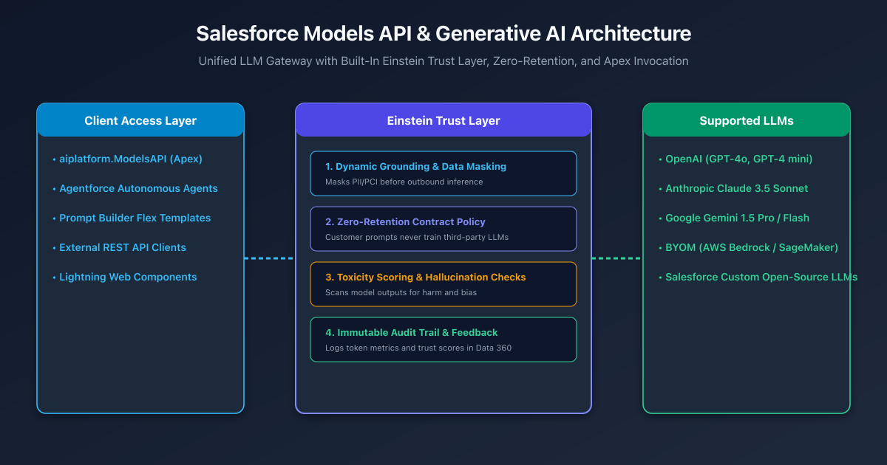
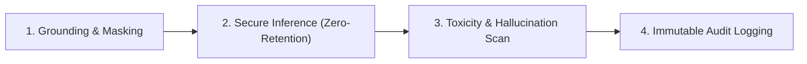

## Overview

As generative AI becomes a standard capability across enterprise software, developers face the challenge of securely embedding large language models (LLMs) into core CRM workflows.

Connecting directly to third-party AI APIs (such as OpenAI or Anthropic) via custom HTTP callouts exposes enterprises to critical risks: sensitive customer Personally Identifiable Information (PII) may leak into prompt logs, external vendors might retain data for model training, and developers must build custom token rate-limiting and audit trails.

The **Salesforce Models API** solves these challenges by providing a managed, unified gateway to foundation models. Whether invoked through Apex (`aiplatform.ModelsAPI`) or REST, every prompt flows through the **Einstein Trust Layer**, ensuring enterprise data protection, dynamic masking, and zero data retention.



---

## The Einstein Trust Layer: Guardrails for Enterprise AI

Every inference request sent through the Models API is intercepted and processed by four automated security stages:



1. **Dynamic Grounding & Data Masking**: Securely retrieves contextual CRM record data while automatically detecting and obfuscating sensitive fields (SSNs, credit card numbers, email addresses) before sending prompts to the model.
2. **Zero Data Retention Contract Policy**: Salesforce enforces strict contractual agreements with LLM providers (including OpenAI, Anthropic, and Google). Customer data is never persisted on provider servers and is never used to train base foundation models.
3. **Toxicity Scoring & Hallucination Checks**: Evaluates model output for harmful content, hate speech, bias, and factual alignment against prompt grounding context.
4. **Immutable Audit Trail & Data Cloud Logging**: Logs prompt tokens, response tokens, latency, and trust evaluation scores directly into **Data 360** for compliance reporting.

---

## Native Model Execution in Apex (`aiplatform.ModelsAPI`)

Starting in Winter '25 and expanded through Winter '27 (API v68.0), developers can invoke foundation LLMs natively in Apex without writing HTTP callouts or configuring Remote Site Settings.

```apex title="CaseSummarizationService.cls"
public with sharing class CaseSummarizationService {
    
    /**
     * Summarizes customer case history using Claude 3.5 Sonnet via Models API.
     */
    public static String summarizeCaseHistory(Id caseId) {
        Case c = [
            SELECT Subject, Description, (SELECT Body, CreatedDate FROM CaseComments ORDER BY CreatedDate DESC)
            FROM Case 
            WHERE Id = :caseId 
            WITH USER_MODE
        ];

        // Format prompt text
        String prompt = 'Summarize the customer issue and next steps in under 100 words.\n';
        prompt += 'Case Subject: ' + c.Subject + '\n';
        prompt += 'Case Description: ' + c.Description + '\n';
        prompt += 'Recent Comments:\n';
        for (CaseComment comment : c.CaseComments) {
            prompt += '- ' + comment.Body + '\n';
        }

        // Prepare Models API Request
        aiplatform.ModelsAPI.createGenerationsRequest request = new aiplatform.ModelsAPI.createGenerationsRequest();
        
        // Specify foundation model alias
        request.modelName = 'sfdc_ai__DefaultAnthropicClaude35Sonnet';

        // Configure generation parameters
        aiplatform.ModelsAPI_GenerationRequest body = new aiplatform.ModelsAPI_GenerationRequest();
        body.prompt = prompt;
        request.body = body;

        // Execute generation
        aiplatform.ModelsAPI modelsAPI = new aiplatform.ModelsAPI();
        aiplatform.ModelsAPI.createGenerationsResponse response = modelsAPI.createGenerations(request);

        if (response.Code200 != null && !response.Code200.generation.generatedText.isEmpty()) {
            return response.Code200.generation.generatedText[0];
        } else {
            throw new AuraHandledException('Generative AI inference failed.');
        }
    }
}
```

---

## Models API REST Endpoint

External applications and middleware can access the same secure gateway via standard REST endpoints:

```http title="POST /services/data/v68.0/einstein/models/generate"
POST /services/data/v68.0/einstein/models/generate HTTP/1.1
Host: yourInstance.salesforce.com
Authorization: Bearer 00D...
Content-Type: application/json

{
  "model": "sfdc_ai__DefaultOpenAIGPT4o",
  "prompt": "Analyze the customer sentiment in this chat transcript and extract action items: ...",
  "parameters": {
    "temperature": 0.2,
    "maxTokens": 500
  }
}
```

---

## Supported LLM Catalog & Bring Your Own Model (BYOM)

The Models API unifies access across premier industry foundation models and private enterprise deployments:

| Model Provider | Supported Model Identifiers | Best-Fit Enterprise Use Case |
| :--- | :--- | :--- |
| **OpenAI** | `sfdc_ai__DefaultOpenAIGPT4o`<br>`sfdc_ai__DefaultOpenAIGPT4OmniMini` | Complex multi-step reasoning, mathematical calculations, code generation |
| **Anthropic** | `sfdc_ai__DefaultAnthropicClaude35Sonnet`<br>`sfdc_ai__DefaultAnthropicClaude3Haiku` | Long-context document analysis, nuanced writing, contract review |
| **Google** | `sfdc_ai__DefaultGoogleGemini15Pro`<br>`sfdc_ai__DefaultGoogleGemini15Flash` | High-volume multimodal tasks, document extraction, low-latency summarization |
| **BYOM (AWS)** | Custom endpoints via Amazon Bedrock & SageMaker | Proprietary fine-tuned enterprise models hosted in private corporate VPCs |
