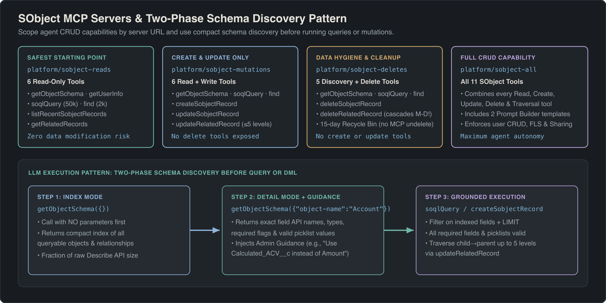
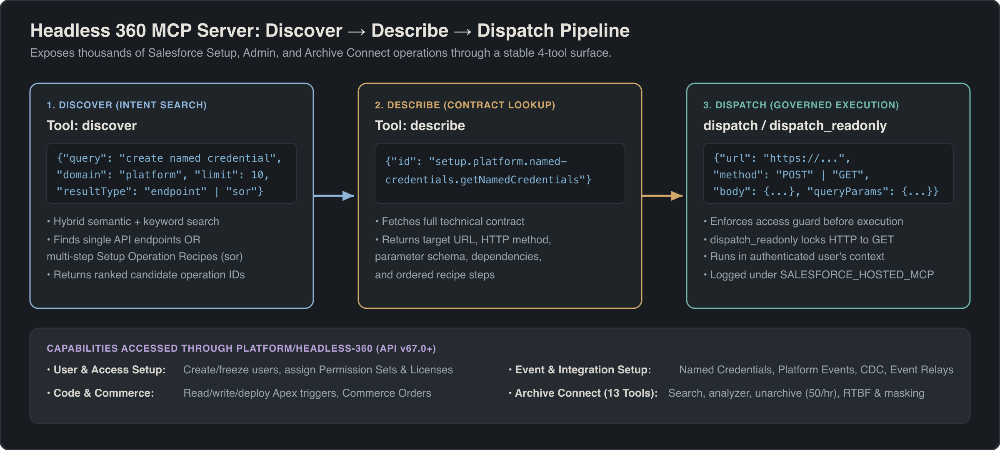

## Overview

Before building a Custom MCP Server, always check whether one of Salesforce's prebuilt **Platform Hosted MCP Servers** already covers your use case. In Winter '27 (API v68.0), Salesforce provides ready-to-use platform endpoints for standard and custom object access (`sobject-*`), dynamic API discovery and invocation (`headless-360`), cold-storage archive operations (`Archive Connect`), semantic schema discovery (`metadata-grounding`), Digital Experiences content management (`content-readonly` and `content-write`), and industry-specific product model verification (`insurance-design-advisor`).

Every prebuilt platform server shares the base URL `https://api.salesforce.com/platform/mcp/v1.0/` (or `https://<my-domain>/services/mcp/v1/d/` for My Domain routing) and executes strictly under the authenticated user's OAuth 2.0 session.

> [!RELEASE] Winter '27
> The SObject server family, Headless 360 with Archive Connect (API v67.0+), Metadata Grounding, Salesforce CMS Read/Write servers (API v67.0 / v68.0), and Insurance Design Advisor (API v68.0) are available through the Salesforce Hosted MCP Servers framework.

---

## SObject MCP Server Family (`platform/sobject-*`)

Rather than forcing every AI client to connect to a single monolithic CRUD server, Salesforce partitions SObject operations into four distinct Hosted MCP Servers. This allows architects to enforce **server-level least privilege** simply by choosing which URL to give an AI client.



### Comparing the 4 SObject Servers

| Server Path | Access Profile | Included Tools | Recommended Use Case |
| :--- | :--- | :--- | :--- |
| `platform/sobject-reads` | Read-Only (`readOnlyHint: true`) | 6 read & schema tools | Reporting agents, developer IDE schema assistants, read-only support triage |
| `platform/sobject-mutations` | Read + Create + Update (No Delete) | 6 read tools + 3 create/update tools | Sales & service co-pilots that log activities, create leads, or update stages |
| `platform/sobject-deletes` | Delete Only (`destructiveHint: true`) | 2 delete tools | Dedicated data-steward cleanup workflows with explicit human confirmation |
| `platform/sobject-all` | Full CRUD + Query | All 11 SObject tools | Full-featured admin/developer assistants in sandbox or tightly governed orgs |

### Complete Reference: All 11 SObject MCP Tools

Every tool below respects the authenticated user's profile, permission sets, Field-Level Security (FLS), and record-level sharing rules.

| Tool Name | Servers | Key Parameters | Limits & Execution Behavior |
| :--- | :--- | :--- | :--- |
| `getObjectSchema` | `reads`, `mutations`, `all` | `object-name` (optional String) | **Two-phase discovery:** Omit `object-name` for an index of accessible objects; pass `object-name` (e.g., `"Opportunity"`) for fields, record types, relationships, and custom admin guidance. |
| `soqlQuery` | `reads`, `mutations`, `all` | `query` (required String) | Executes a dynamic `SELECT` SOQL query. Returns up to **50,000 records**. Uses `getObjectSchema` first to verify field API names. |
| `find` | `reads`, `mutations`, `all` | `search` (required String) | Executes a dynamic `FIND` SOSL search across multiple objects. Returns up to **2,000 records**. Ideal when the user provides a name, email, or phone number without knowing the object type. |
| `getUserInfo` | `reads`, `mutations`, `all` | *(none)* | Returns identity, locale, time zone, profile, and org metadata for the currently authenticated Salesforce user. |
| `listRecentSobjectRecords` | `reads`, `mutations`, `all` | `sobject-name` (required String) | Returns the authenticated user's recently viewed records (`RecentlyViewed`) for the specified object (e.g., `"Account"`). |
| `getRelatedRecords` | `reads`, `mutations`, `all` | `sobject-name`, `id`, `relationship-path` | Retrieves related child or parent records for a given record ID along `relationship-path` (e.g., `"Contacts"` or `"Account.Owner"`). |
| `createSobjectRecord` | `mutations`, `all` | `sobject-name` (String), `body` (JSON Object) | Inserts a single record and returns the new 18-character Salesforce ID. Fires all standard validation rules, before/after triggers, and record-triggered flows. |
| `updateSobjectRecord` | `mutations`, `all` | `sobject-name`, `id`, `body` (JSON Object) | Updates field values on an existing record by ID (`idempotentHint: false`). |
| `updateRelatedRecord` | `mutations`, `all` | `sobject-name`, `id`, `relationship-path`, `body` | Updates a related parent record directly via a child-to-parent `relationship-path` (supports traversing up to **5 levels**, such as `Contact` -> `Account` -> `Parent`). |
| `deleteSobjectRecord` | `deletes`, `all` | `sobject-name` (String), `id` (String) | Moves the specified record to the Recycle Bin for **15 days** (`destructiveHint: true`). No MCP undelete tool exists. |
| `deleteRelatedRecord` | `deletes`, `all` | `sobject-name`, `id`, `relationship-path` | Deletes a related record referenced via `relationship-path` (`destructiveHint: true`). |

### Architect Best Practice: Injecting Admin Guidance into `getObjectSchema`

One of the most common reasons AI agents write broken SOQL queries is ambiguous custom field naming—for example, an org that has `Amount`, `Total_ARR__c`, and `Net_Booking_Value__c` on `Opportunity`.

When an AI client invokes `getObjectSchema({"object-name": "Opportunity"})`, the SObject MCP Server includes **custom admin guidance** configured in **Setup -> Object Manager** alongside standard field descriptions and help text. Populate clear, disambiguating descriptions on your core objects and fields in Object Manager (for example: *"Always filter closed revenue queries by StageName = 'Closed Won' and use Net_Booking_Value__c instead of Amount for subscription deals"*). Every MCP client that inspects the schema will automatically inherit those business rules before writing its `soqlQuery`.

> [!WARNING]
> **Master-Detail Cascade Delete Risk:** Neither `deleteSobjectRecord` nor `deleteRelatedRecord` has an undo or undelete counterpart in MCP. Furthermore, if an AI client deletes a master record in a Master-Detail relationship, Salesforce automatically cascade-deletes all detail child records. Never attach `platform/sobject-all` or `platform/sobject-deletes` to autonomous background agents without human-in-the-loop approval.

---

## Headless 360 MCP Server (`platform/headless-360`)

While SObject servers handle record-level CRUD and SOQL, Salesforce exposes hundreds of specialized REST and Connect APIs (B2B Commerce, Scheduler, Loyalty, Archive Connect, and custom endpoints) that are not simple SObject table reads. The **Headless 360 MCP Server** (`https://api.salesforce.com/platform/mcp/v1.0/platform/headless-360`, Beta, requires **API v67.0+**) solves this without exposing thousands of individual tools that would overwhelm the LLM's context window.

Instead, Headless 360 implements a three-stage **Discover -> Describe -> Dispatch** meta-tool pipeline:



### The 4 Headless 360 Core Tools

| Tool Name | Input Schema | Purpose & Behavior |
| :--- | :--- | :--- |
| `discover` | `query` (required String)<br>`limit` (Integer, `1`–`50`, default `10`)<br>`domain` (optional String)<br>`resultType` (`"endpoint"` or `"sor"`) | Searches the org's API Catalog using natural-language intent (e.g., `"schedule service appointment"` or `"archive storage"`). Returns matching API endpoints or System of Record (`"sor"`) objects with their catalog `id`s. |
| `describe` | `id` (required String from `discover`) | Returns the full OpenAPI specification for the selected endpoint `id`, including HTTP method, path parameters, request headers, JSON body schema, and response structure. |
| `dispatch` | `url` (required String)<br>`method` (`GET`, `POST`, `PATCH`, `PUT`, `DELETE`)<br>`headers` (optional Object)<br>`body` (optional Object)<br>`queryParams` (optional Object) | Executes the target Salesforce API endpoint using the authenticated user's token and returns the HTTP status and JSON response payload. |
| `dispatch_readonly` | `url` (required String)<br>`method` (must be `"GET"`)<br>`headers` (optional Object)<br>`queryParams` (optional Object) | Safe read-only dispatcher (`readOnlyHint: true`) that strictly rejects any HTTP method other than `GET`. |

```json title="Example Headless 360 Tool Call Sequence"
// Step 1: Discover endpoints matching intent
{
  "tool": "discover",
  "arguments": {
    "query": "organization limits and storage usage",
    "limit": 5,
    "resultType": "endpoint"
  }
}

// Step 2: Describe the matched endpoint ID returned by discover
{
  "tool": "describe",
  "arguments": {
    "id": "sfdc_rest_limits_v68"
  }
}

// Step 3: Execute safely via dispatch_readonly
{
  "tool": "dispatch_readonly",
  "arguments": {
    "url": "/services/data/v68.0/limits",
    "method": "GET"
  }
}
```

---

## Archive Connect via Headless 360

Organizations using **Salesforce Archive** (API v67.0+, requires the **Archive add-on license** and the **Archive Admin** permission set) can manage cold-storage records, run compliance erasures, and restore archived hierarchies through 13 specialized **Archive Connect** tools exposed via the Headless 360 MCP Server.

### Complete Reference: All 13 Archive Connect Tools

| Tool Category | Tool Name | Key Parameters & Operational Nuances |
| :--- | :--- | :--- |
| **Global Search & Pagination** | `run-archive-global-search` | Searches archived records using **1 to 6 `AND` filter conditions** (supports `archive_date` ranges). `pageSize` max `1000` (default `25`). Returns **HTTP 201** with a `scroll_id`; when `scroll_id` equals `"-1"`, all pages have been exhausted. |
| **Global Search & Pagination** | `get-archive-global-search-next-page` | Fetches the next page of results using the `scroll_id` returned by `run-archive-global-search`. Also returns `scroll_id: "-1"` on the final page. |
| **Sharing-Aware Search** | `run-archive-global-search-with-sharing-rules` | Evaluates archived records against Salesforce sharing rules. **Important quirk:** Validation failures still return **HTTP 201**—you must inspect `"isSuccess": false` in the response payload to detect errors. |
| **Storage Telemetry** | `get-organization-archive-storage-used` | Returns two 4-element byte arrays: `usedStorage[4]` and `availableStorage[4]`. Indices `0` and `1` represent general org data/file storage; **indices `2` and `3` represent archive-tier storage in bytes**. |
| **Smart Analyzer** | `run-analyzer` | Starts an asynchronous Smart Analyzer job to profile candidate records for archiving and estimate storage savings. |
| **Smart Analyzer** | `get-analyzer-report` | Retrieves the status and findings of a Smart Analyzer job initiated by `run-analyzer`. |
| **Unarchiving** | `run-unarchive` | Restores archived records and their **full parent-child hierarchy** back into live Salesforce SObjects. Governed by a hard limit of **50 requests per hour per org** and **1,000 records per request**. |
| **GDPR / Compliance (RTBF)** | `run-rtbf` | Initiates a Right to Be Forgotten (RTBF) permanent deletion job in the archive store. Shares a combined **10,000 root records/day** org limit with `run-masking`. Max **10 exact-match criteria** per request. Skips records under legal hold. |
| **GDPR / Compliance (RTBF)** | `get-rtbf-status` | Polls an RTBF job until its lifecycle state reaches `"HANDLED"`. |
| **Data Masking** | `run-masking` | Permanently obfuscates sensitive fields on archived records. Shares the **10,000 root records/day** org limit with `run-rtbf`, max **10 exact-match criteria** per request, and skips records under legal hold. |
| **Data Masking** | `get-masking-status` | Polls a masking job until its status reaches `"HANDLED"`. |
| **Activity & Error Logs** | `get-archive-execution-details-streaming-url` | Accepts an `ArchiveActivity` record ID (key prefix `8qv...`) and returns a pre-signed streaming URL to download full execution details. |
| **Activity & Error Logs** | `get-archive-failed-records-streaming-url` | Accepts an `ArchiveActivity` record ID (`8qv...`) and returns a pre-signed streaming URL to download CSV/JSON logs of records that failed archiving. |

> [!WARNING]
> **Irreversible Compliance Operations:** Both `run-rtbf` and `run-masking` modify cold-storage archive data permanently. Once `get-rtbf-status` or `get-masking-status` reports `"HANDLED"`, the original archived values cannot be recovered via `run-unarchive` or Salesforce Support. Always verify exact-match filter criteria with `run-archive-global-search` first.

---

## Metadata Grounding MCP Server (`platform/metadata-grounding`)

In enterprise orgs with 2,000+ custom objects and 50,000+ custom fields, even `getObjectSchema` requires knowing which object names to inspect. The **Metadata Grounding MCP Server** (`https://api.salesforce.com/platform/mcp/v1.0/platform/metadata-grounding`, Beta) uses **Data 360** and the **Salesforce Catalog** to provide semantic and keyword search across your entire org schema.

### Prerequisites & Environment Constraints
- Requires **Data 360** enabled and the **Salesforce Catalog** metadata index provisioned.
- **Not supported** in **Scratch Orgs** or **namespaced Developer Edition orgs**.
- Only **active picklist values** are indexed (inactive picklist values are excluded from search results).
- Strictly read-only (`readOnlyHint: true`).

### The 3-Step Metadata Grounding Workflow

1. **`describe_metadata`**: Call first to discover the searchable metadata entity types and attributes indexed in the Salesforce Catalog.
2. **`search_metadata`**: Perform semantic or keyword search across objects, fields, relationships, and active picklist values (for example, searching `"customer churn risk score"` to locate `Account.Churn_Probability_Pct__c`).
3. **`query_metadata`**: Execute structured queries against the catalog metadata tables to retrieve exact relationships, data types, and compliance classifications before handing the discovered API names to the SObject MCP Server.

---

## Salesforce CMS MCP Servers (`platform/content-readonly` & `platform/content-write`)

Teams building Digital Experiences sites can manage enhanced CMS workspaces, content variants, translations, and publication lifecycles through two dedicated CMS Hosted MCP Servers designed for **Agentforce Vibes**.

### Prerequisites
- **Digital Experiences** and **Salesforce CMS** must be enabled in Setup.
- The authenticated user must be assigned a **Content Admin** or **Content Manager** contributor role inside the target enhanced CMS Workspace.

### Server Comparison & Key Capabilities

| Server Path | Min API Version | Tool Count | Key Tools & Capabilities |
| :--- | :--- | :--- | :--- |
| `platform/content-readonly` | v67.0 | **22 read-only tools** | Inspect CMS workspaces (`list_cms_workspaces`, `get_cms_workspace`), channels (`list_cms_channels`), content types (`list_cms_content_types`), folders, collections, and published/draft content items (`get_cms_content`, `search_cms_content`). |
| `platform/content-write` | v68.0 | **15 write tools** | Provision workspaces and web app channels (`get_or_create_cms_workspace_and_web_app_channel`), create content (`create_cms_content`), update variants (`update_cms_content_variant`), manage folders/collections, and publish or unpublish (`publish_cms_content`, `unpublish_cms_content`). |

> [!TIP]
> **Mutually Exclusive Parameters on `update_cms_content_variant`:** When updating a CMS content variant via `platform/content-write`, the tool accepts either a structured `contentBody` JSON object **or** a natural-language `prompt` string for generative AI authoring—never both in the same call. Passing both `contentBody` and `prompt` simultaneously will fail schema validation.

---

## Insurance Design Advisor MCP Server (`platform/insurance-design-advisor`)

Available in **API v68.0+**, the **Insurance Design Advisor MCP Server** (`https://api.salesforce.com/platform/mcp/v1.0/platform/insurance-design-advisor`) is a read-only design-time verification server for architects and product configurators working with Salesforce Insurance (Product Catalog Management, Constraint Modeling Language, and Salesforce Pricing) inside **Agentforce Vibes**.

### All 9 Insurance Design Advisor Tools

| Tool Name | What It Validates or Resolves | Architect Notes & Edge Cases |
| :--- | :--- | :--- |
| `validateProductModel` | Verifies root insurance products, coverages, insured items, child specs, and cardinality rules. | Run first after configuring a new root product in Product Catalog Management (PCM). |
| `validateProductDiscovery` | Audits Product Discovery Context Definitions, mapping tags, and qualification rules. | **Known validation rule:** You must pass a valid lookup identifier; invoking without a lookup returns error **`SF-INS-DSAV-00038`**. |
| `validateAttributes` | Checks product attributes, picklists, default values, and dynamic attribute bindings. | Automatically resolves dynamic `DYN__INS__` namespace prefixes during validation. |
| `validateCMLModel` | Parses and validates Constraint Modeling Language (CML) rules associated with insurance products. | Catches circular dependencies and unsatisfiable coverage constraints before activation. |
| `validatePricingSetup` | Checks Pricing Procedures, Decision Tables, and attribute-based rate cards. | Confirms that all input variables expected by the pricing procedure are mapped from the context definition. |
| `validateApiRequest` | Validates JSON request payloads against the org's active product model before calling runtime APIs. | Specifically supports validating payloads for `/connect/insurance/quotes` and `/connect/insurance/product-rating`. |
| `lookupErrorCode` | Explains the root cause and remediation steps for any Insurance engine error code. | Accepts error codes matching the pattern `SF-INS-<category>-NNNNN` (for example, `SF-INS-DSAV-00038` or `SF-INS-RATE-00102`). |
| `validateUserPermissions` | Audits whether a specified user has all required PSLs, object permissions, and context access. | Eliminates silent runtime failures where a quoting user lacks read access to an underlying rating table. |
| `getRatingInput` | Generates a valid sample rating input JSON payload for a given root insurance product. | Ideal for bootstrapping Postman tests or automated Apex integration tests for new insurance products. |

---

## Summary Decision Matrix: Which Platform Server Should You Use?

| Requirement | Target Hosted MCP Server Path |
| :--- | :--- |
| Query SObjects and inspect schemas without modifying data | `platform/sobject-reads` |
| Create and update CRM records without allowing record deletion | `platform/sobject-mutations` |
| Discover and invoke arbitrary Salesforce REST / Connect APIs dynamically | `platform/headless-360` |
| Search, unarchive, mask, or run GDPR RTBF on cold-storage Archive records | `platform/headless-360` (Archive Connect tools) |
| Semantically search across thousands of custom objects and fields | `platform/metadata-grounding` |
| Author, translate, and publish Digital Experiences CMS content | `platform/content-readonly` & `platform/content-write` |
| Validate Insurance PCM models, CML rules, and rating payloads | `platform/insurance-design-advisor` |

