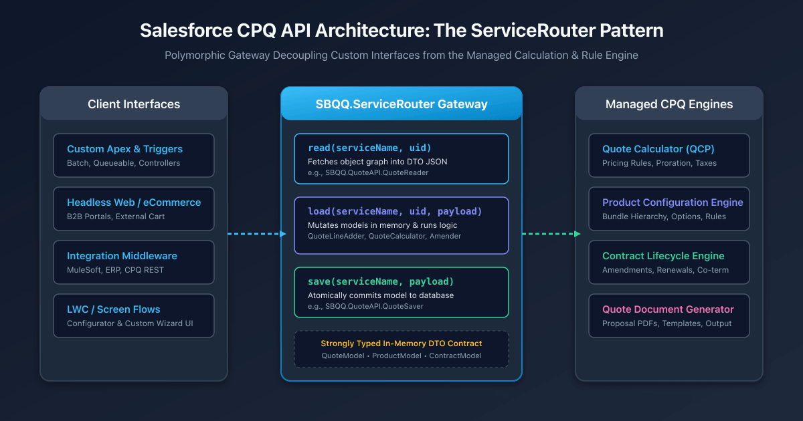
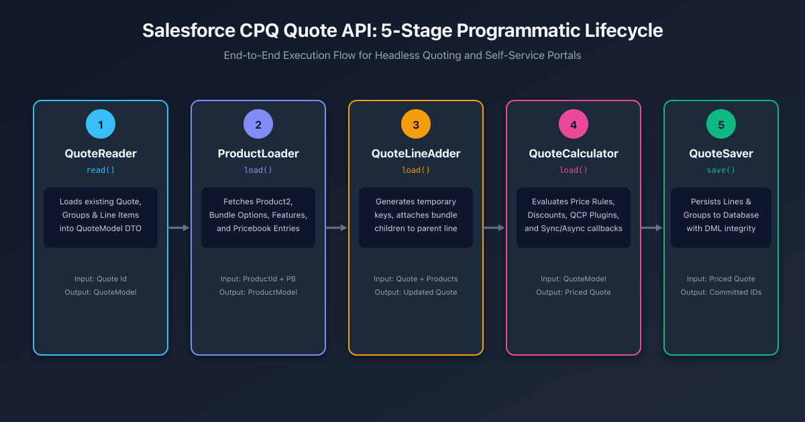
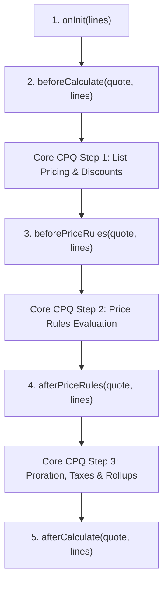

## Overview

When building headless e-commerce portals, custom quoting wizards in Lightning Web Components, or integrations with external Enterprise Resource Planning (ERP) systems, developers must interact programmatically with Salesforce CPQ (Configure, Price, Quote).

A frequent mistake among developers is attempting direct Data Manipulation Language (DML) inserts or updates on `SBQQ__Quote__c` and `SBQQ__QuoteLine__c`. Direct DML bypasses the **JavaScript Quote Calculation Engine (QCP)**, Price Rules, Discount Schedules, Block Pricing, and bundle option validation. This leaves quotes in an uncalculated, corrupted state with zeroed net totals.

To solve this, Salesforce CPQ exposes its core configuration, pricing, contracting, and document generation engines through a unified entry point: **`SBQQ.ServiceRouter`**.



---

## The `SBQQ.ServiceRouter` Architecture

Rather than shipping dozens of discrete global Apex classes with rigid method signatures that break across releases, Salesforce CPQ uses the **Router Service Pattern**. All programmatic interactions flow through three static methods:

```apex
global class ServiceRouter {
    global static String read(String serviceName, String uid);
    global static String load(String serviceName, String uid, String payload);
    global static String save(String serviceName, String payload);
}
```

### Core Method Semantics

| Method | Purpose | Typical Use Case |
| :--- | :--- | :--- |
| `read(serviceName, uid)` | Fetches a domain model by Record ID without mutating state. | Reading an entire Quote hierarchy (`QuoteModel`) or Contract. |
| `load(serviceName, uid, payload)` | Executes business logic that adds, transforms, or prices models based on input parameters. | Adding products to quotes, executing pricing calculations, generating amendment quotes. |
| `save(serviceName, payload)` | Atomically persists an updated domain model back into Salesforce CPQ tables. | Saving an updated `QuoteModel` with new lines, groups, or discount overrides. |

### Architectural Benefits of `ServiceRouter`

1. **Engine Encapsulation**: Guarantees that every change triggers CPQ's managed lifecycle, including proration, bundle validation, and price rollups.
2. **Governor Limit Protection via In-Memory DTOs**: Serialized JSON Data Transfer Objects (DTOs) allow clients to manipulate multi-level hierarchies (Quote -> Groups -> Lines -> Options) in memory without intermediate SOQL and DML round-trips.
3. **API Version Resilience**: Changes to internal managed fields or calculation steps do not break client Apex code; only the JSON model contract is maintained.

---

## The 5-Stage Programmatic Quoting Lifecycle

Building a headless quote follows a structured sequence: reading the quote, loading products, adding lines, calculating pricing, and saving to the database.



### Data Contract: Core Model Classes (DTOs)

Because `ServiceRouter` methods accept and return JSON strings, you must define wrapper classes in your org to serialize and deserialize the models:

```apex title="CPQCoreModels.cls"
public with sharing class CPQCoreModels {
    // Root Quote DTO
    public class QuoteModel {
        public SBQQ__Quote__c record;
        public List<QuoteLineModel> lineItems;
        public List<QuoteLineGroupModel> lineItemGroups;
        public Integer nextKey;
        public Boolean applyAdditionalDiscountLast;
        public Boolean applyPartnerDiscountFirst;
        public String channel;
        public String currencySymbol;
        public String currencyCode;
        public Decimal customerTotal;
        public Decimal netTotal;
    }

    // Quote Line DTO
    public class QuoteLineModel {
        public SBQQ__QuoteLine__c record;
        public Boolean amountDiscountProrated;
        public Integer parentGroupKEY;
        public Integer parentItemKEY;
        public Integer key;
    }

    // Quote Line Group DTO
    public class QuoteLineGroupModel {
        public SBQQ__QuoteLineGroup__c record;
        public Decimal netTotal;
        public Integer key;
    }

    // Product DTO
    public class ProductModel {
        public Product2 record;
        public Id pricebookEntryId;
        public List<PricebookEntry> pricebookEntries;
        public List<OptionModel> options;
        public List<UIFeatureModel> features;
        public ConfigurationModel configuration;
    }

    // Product Option DTO
    public class OptionModel {
        public SBQQ__ProductOption__c record;
        public Map<String, Object> externalConfigurationData;
        public Boolean isUpgrade;
    }

    // Bundle Configuration DTO
    public class ConfigurationModel {
        public Id configuredProductId;
        public SBQQ__ProductConfiguration__c configurationData;
        public List<ConfigurationModel> optionConfigurations;
        public Id optionId;
        public Decimal priceData;
        public List<String> validationErrors;
        public Boolean isDynamicOption;
        public Boolean isSelected;
    }

    // UI Feature DTO
    public class UIFeatureModel {
        public SBQQ__ProductFeature__c record;
        public List<OptionModel> options;
    }

    // Context DTOs for ServiceRouter calls
    public class ProductLoadContext {
        public String pricebookId;
        public String currencyCode;
    }

    public class ProductAddContext {
        public QuoteModel quote;
        public List<ProductModel> products;
        public QuoteLineGroupModel groupItem;
        public Integer groupKey;
    }
}
```

> [!TIP]
> **The `nextKey` and `key` Rule for Unsaved Lines:** Unsaved quote lines do not have Salesforce record IDs yet. CPQ tracks bundle parent-child relationships and group memberships in memory using integer `key` values. When creating lines manually, read `quoteModel.nextKey`, assign it to `quoteLineModel.key`, assign `parentItemKEY` to the bundle parent's `key`, and increment `quoteModel.nextKey`.

---

## Implementation: Complete Programmatic Quoting Service

The following production-ready class demonstrates the complete workflow: reading a quote, loading a product bundle, adding lines, calculating pricing, and persisting the quote.

```apex title="CPQQuoteService.cls"
public with sharing class CPQQuoteService {
    
    /**
     * Reads a full QuoteModel hierarchy from the database.
     */
    public static CPQCoreModels.QuoteModel readQuote(Id quoteId) {
        if (quoteId == null) {
            throw new IllegalArgumentException('quoteId cannot be null');
        }
        String jsonResult = SBQQ.ServiceRouter.read('SBQQ.QuoteAPI.QuoteReader', (String) quoteId);
        return (CPQCoreModels.QuoteModel) JSON.deserialize(jsonResult, CPQCoreModels.QuoteModel.class);
    }

    /**
     * Loads a Product with its options and features for a specific pricebook and currency.
     */
    public static CPQCoreModels.ProductModel loadProduct(Id productId, Id pricebookId, String currencyCode) {
        CPQCoreModels.ProductLoadContext context = new CPQCoreModels.ProductLoadContext();
        context.pricebookId = pricebookId;
        context.currencyCode = String.isNotBlank(currencyCode) ? currencyCode : 'USD';

        String jsonResult = SBQQ.ServiceRouter.load(
            'SBQQ.ProductAPI.ProductLoader',
            (String) productId,
            JSON.serialize(context)
        );
        return (CPQCoreModels.ProductModel) JSON.deserialize(jsonResult, CPQCoreModels.ProductModel.class);
    }

    /**
     * Adds products to the quote in memory.
     */
    public static CPQCoreModels.QuoteModel addProducts(
        CPQCoreModels.QuoteModel quote, 
        List<CPQCoreModels.ProductModel> products, 
        Integer groupKey
    ) {
        CPQCoreModels.ProductAddContext context = new CPQCoreModels.ProductAddContext();
        context.quote = quote;
        context.products = products;
        context.groupKey = groupKey;

        String jsonResult = SBQQ.ServiceRouter.load(
            'SBQQ.QuoteAPI.QuoteLineAdder',
            null,
            JSON.serialize(context)
        );
        return (CPQCoreModels.QuoteModel) JSON.deserialize(jsonResult, CPQCoreModels.QuoteModel.class);
    }

    /**
     * Calculates pricing synchronously.
     */
    public static CPQCoreModels.QuoteModel calculateQuoteSync(CPQCoreModels.QuoteModel quote) {
        String jsonResult = SBQQ.ServiceRouter.load(
            'SBQQ.QuoteAPI.QuoteCalculator',
            null,
            JSON.serialize(quote)
        );
        return (CPQCoreModels.QuoteModel) JSON.deserialize(jsonResult, CPQCoreModels.QuoteModel.class);
    }

    /**
     * Saves the quote model and commits all line changes to the database.
     */
    public static CPQCoreModels.QuoteModel saveQuote(CPQCoreModels.QuoteModel quote) {
        String jsonResult = SBQQ.ServiceRouter.save(
            'SBQQ.QuoteAPI.QuoteSaver',
            JSON.serialize(quote)
        );
        return (CPQCoreModels.QuoteModel) JSON.deserialize(jsonResult, CPQCoreModels.QuoteModel.class);
    }

    /**
     * End-to-end convenience method: Reads quote, adds product, calculates, and saves.
     */
    public static CPQCoreModels.QuoteModel addProductAndSave(Id quoteId, Id productId, Id pricebookId) {
        CPQCoreModels.QuoteModel quote = readQuote(quoteId);
        CPQCoreModels.ProductModel product = loadProduct(productId, pricebookId, 'USD');
        CPQCoreModels.QuoteModel updatedQuote = addProducts(quote, new List<CPQCoreModels.ProductModel>{ product }, null);
        CPQCoreModels.QuoteModel pricedQuote = calculateQuoteSync(updatedQuote);
        return saveQuote(pricedQuote);
    }
}
```

---

## Asynchronous Calculation with `SBQQ.CalculateCallback`

In enterprise orgs with more than 50 quote lines, complex bundle hierarchies, and multiple price rules, running `QuoteCalculator` synchronously often breaches the **10-second Apex CPU timeout**.

Salesforce CPQ provides the `SBQQ.CalculateCallback` interface to process calculation asynchronously in the background.

```apex title="CPQAsyncCalculationCallback.cls"
global with sharing class CPQAsyncCalculationCallback implements SBQQ.CalculateCallback {
    
    /**
     * Invoked automatically by Salesforce CPQ when async calculation completes.
     */
    global void callback(String quoteJSON) {
        if (String.isBlank(quoteJSON)) {
            return;
        }

        CPQCoreModels.QuoteModel calculatedQuote = (CPQCoreModels.QuoteModel) JSON.deserialize(
            quoteJSON, 
            CPQCoreModels.QuoteModel.class
        );

        // Commit calculated pricing and net totals to database
        SBQQ.ServiceRouter.save('SBQQ.QuoteAPI.QuoteSaver', JSON.serialize(calculatedQuote));
    }
}
```

```apex title="Triggering Asynchronous Calculation"
public with sharing class CPQAsyncCalculator {
    public class CalculatorContext {
        public CPQCoreModels.QuoteModel quote;
        public String callbackClass;

        public CalculatorContext(CPQCoreModels.QuoteModel quote, String callbackClass) {
            this.quote = quote;
            this.callbackClass = callbackClass;
        }
    }

    public static void calculateAsync(CPQCoreModels.QuoteModel quote) {
        CalculatorContext ctx = new CalculatorContext(quote, 'CPQAsyncCalculationCallback');
        SBQQ.ServiceRouter.load(
            'SBQQ.QuoteAPI.QuoteCalculator',
            null,
            JSON.serialize(ctx)
        );
    }
}
```

---

## Contract Lifecycles: Amendments and Renewals

Beyond initial quoting, Salesforce CPQ automates subscription lifecycle changes through dedicated ServiceRouter APIs:

### 1. Contract Amendments (`SBQQ.ContractAPI.ContractAmender`)
Generates an amendment quote containing existing active subscriptions and assets, preserving co-termination dates and contracted discount pricing.

```apex title="CPQContractService.cls"
public with sharing class CPQContractService {
    public static CPQCoreModels.QuoteModel amendContract(Id contractId) {
        String jsonResult = SBQQ.ServiceRouter.load(
            'SBQQ.ContractAPI.ContractAmender',
            (String) contractId,
            null
        );
        return (CPQCoreModels.QuoteModel) JSON.deserialize(jsonResult, CPQCoreModels.QuoteModel.class);
    }
}
```

### 2. Contract Renewals (`SBQQ.ContractAPI.ContractRenewer`)
Generates renewal quotes or opportunities across one or multiple master contracts.

```apex title="CPQRenewalService.cls"
public with sharing class CPQRenewalService {
    public class ContractRenewerContext {
        public Id masterContractId;
        public List<Id> contractIds;
        public Boolean returnOnlyQuote;
    }

    public static CPQCoreModels.QuoteModel renewContracts(Id masterContractId, List<Id> contractIds) {
        ContractRenewerContext context = new ContractRenewerContext();
        context.masterContractId = masterContractId;
        context.contractIds = contractIds;
        context.returnOnlyQuote = true;

        String jsonResult = SBQQ.ServiceRouter.load(
            'SBQQ.ContractAPI.ContractRenewer',
            null,
            JSON.serialize(context)
        );
        return (CPQCoreModels.QuoteModel) JSON.deserialize(jsonResult, CPQCoreModels.QuoteModel.class);
    }
}
```

---

## Quote Document Generation API

To automate document generation programmatically (such as after an e-signature approval or e-commerce checkout), invoke `SBQQ.QuoteDocumentAPI.QuoteDocumentGenerator`:

```apex title="CPQDocumentService.cls"
public with sharing class CPQDocumentService {
    public class QuoteProposalModel {
        public String name;
        public Id quoteId;
        public Id templateId;
        public String language;
        public String outputFormat; // 'PDF' or 'MS Word'
    }

    public static Id generateProposal(Id quoteId, Id templateId, String documentName) {
        QuoteProposalModel proposal = new QuoteProposalModel();
        proposal.quoteId = quoteId;
        proposal.templateId = templateId;
        proposal.name = documentName;
        proposal.outputFormat = 'PDF';
        proposal.language = 'en_US';

        String jsonResult = SBQQ.ServiceRouter.save(
            'SBQQ.QuoteDocumentAPI.QuoteDocumentGenerator',
            JSON.serialize(proposal)
        );

        Map<String, Object> result = (Map<String, Object>) JSON.deserializeUntyped(jsonResult);
        return (Id) result.get('documentId');
    }
}
```

---

## Custom Calculator Plugin (QCP) Architecture

Salesforce CPQ executes custom JavaScript calculation logic in an isolated browser or server runtime. The Custom Calculator Plugin (QCP) hooks into eight sequential events during the calculation cycle:



```javascript title="Example JavaScript QCP Plugin"
export function onInit(lines) {
    // Pre-calculate or cache values before pricing starts
    return Promise.resolve();
}

export function beforeCalculate(quote, lines) {
    // Modify initial list prices or attributes before system discount evaluation
    lines.forEach(line => {
        if (line.record.Tier__c === 'Enterprise') {
            line.record.SBQQ__CustomerPrice__c = line.record.SBQQ__ListPrice__c * 0.85;
        }
    });
    return Promise.resolve();
}

export function afterPriceRules(quote, lines) {
    // Execute complex cross-line discounts that depend on Price Rule outputs
    return Promise.resolve();
}

export function afterCalculate(quote, lines) {
    // Compute custom rollup summaries across lines
    let totalHardwareNet = 0;
    lines.forEach(line => {
        if (line.record.ProductFamily__c === 'Hardware') {
            totalHardwareNet += (line.record.SBQQ__NetTotal__c || 0);
        }
    });
    quote.record.HardwareSubtotal__c = totalHardwareNet;
    return Promise.resolve();
}
```

---

## Bulk Data Migrations: Disabling CPQ Triggers

When migrating thousands of legacy contracts or quotes into Salesforce, firing CPQ package triggers causes massive CPU timeout failures and row lock contention.

CPQ provides the `SBQQ.TriggerControl` utility to suppress package triggers within an execution context:

```apex title="BulkMigrationHelper.cls"
public with sharing class BulkMigrationHelper {
    public static void migrateQuotes(List<SBQQ__Quote__c> legacyQuotes) {
        // Disable all Salesforce CPQ package triggers
        SBQQ.TriggerControl.disable();

        try {
            insert legacyQuotes;
        } finally {
            // Always re-enable triggers in a finally block to prevent thread poisoning
            SBQQ.TriggerControl.enable();
        }
    }
}
```

> [!WARNING]
> **Trigger Suppression Risk:** Records inserted with `SBQQ.TriggerControl.disable()` are not calculated by the CPQ pricing engine. You must set `SBQQ__Uncalculated__c = true` on migrated quotes and schedule an asynchronous batch job to recalculate quotes in controlled chunks using `SBQQ.QuoteAPI.QuoteCalculator`.

---

## Senior Architect Comparison Matrix

| Scenario | Recommended Approach | Anti-Pattern to Avoid |
| :--- | :--- | :--- |
| **Headless E-Commerce Quoting** | `SBQQ.ServiceRouter` (`QuoteReader` -> `QuoteLineAdder` -> `QuoteCalculator` -> `QuoteSaver`) | Direct DML on `SBQQ__QuoteLine__c` (bypasses pricing rollups) |
| **Cross-Line Discount Calculations** | JavaScript QCP (`afterPriceRules` hook) | Apex triggers on `QuoteLine__c` updating sibling lines (causes recursion) |
| **High-Volume Quotes (>50 lines)** | Async `QuoteCalculator` with `SBQQ.CalculateCallback` | Synchronous `QuoteCalculator` (hits 10s CPU limit) |
| **Contract Renewals in Batch** | `SBQQ.ContractAPI.ContractRenewer` in Batch Apex | Copying subscription lines via SOQL (breaks co-termination) |
| **Bulk Data Migrations** | `SBQQ.TriggerControl.disable()` + Async Batch Pricing | Inserting legacy lines with triggers enabled (hits CPU limits) |
| **Proposal Document Generation** | `SBQQ.QuoteDocumentAPI.QuoteDocumentGenerator` | Custom Visualforce rendering that bypasses CPQ template sections |

