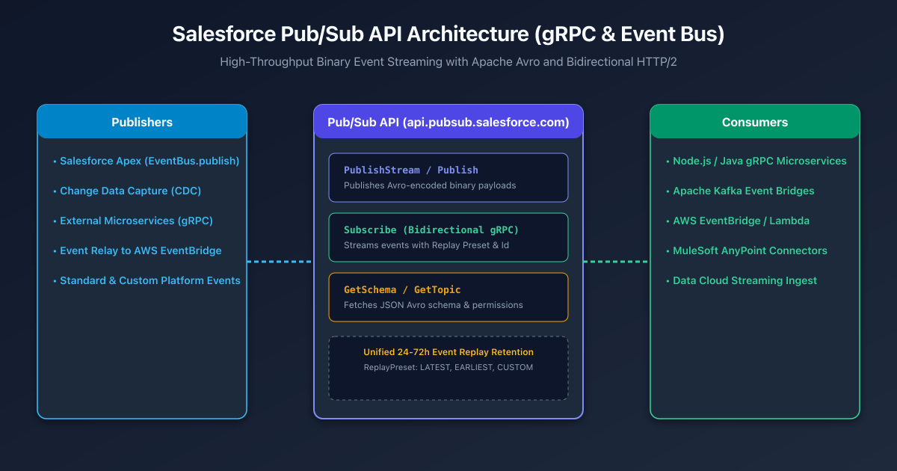

## Overview

In enterprise event-driven architectures, synchronizing core CRM transactions with external microservices, Kafka event streams, and cloud data warehouses requires reliable, sub-second messaging.

Historically, Salesforce developers connected to the Event Bus using the **Streaming API** (CometD / EMP Connector over Long-Polling HTTP/1.1 with Bayeux protocol). While functional, CometD struggled under heavy enterprise volumes: JSON payloads introduced massive serialization overhead, connections suffered from proxy timeouts, and publishing required separate REST or SOAP API round-trips.

The **Salesforce Pub/Sub API** (`api.pubsub.salesforce.com`) is the modern, high-performance standard for event streaming. Built on **gRPC** over **HTTP/2** with **Apache Avro** binary serialization, it provides up to 10x higher message throughput, bidirectional streaming flow control, and a unified endpoint for publishing and subscribing.



---

## Technical Comparison: Pub/Sub API vs Legacy CometD

| Feature | Legacy CometD Streaming API | Modern Pub/Sub API (gRPC) |
| :--- | :--- | :--- |
| **Transport Protocol** | HTTP/1.1 (Long-Polling / WebSockets) | **HTTP/2 (Multiplexed Streams)** |
| **Serialization** | Text-based JSON (High byte overhead) | **Apache Avro (Compact Binary)** |
| **Communication Pattern** | Unidirectional subscription (Publish via REST) | **Bidirectional gRPC (Unified Pub & Sub)** |
| **Flow Control** | Best-effort push (Risk of client buffer overflow) | **Client-driven credit-based `fetch_size`** |
| **Schema Grounding** | Implicit runtime JSON | **Strongly typed Schema ID via `GetSchema`** |
| **Event Replay Retention** | 24 to 72 hours | **Unified 72 hours across high-volume buses** |

---

## Core gRPC Service Definition & RPC Methods

The Pub/Sub API proto file defines four primary Remote Procedure Calls (RPCs):

```protobuf title="pubsub_api.proto"
service PubSub {
  // Subscribe to an event topic with client-driven flow control
  rpc Subscribe (stream FetchRequest) returns (stream FetchResponse);

  // Publish a batch of events synchronously
  rpc Publish (PublishRequest) returns (PublishResponse);

  // High-throughput bidirectional publish stream
  rpc PublishStream (stream StreamPublishRequest) returns (stream StreamPublishResponse);

  // Retrieve Avro JSON schema string by Schema ID
  rpc GetSchema (SchemaRequest) returns (SchemaInfo);

  // Retrieve topic metadata and publish/subscribe capabilities
  rpc GetTopic (TopicRequest) returns (TopicInfo);
}
```

### 1. `Subscribe` (Bidirectional Flow-Controlled Streaming)
Clients establish a persistent bidirectional stream. The client initiates the stream by sending a `FetchRequest` specifying the `topic_name`, `replay_preset`, and `num_requested` (batch size). The server streams back `ConsumerEvent` messages until `num_requested` is fulfilled, pausing until the client sends another request for more messages.

### 2. `Publish` & `PublishStream`
Allows external systems to publish single or bulk events directly into the Salesforce Event Bus without passing through standard REST DML limits.

### 3. `GetSchema` & Dynamic Serialization
Every event published to the Event Bus contains a `schema_id`. Clients query `GetSchema` once to cache the Apache Avro JSON schema definition and deserialize the binary payload into structured application objects.

---

## Replay Presets & Fault-Tolerant Consumption

If a downstream consumer crashes or loses network connectivity, the Salesforce Event Bus guarantees message persistence for **72 hours**. The Pub/Sub API exposes three replay presets:

| ReplayPreset | Behavior | Recommended Use Case |
| :--- | :--- | :--- |
| `LATEST` | Delivers only new events published after subscription starts. | Real-time dashboards, ephemeral UI push notifications. |
| `EARLIEST` | Replays all available events retained within the 72-hour window. | Rebuilding a damaged read replica, fresh subscriber bootstrap. |
| `CUSTOM` | Resumes playback immediately after the specified binary `replay_id`. | **Production microservices (persisting last processed checkpoint).** |

---

## Example: Consuming Events with Node.js & gRPC

Below is a complete, production-grade Node.js subscriber implementation using `@grpc/grpc-js` and `avsc` (Avro parser):

```javascript title="eventSubscriber.js"
import grpc from '@grpc/grpc-js';
import protoLoader from '@grpc/proto-loader';
import avro from 'avsc';

const PROTO_PATH = './pubsub_api.proto';
const packageDefinition = protoLoader.loadSync(PROTO_PATH, {
  keepCase: true,
  longs: String,
  enums: String,
  defaults: true,
  oneofs: true
});
const pubsubProto = grpc.loadPackageDefinition(packageDefinition).eventbus.v1;

// Initialize gRPC Client with Salesforce OAuth Bearer Token
const client = new pubsubProto.PubSub(
  'api.pubsub.salesforce.com:7443',
  grpc.credentials.combineChannelCredentials(
    grpc.credentials.createSsl(),
    grpc.credentials.createFromMetadataGenerator((_, callback) => {
      const meta = new grpc.Metadata();
      meta.add('accesstoken', process.env.SF_ACCESS_TOKEN);
      meta.add('instanceurl', process.env.SF_INSTANCE_URL);
      meta.add('tenantid', process.env.SF_TENANT_ID);
      callback(null, meta);
    })
  )
);

const schemaCache = new Map();

async function getSchema(schemaId) {
  if (schemaCache.has(schemaId)) return schemaCache.get(schemaId);
  return new Promise((resolve, reject) => {
    client.GetSchema({ schema_id: schemaId }, (err, response) => {
      if (err) return reject(err);
      const parsedType = avro.Type.forSchema(JSON.parse(response.schema_json));
      schemaCache.set(schemaId, parsedType);
      resolve(parsedType);
    });
  });
}

// Start Bidirectional Subscribe Stream
const call = client.Subscribe();

call.on('data', async (fetchResponse) => {
  for (const consumerEvent of fetchResponse.events) {
    const avroType = await getSchema(consumerEvent.event.schema_id);
    const decodedPayload = avroType.decode(consumerEvent.event.payload);
    
    console.log('Received Event:', {
      replayId: consumerEvent.replay_id.toString('hex'),
      payload: decodedPayload
    });
  }

  // Request next batch of 25 events (Flow Control)
  call.write({ num_requested: 25 });
});

call.on('error', (err) => console.error('gRPC Stream Error:', err));

// Initial Request: Subscribe from LATEST with batch size 25
call.write({
  topic_name: '/event/Order_Fulfillment__e',
  replay_preset: 1, // 1 = LATEST
  num_requested: 25
});
```

---

## Event Relay: Zero-Code Streaming to AWS EventBridge

For organizations hosted on Amazon Web Services (AWS), writing custom microservices to poll Salesforce events is unnecessary. **Event Relay** integrates the Salesforce Event Bus natively with **Amazon EventBridge**.

1. Create an AWS Named Credential in Salesforce Setup containing the target AWS Account ID and IAM role.
2. Define an `EventRelayConfig` metadata component linking your Platform Event (e.g., `Order_Fulfillment__e`) to the AWS EventBridge partner event source.
3. Salesforce automatically streams events over secure AWS PrivateLink channels directly into AWS Lambda, SQS, or Step Functions without custom middleware.

