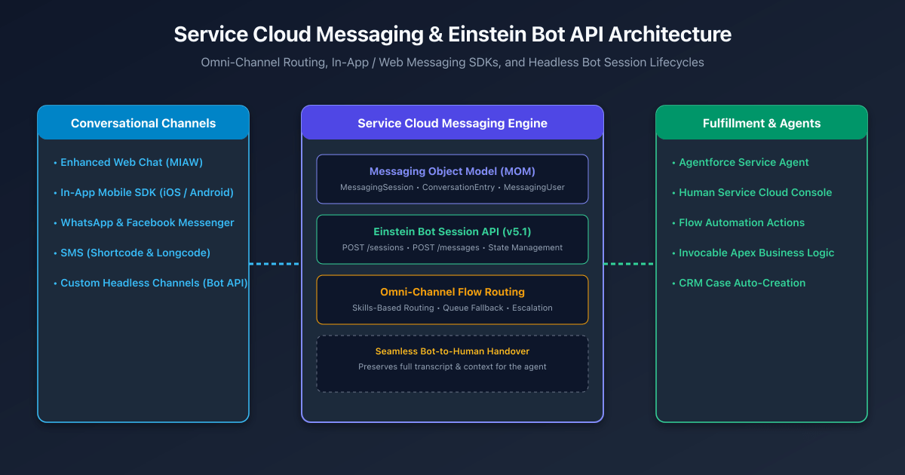
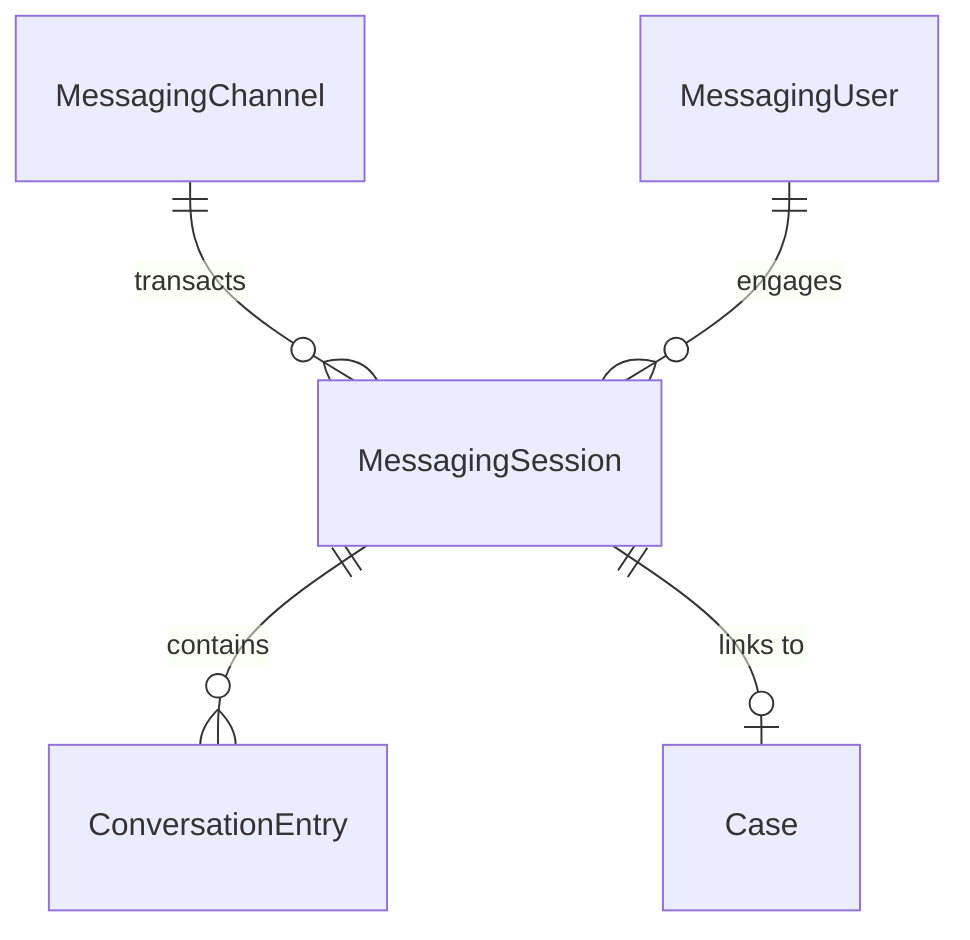
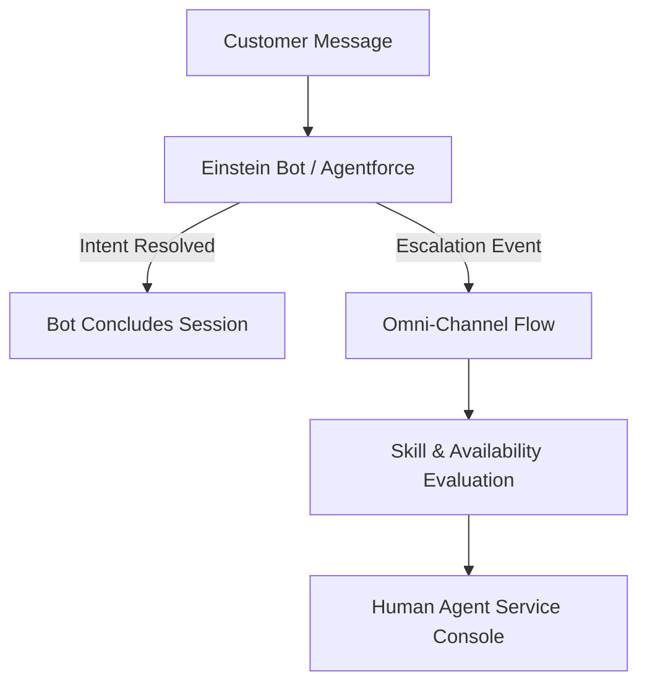

## Overview

Customer communication has fundamentally shifted from ephemeral, synchronous live chat to persistent, asynchronous messaging channels (WhatsApp, Apple Messages for Business, mobile apps, and modern web portals).

Salesforce Service Cloud delivers this paradigm through **Messaging for In-App and Web (MIAW)** and the **Einstein Bot Session REST API**. Unlike legacy Live Agent Chat (which permanently disconnected when a customer closed their browser tab), modern Service Cloud Messaging preserves full conversational context in the **Messaging Object Model (MOM)**, enabling seamless transitions between autonomous Agentforce bots and human contact center agents.



---

## The Messaging Object Model (MOM) Architecture

All conversational interactions across web, mobile, SMS, and social messaging channels resolve into standardized CRM data structures:



1. **`MessagingChannel`**: Represents the communication endpoint (e.g., an In-App Mobile Channel, Web Deployment, or WhatsApp business number).
2. **`MessagingUser`**: Maps the customer's external channel identity (phone number, authenticated JWT subject, or device UUID) to a standard `Contact` or `Lead`.
3. **`MessagingSession`**: Represents a single interaction lifecycle. Tracks session start/end timestamps, agent acceptance, routing queues, and resolution status (`Active`, `Ended`, `Error`).
4. **`ConversationEntry`**: Stores individual message entries, transcripts, attachments, and routing system events.

---

## Headless Einstein Bot Session REST API (v5.1)

For organizations embedding Salesforce AI bots into custom native apps, IoT devices, or third-party web portals, the **Einstein Bot REST API** provides programmatic access to bot dialogs without using Salesforce's prebuilt chat widgets.

### Step 1: Initiate Bot Session (`POST /sessions`)

```http title="Initiate Bot Session"
POST /api/v5.1.0/bots/{botId}/sessions HTTP/1.1
Host: runtime-api-na-east.bot.salesforce.com
Authorization: Bearer <OAuth_Token>
Content-Type: application/json

{
  "externalSessionKey": "user-session-uuid-12345",
  "instanceUrl": "https://mycompany.my.salesforce.com",
  "variables": [
    {
      "name": "CustomerEmail",
      "value": "customer@example.com"
    },
    {
      "name": "OrderNumber",
      "value": "ORD-99882"
    }
  ]
}
```

The response returns a `sessionId` used for all subsequent conversational turns.

### Step 2: Send Message & Receive Responses (`POST /messages`)

```http title="Send Message to Bot"
POST /api/v5.1.0/sessions/{sessionId}/messages HTTP/1.1
Host: runtime-api-na-east.bot.salesforce.com
Authorization: Bearer <OAuth_Token>
Content-Type: application/json

{
  "message": {
    "text": "What is the status of my order?"
  }
}
```

```json title="Example Bot Response Payload"
{
  "messages": [
    {
      "type": "text",
      "text": "Your order ORD-99882 has shipped and is scheduled for delivery tomorrow."
    }
  ],
  "agentEscalated": false
}
```

---

## Omni-Channel Flow Routing & Human Escalation

When customer queries exceed automated bot capabilities, the system initiates a **Bot-to-Human Handover**:



1. **Triggering Escalation**: The bot executes a Transfer Dialog or emits an `EscalationEvent`.
2. **Omni-Channel Evaluation**: Salesforce invokes an **Omni-Channel Flow** that checks agent capacity, operating hours, and required routing skills (e.g., Tier 2 Billing).
3. **Context Preservation**: The human agent receives the incoming `MessagingSession` in the Service Console with the **complete historical transcript** and customer record automatically linked, eliminating customer repetition.

