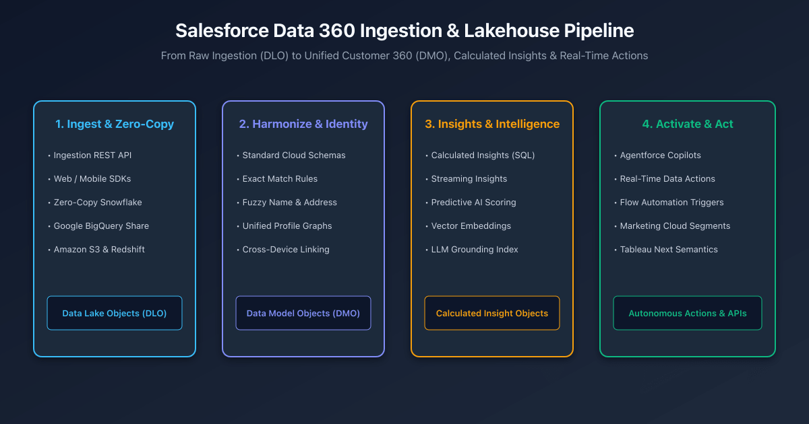

## Overview

Modern enterprises accumulate customer engagement data across hundreds of disparate systems—ERP backends, web analytics trackers, point-of-sale systems, and third-party data lakes. Attempting to synchronize this massive, high-velocity data directly into standard Salesforce CRM objects (`Account` or `Contact`) creates severe storage bloat and breaches platform governor limits.

**Salesforce Data 360** (formerly Data Cloud) provides an elastically scalable Lakehouse engine natively integrated into the Salesforce ecosystem. It decouples high-volume analytical data from transactional CRM tables, enabling sub-second identity resolution, zero-copy data federation, and real-time grounding for **Agentforce** autonomous agents.



---

## The 4-Stage Data 360 Pipeline

The end-to-end architecture flows through four distinct transformations:

### Stage 1: Ingestion & Zero-Copy Federation
Data arrives in Data 360 through two primary patterns:
1. **Physical Ingest**: Ingestion REST APIs, Mobile SDKs, Web Interactions SDK, or Amazon S3 connectors stream data into raw **Data Lake Objects (DLOs)**.
2. **Zero-Copy Federation**: Rather than copying petabytes of data, Data 360 establishes bi-directional federated shares with **Snowflake**, **Google BigQuery**, and **AWS Redshift**. Queries run directly against remote Apache Iceberg tables without data duplication or egress charges.

### Stage 2: Harmonization & Identity Resolution
Raw DLOs map to canonical **Data Model Objects (DMOs)** aligned with the open-source **Cloud Information Model (CIM)**.
- **DLO-to-DMO Mapping**: Transforms raw external schema fields into standardized entities (`Individual__dlm`, `ContactPointEmail__dlm`, `SalesOrder__dlm`).
- **Identity Resolution Engine**: Executes configurable reconciliation rules combining **Exact Match** (e.g., matching normalized Email + Phone) and **Fuzzy Match** (probabilistic string distance on First Name + Billing Address) to unify fragmented records into a single `UnifiedIndividual__dlm` profile graph.

### Stage 3: Insights & Semantic Grounding
- **Calculated Insights (CI)**: Multidimensional SQL queries evaluated on automated schedules to compute complex customer metrics (such as `Customer_Lifetime_Value__cio` or `Average_Order_Frequency__cio`).
- **Vector Search Indexes**: Converts unstructured data (PDF manuals, customer cases, website scrapings) into dense vector embeddings using LLM embedding models, stored for low-latency retrieval.

### Stage 4: Activation & Autonomous Action
Unified customer profiles and insights power real-time business action:
- **Agentforce Grounding**: Autonomous co-pilots query DMOs and vector indexes via Hosted MCP Servers (`data/data-cloud-queries`).
- **Data Actions & Flow Triggers**: Stream events fire automated Salesforce Platform Flows when calculated thresholds are breached (e.g., triggering a retention outreach flow when customer churn probability exceeds 80%).

---

## Defining a Calculated Insight with SQL

Calculated Insights are defined using ANSI-compliant SQL. They require at least one dimension and one aggregation metric:

```sql title="Customer_LTV_Insight.sql"
SELECT 
    UnifiedIndividual__dlm.Id__c as Individual_Id__c,
    SUM(SalesOrder__dlm.GrandTotalAmount__c) as Total_Lifetime_Spend__c,
    COUNT(SalesOrder__dlm.Id__c) as Total_Order_Count__c,
    MAX(SalesOrder__dlm.OrderDate__c) as Last_Purchase_Date__c
FROM UnifiedIndividual__dlm
JOIN IndividualIdentityLink__dlm 
    ON UnifiedIndividual__dlm.Id__c = IndividualIdentityLink__dlm.UnifiedRecordId__c
JOIN SalesOrder__dlm 
    ON IndividualIdentityLink__dlm.SourceRecordId__c = SalesOrder__dlm.BillToContactId__c
WHERE SalesOrder__dlm.OrderStatus__c = 'Completed'
GROUP BY UnifiedIndividual__dlm.Id__c
```

---

## Querying Data 360 Programmatically in Apex

Developers can query Data 360 Lakehouse tables directly from Apex using the `ConnectApi.CdpQuery` namespace:

```apex title="DataCloudQueryService.cls"
public with sharing class DataCloudQueryService {
    
    public static List<Map<String, Object>> queryCustomerInsights(String unifiedId) {
        ConnectApi.CdpQueryInput queryInput = new ConnectApi.CdpQueryInput();
        queryInput.sql = 'SELECT Total_Lifetime_Spend__c, Total_Order_Count__c ' +
                         'FROM Customer_LTV_Insight__cio ' +
                         'WHERE Individual_Id__c = \'' + String.escapeSingleQuotes(unifiedId) + '\'';

        ConnectApi.CdpQueryOutput response = ConnectApi.CdpQuery.queryAnsiSql(queryInput);
        List<Map<String, Object>> records = new List<Map<String, Object>>();

        for (ConnectApi.CdpRow row : response.data) {
            Map<String, Object> recordMap = new Map<String, Object>();
            for (Integer i = 0; i < response.metadata.size(); i++) {
                recordMap.put(response.metadata[i].name, row.rowData[i]);
            }
            records.add(recordMap);
        }
        return records;
    }
}
```

