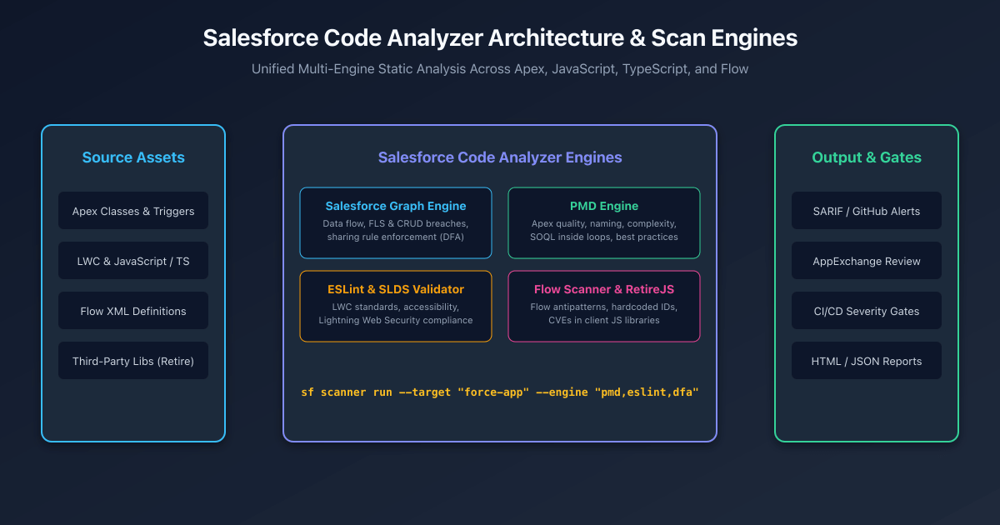

## Overview

Static application security testing (SAST) and code quality gating are critical components of enterprise Salesforce release engineering. Historically, teams had to maintain separate command-line runners for PMD, ESLint, RetireJS, and custom security scripts.

The **Salesforce Code Analyzer** (formerly `@salesforce/sfdx-scanner`) unifies multiple best-in-class static analysis engines into a single, cohesive Salesforce CLI plugin. It scans server-side Apex, client-side Lightning Web Components (JavaScript/TypeScript), third-party dependencies, and declarative Flow metadata for bugs, performance anti-patterns, and critical security vulnerabilities.



---

## The Unified Engine Suite

| Engine | Target Technologies | What It Evaluates |
| :--- | :--- | :--- |
| **Salesforce Graph Engine (SFGE)** | Apex Classes & Triggers | Interprocedural **Data Flow Analysis (DFA)**; path-based CRUD/FLS validation, SOQL injection tracing, and sharing rule enforcement. |
| **PMD Engine** | Apex | Code quality, Cyclomatic Complexity, naming conventions, SOQL/DML inside loops, and dead code. |
| **ESLint & SLDS Validator** | LWC JavaScript & TypeScript | Modern ECMAScript standards, component reactivity, Lightning Web Security compliance, and CSS token usage. |
| **RetireJS** | Static Resource JavaScript | Known Common Vulnerabilities and Exposures (CVEs) in third-party client libraries (e.g., outdated jQuery or Lodash). |
| **Flow Scanner** | Flow XML definitions | Unhandled fault paths, DML operations inside loops, hardcoded record IDs, and flow complexity antipatterns. |

---

## Installation & CLI Usage

Install the Code Analyzer plugin directly into your Salesforce CLI environment:

```bash
# Install the official Code Analyzer plugin
sf plugins install @salesforce/sfdx-scanner

# Verify installed scan engines
sf scanner engine list
```

### Running Basic Scans
```bash
# Scan all Apex and LWC code using default PMD and ESLint rules
sf scanner run --target "force-app" --format table

# Scan with high-severity violation threshold (exits with error code 1 if severity <= 2)
sf scanner run --target "force-app" --severity-threshold 2
```

---

## Deep Dive: Salesforce Graph Engine (DFA)

While traditional PMD inspects individual lines of code, the **Salesforce Graph Engine (SFGE)** builds an Abstract Syntax Tree (AST) and traces variable execution paths across methods and classes.

It catches subtle vulnerabilities such as:
1. **Unchecked CRUD / FLS**: Inserting or updating fields without checking `Schema.sObjectType.Account.fields.Amount.isCreateable()`.
2. **SOQL Injection via Parameter Sinks**: Tracing unsanitized URL or user inputs passed into dynamic `Database.query()`.
3. **Sharing Rule Violations**: Exposing sensitive calculations in classes defined without `with sharing` or `WITH USER_MODE`.

```bash
# Run Graph Engine with path analysis across project entry points
sf scanner run dfa \
  --target "force-app/main/default/classes" \
  --projectdir "force-app" \
  --format table
```

---

## Automated CI/CD Quality Gate with GitHub Actions

Enterprise development teams integrate Code Analyzer into pull request workflows. By outputting findings in **SARIF (Static Analysis Results Interchange Format)**, GitHub automatically renders findings as inline comments on code diffs:

```yaml title=".github/workflows/code-analyzer.yml"
name: Salesforce Static Code Analysis

on:
  pull_request:
    paths:
      - 'force-app/**'

jobs:
  code-scan:
    runs-on: ubuntu-latest
    steps:
      - name: Checkout Code
        uses: actions/checkout@v4

      - name: Setup Node.js & Install CLI
        uses: actions/setup-node@v4
        with:
          node-version: 22
      - run: npm install -g @salesforce/cli
      - run: sf plugins install @salesforce/sfdx-scanner

      - name: Run Code Analyzer Scan
        run: |
          sf scanner run \
            --target "force-app" \
            --engine "pmd,eslint,sfge,retire-js" \
            --format sarif \
            --outfile code-scan-results.sarif \
            --severity-threshold 1

      - name: Upload SARIF to GitHub Security Tab
        if: always()
        uses: github/codeql-action/upload-sarif@v3
        with:
          sarif_file: code-scan-results.sarif
```

