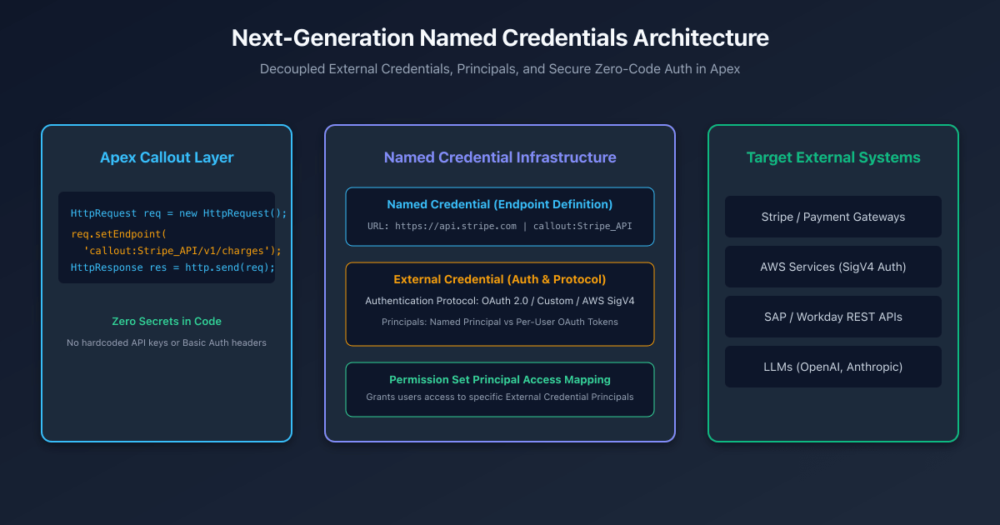

## Overview

Making HTTP callouts from Apex to external APIs (payment gateways, ERP microservices, cloud storage, or LLM endpoints) presents significant architectural challenges around credential storage, authentication lifecycle management, and security governance.

Historically, developers often stored API keys in Custom Metadata Types or hardcoded authorization headers directly in Apex classes. This exposed systems to credential leaks in version control, violated security compliance audits, and required custom Apex logic to manage OAuth 2.0 token refreshes.

**Next-Generation Named Credentials** resolve these vulnerabilities. By decoupling endpoint definitions from authentication protocols and user permissions, they allow developers to execute zero-code authenticated callouts directly via the `callout:` URL pseudo-protocol.



---

## Architectural Breakdown: Named Credentials vs External Credentials

Modern callout security separates concerns into three distinct metadata layers:

### 1. Named Credential (The Endpoint Definition)
Defines **where** the callout goes:
- **URL**: Base endpoint (e.g., `https://api.stripe.com` or `https://s3.amazonaws.com`).
- **External Credential Reference**: Links to the authentication profile.
- **Header Options**: Configures whether Salesforce automatically generates standard HTTP headers (`Authorization`, `Host`).

### 2. External Credential (The Authentication Profile)
Defines **how** the callout authenticates:
- **Authentication Protocol**: OAuth 2.0, AWS Signature Version 4 (SigV4), Custom Headers, or Basic Auth.
- **Principals**: Defines authentication identities (e.g., `Named Principal` for a shared service account vs `Per-User` for individual user OAuth tokens).
- **Authentication Parameters**: Client IDs, Client Secrets, Token Endpoints, and Scopes.

### 3. Permission Set Mapping (Access Governance)
Defines **who** is allowed to make the callout:
- Access to an External Credential Principal is controlled via **Permission Sets** or **Profiles** under **External Credential Principal Access**.
- If a running user lacks permission set access to the specified principal, Salesforce immediately rejects the callout before making any network request.

---

## Example: Executing an Authenticated Callout in Apex

With Named Credentials, the Apex callout code contains **zero credentials, headers, or token logic**:

```apex title="PaymentGatewayService.cls"
public with sharing class PaymentGatewayService {
    
    /**
     * Executes an authenticated payment charge via Stripe Named Credential.
     */
    public static HttpResponse createCharge(Decimal amountInCents, String currencyIso, String customerToken) {
        HttpRequest req = new HttpRequest();
        
        // Use the callout: schema followed by the Named Credential DeveloperName
        req.setEndpoint('callout:Stripe_Payment_Gateway/v1/charges');
        req.setMethod('POST');
        req.setHeader('Content-Type', 'application/x-www-form-urlencoded');

        // Form-encoded body parameters
        String requestBody = 'amount=' + EncodingUtil.urlEncode(String.valueOf(amountInCents), 'UTF-8') +
                             '&currency=' + EncodingUtil.urlEncode(currencyIso.toLowerCase(), 'UTF-8') +
                             '&source=' + EncodingUtil.urlEncode(customerToken, 'UTF-8');
        req.setBody(requestBody);

        Http http = new Http();
        // Salesforce automatically injects the Bearer token / auth headers
        HttpResponse res = http.send(req);

        if (res.getStatusCode() != 200) {
            throw new CalloutException('Payment Gateway Error: ' + res.getBody());
        }
        return res;
    }
}
```

---

## AWS Signature Version 4 (SigV4) Integration

Connecting to Amazon Web Services (such as S3, DynamoDB, or Bedrock) traditionally required hundreds of lines of complex Apex code to calculate SHA-256 canonical request hashes and HMAC-SHA256 signatures.

With modern External Credentials:
1. Set **Authentication Protocol** to **AWS Signature Version 4**.
2. Configure **Service** (e.g., `s3` or `bedrock`) and **AWS Region** (e.g., `us-east-1`).
3. Add a Principal with your AWS Access Key ID and Secret Access Key.
4. Execute `req.setEndpoint('callout:AWS_S3_Bucket/my-folder/report.pdf')`—Salesforce signs the request automatically according to AWS SigV4 specifications.

