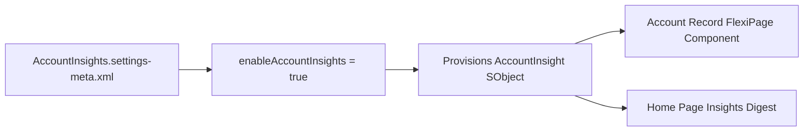

## Architectural Overview

The `AccountInsightsSettings` metadata type controls the org-wide enablement of Einstein Account Insights. When enabled, Salesforce evaluates Account names, websites, and ticker symbols against trusted external news providers to surface key business events—such as mergers and acquisitions, executive leadership changes, cost-cutting initiatives, and company expansion—directly to sales teams.

From a release engineering perspective, managing `AccountInsightsSettings` in version control prevents `FlexiPage` deployment failures. If an Account Lightning Record Page (`FlexiPage`) includes the standard Account Insights component, deploying that page to a target org where `enableAccountInsights` is `false` can trigger component validation errors.



## Directory and File Conventions

In SFDX source format, `AccountInsightsSettings` is stored in the `settings/` directory and retrieved via `Settings:AccountInsights`.

| Property | Value |
| :--- | :--- |
| **Metadata Type Name** | `Settings` (member: `AccountInsights`) / `AccountInsightsSettings` |
| **SFDX Folder** | `force-app/main/default/settings/` |
| **File Name** | `AccountInsights.settings-meta.xml` |
| **Scratch Org Setting Key** | `accountInsightsSettings` |

## Key Metadata Fields

The `AccountInsightsSettings` XML schema defines the following field in API version `68.0`:

| Field Name | Field Type | Required | Architectural Description |
| :--- | :--- | :--- | :--- |
| `enableAccountInsights` | `boolean` | Yes | Enables (`true`) or disables (`false`) Einstein Account Insights across the organization. |

> [!NOTE]
> Salesforce has progressively transitioned legacy standalone Einstein Account Insights capabilities into unified `AccountIntelligenceSettings` and generative Sales Cloud Einstein features. Keep `AccountInsightsSettings` synchronized with `AccountIntelligenceSettings` in older orgs that still reference the `AccountInsight` standard object.

## Declarative XML and Package Manifest Examples

Here is the standard `AccountInsights.settings-meta.xml` file:

```xml title="force-app/main/default/settings/AccountInsights.settings-meta.xml"
<?xml version="1.0" encoding="UTF-8"?>
<AccountInsightsSettings xmlns="http://soap.sforce.com/2006/04/metadata">
    <enableAccountInsights>true</enableAccountInsights>
</AccountInsightsSettings>
```

### Package Manifest (`package.xml`)

```xml title="manifest/package.xml"
<?xml version="1.0" encoding="UTF-8"?>
<Package xmlns="http://soap.sforce.com/2006/04/metadata">
    <types>
        <members>AccountInsights</members>
        <name>Settings</name>
    </types>
    <version>68.0</version>
</Package>
```

## CLI Retrieval and Deployment Commands

Retrieve and deploy `AccountInsightsSettings` using the `sf` CLI:

```bash
# Retrieve AccountInsightsSettings into force-app/main/default/settings/
sf project retrieve start --metadata Settings:AccountInsights

# Deploy AccountInsightsSettings to the target org
sf project deploy start --metadata Settings:AccountInsights
```

## Architect Best Practices and Gotchas

- **Data Privacy and External Processing:** Enabling `enableAccountInsights` shares Account name and website metadata with Salesforce's news aggregation service to match relevant articles. Verify compliance with your enterprise data governance policies in regulated industries (such as healthcare or defense) before enabling in production.
- **FlexiPage Dependency:** Always deploy `Settings:AccountInsights` before or alongside any [FlexiPage](/docs/metadata/flexipage-metadata-type/) that embeds the Einstein Account Insights standard component.

> [!TIP]
> To maximize article matching accuracy, enforce validation rules or data enrichment on the `Account.Website` and `Account.BillingCountry` fields on your [CustomObject](/docs/metadata/custom-object-metadata-type/) Account configuration.
