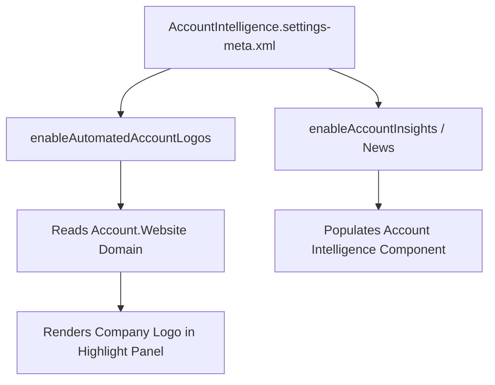

## Architectural Overview

The `AccountIntelligenceSettings` metadata type configures Salesforce's Account Intelligence suite, including Automated Account Logos, Einstein Account News/Insights, and AI-assisted account research. When enabled, Salesforce enriches Account headers and intelligence panels with visual branding and contextual market signals without requiring third-party AppExchange enrichment packages.

Architects include `AccountIntelligenceSettings` in baseline org configurations so that all sandboxes, scratch orgs, and production environments maintain consistent UI enrichment and data-sharing postures.



## Directory and File Conventions

In SFDX source format, `AccountIntelligenceSettings` is stored in the `settings/` directory and referenced as `Settings:AccountIntelligence`.

| Property | Value |
| :--- | :--- |
| **Metadata Type Name** | `Settings` (member: `AccountIntelligence`) / `AccountIntelligenceSettings` |
| **SFDX Folder** | `force-app/main/default/settings/` |
| **File Name** | `AccountIntelligence.settings-meta.xml` |
| **Scratch Org Setting Key** | `accountIntelligenceSettings` |

## Key Metadata Fields

The `AccountIntelligenceSettings` XML schema supports the following flags in API version `68.0`:

| Field Name | Field Type | Required | Architectural Description |
| :--- | :--- | :--- | :--- |
| `enableAccountInsights` | `boolean` | No | Enables curated news and business event insights for Account records. |
| `enableAutomatedAccountLogos` | `boolean` | No | Automatically fetches and displays company logos on Account records based on the `Website` field. |
| `enableNews` | `boolean` | No | Enables the Account News component and feed across Lightning Experience and Salesforce Mobile. |

> [!NOTE]
> Availability of specific boolean flags inside `AccountIntelligenceSettings` depends on the org's edition and whether Sales Cloud Einstein or Agentforce for Sales licenses are provisioned.

## Declarative XML and Package Manifest Examples

Below is a standard `AccountIntelligence.settings-meta.xml` configuration enabling automated logos and account intelligence:

```xml title="force-app/main/default/settings/AccountIntelligence.settings-meta.xml"
<?xml version="1.0" encoding="UTF-8"?>
<AccountIntelligenceSettings xmlns="http://soap.sforce.com/2006/04/metadata">
    <enableAccountInsights>true</enableAccountInsights>
    <enableAutomatedAccountLogos>true</enableAutomatedAccountLogos>
    <enableNews>true</enableNews>
</AccountIntelligenceSettings>
```

### Scratch Org Configuration (`config/project-scratch-def.json`)

```json title="config/project-scratch-def.json"
{
  "orgName": "Sales Cloud Architecture Scratch Org",
  "edition": "Enterprise",
  "settings": {
    "accountIntelligenceSettings": {
      "enableAccountInsights": true,
      "enableAutomatedAccountLogos": true,
      "enableNews": true
    }
  }
}
```

### Package Manifest (`package.xml`)

```xml title="manifest/package.xml"
<?xml version="1.0" encoding="UTF-8"?>
<Package xmlns="http://soap.sforce.com/2006/04/metadata">
    <types>
        <members>AccountIntelligence</members>
        <name>Settings</name>
    </types>
    <version>68.0</version>
</Package>
```

## CLI Retrieval and Deployment Commands

Use Salesforce CLI (`sf`) to synchronize `AccountIntelligenceSettings` across environments:

```bash
# Retrieve AccountIntelligenceSettings from the org
sf project retrieve start --metadata Settings:AccountIntelligence

# Deploy AccountIntelligenceSettings to the target org
sf project deploy start --metadata Settings:AccountIntelligence
```

## Architect Best Practices and Gotchas

- **Firewall and CSP Considerations:** Automated Account Logos are served from Salesforce-hosted CDN endpoints after domain resolution against `Account.Website`. Ensure corporate network proxies do not block standard Salesforce static content domains.
- **Person Accounts:** Automated Account Logos apply only to business [CustomObject](/docs/metadata/custom-object-metadata-type/) `Account` records (`IsPersonAccount = false`); Person Accounts display social/contact avatars instead.

> [!TIP]
> If sales reps report an incorrect logo on an Account record, users with Edit access on the Account can click the logo in the highlight panel to flag or replace it without disabling `enableAutomatedAccountLogos` org-wide.
