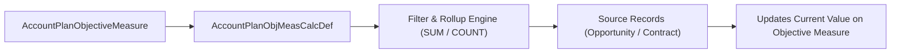

## Architectural Overview

The `AccountPlanObjMeasCalcDef` (Account Plan Objective Measure Calculation Definition) metadata type configures the automated KPI calculation engine inside native Salesforce Account Plans. In enterprise B2B sales, key account managers define strategic objectives (`AccountPlanObjective`) with measurable targets (`AccountPlanObjectiveMeasure`)—such as growing annual recurring revenue by 25% or closing 10 expansion deals.

Rather than forcing sales teams to manually update progress numbers or building custom rollup batch jobs, architects deploy `AccountPlanObjMeasCalcDef` components to declaratively specify which source object, aggregation function (`SUM`, `COUNT`), field, and filter criteria calculate the live actuals for an Account Plan Objective Measure.



## Directory and File Conventions

In SFDX source format (`apiVersion` 68.0), `AccountPlanObjMeasCalcDef` files live in the `accountPlanObjMeasCalcDefs` directory.

| Property | Value |
| :--- | :--- |
| **Metadata Type Name** | `AccountPlanObjMeasCalcDef` |
| **SFDX Folder** | `force-app/main/default/accountPlanObjMeasCalcDefs/` |
| **File Suffix** | `.accountPlanObjMeasCalcDef-meta.xml` |
| **Wildcard Support (`*`)** | Supported in `package.xml` |

## Key Metadata Fields

The `AccountPlanObjMeasCalcDef` XML schema contains the following primary properties:

| Field Name | Field Type | Required | Architectural Description |
| :--- | :--- | :--- | :--- |
| `masterLabel` | `string` | Yes | Human-readable label shown to users selecting a calculation definition on an objective measure. |
| `developerName` | `string` | No | Unique API name of the calculation definition. |
| `status` | `string` | Yes | Activation state of the definition (for example, `Active` or `Draft`). |
| `sourceObject` | `string` | Yes | API name of the object being aggregated (such as `Opportunity` or `Order`). |
| `aggregateFunction` | `string` | Yes | Rollup operation to perform (`Sum`, `Count`, `Avg`). |
| `aggregateField` | `string` | No | Field on `sourceObject` to aggregate when using `Sum` or `Avg` (for example, `Amount` or `ARR__c`). |
| `accountLookupField` | `string` | Yes | Field on `sourceObject` that links the record back to the target `Account` (such as `AccountId`). |
| `dateField` | `string` | No | Date field on `sourceObject` used to bound the calculation within the Account Plan's time period. |
| `filterLogic` | `string` | No | Boolean filter logic combining child filter conditions (for example, `1 AND 2`). |

> [!TIP]
> Always populate `dateField` (such as `CloseDate` on `Opportunity`) when configuring revenue calculation definitions so the rollup automatically respects the start and end dates of the parent `AccountPlanObjectiveMeasure`.

## Declarative XML and Package Manifest Examples

The following XML defines a calculation rule that sums `Amount` across Closed Won Opportunities for the target Account:

```xml title="force-app/main/default/accountPlanObjMeasCalcDefs/Closed_Won_Revenue_Rollup.accountPlanObjMeasCalcDef-meta.xml"
<?xml version="1.0" encoding="UTF-8"?>
<AccountPlanObjMeasCalcDef xmlns="http://soap.sforce.com/2006/04/metadata">
    <accountLookupField>AccountId</accountLookupField>
    <aggregateField>Amount</aggregateField>
    <aggregateFunction>Sum</aggregateFunction>
    <dateField>CloseDate</dateField>
    <masterLabel>Closed Won Opportunity Revenue</masterLabel>
    <sourceObject>Opportunity</sourceObject>
    <status>Active</status>
</AccountPlanObjMeasCalcDef>
```

### Package Manifest (`package.xml`)

```xml title="manifest/package.xml"
<?xml version="1.0" encoding="UTF-8"?>
<Package xmlns="http://soap.sforce.com/2006/04/metadata">
    <types>
        <members>Closed_Won_Revenue_Rollup</members>
        <name>AccountPlanObjMeasCalcDef</name>
    </types>
    <types>
        <members>AccountPlan</members>
        <name>Settings</name>
    </types>
    <version>68.0</version>
</Package>
```

## SOQL Queries and CLI Automation

Query active calculation definitions using SOQL or manage them via Salesforce CLI:

```soql
SELECT Id, DeveloperName, MasterLabel, Status,
       SourceObject, AggregateFunction, AggregateField
FROM AccountPlanObjMeasCalcDef
WHERE Status = 'Active'
ORDER BY MasterLabel ASC
```

```bash
# Retrieve all AccountPlanObjMeasCalcDef records
sf project retrieve start --metadata "AccountPlanObjMeasCalcDef:*"

# Deploy a specific calculation definition
sf project deploy start --metadata AccountPlanObjMeasCalcDef:Closed_Won_Revenue_Rollup
```

## Architect Best Practices and Gotchas

- **Enable AccountPlanSettings First:** Deploying `AccountPlanObjMeasCalcDef` to an org where `AccountPlanSettings` (`enableAccountPlan`) is disabled fails immediately because the `AccountPlanObjMeasCalcDef` entity is hidden.
- **Multi-Currency Considerations:** In orgs with Advanced Currency Management enabled, `Sum` aggregations on currency fields convert amounts into the currency of the `AccountPlanObjectiveMeasure` record using corporate or dated exchange rates.

> [!WARNING]
> You cannot modify the `sourceObject` or `aggregateFunction` of an `AccountPlanObjMeasCalcDef` while its `status` is `Active` and linked to live `AccountPlanObjectiveMeasure` records. Deactivate or version a new definition instead.
