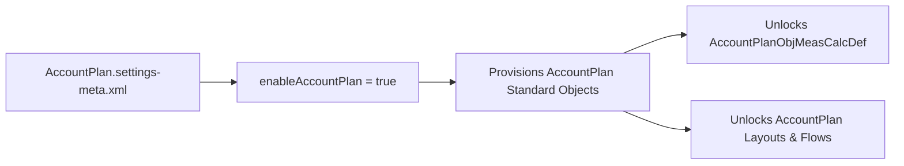

## Architectural Overview

The `AccountPlanSettings` metadata type is the org-wide switch for native Sales Cloud Account Plans. When enabled, Salesforce provisions the standard data model for strategic account management—including `AccountPlan`, `AccountPlanObjective`, `AccountPlanObjectiveMeasure`, and `AccountPlanObjMeasCalcDef`—alongside SWOT analysis panels and buyer relationship map integrations.

For architects managing multi-stage CI/CD pipelines, `AccountPlanSettings` is a critical schema gatekeeper: any custom fields, page layouts, Lightning Record Pages (`FlexiPage`), or Permission Sets referencing `AccountPlan` will fail to deploy unless `AccountPlan.settings-meta.xml` is enabled first.



## Directory and File Conventions

In SFDX source format, `AccountPlanSettings` resides in `force-app/main/default/settings/` and is addressed via `Settings:AccountPlan`.

| Property | Value |
| :--- | :--- |
| **Metadata Type Name** | `Settings` (member: `AccountPlan`) / `AccountPlanSettings` |
| **SFDX Folder** | `force-app/main/default/settings/` |
| **File Name** | `AccountPlan.settings-meta.xml` |
| **Scratch Org Setting Key** | `accountPlanSettings` |

## Key Metadata Fields

The `AccountPlanSettings` XML schema exposes the following boolean flags in API version `68.0`:

| Field Name | Field Type | Required | Architectural Description |
| :--- | :--- | :--- | :--- |
| `enableAccountPlan` | `boolean` | Yes | Master toggle (`true`/`false`) that enables native Account Plans and provisions the underlying standard objects. |

> [!NOTE]
> Native `AccountPlan` objects introduced in recent releases share a similar conceptual name with legacy custom `Account_Plan__c` objects found in older orgs. Using the standard `AccountPlan` object avoids consuming custom object allocations and unlocks native Einstein Account Plan summarization.

## Declarative XML and Package Manifest Examples

Below is the declarative `AccountPlan.settings-meta.xml` file:

```xml title="force-app/main/default/settings/AccountPlan.settings-meta.xml"
<?xml version="1.0" encoding="UTF-8"?>
<AccountPlanSettings xmlns="http://soap.sforce.com/2006/04/metadata">
    <enableAccountPlan>true</enableAccountPlan>
</AccountPlanSettings>
```

### Scratch Org Configuration (`config/project-scratch-def.json`)

```json title="config/project-scratch-def.json"
{
  "orgName": "Enterprise Account Planning Scratch Org",
  "edition": "Enterprise",
  "settings": {
    "accountPlanSettings": {
      "enableAccountPlan": true
    }
  }
}
```

### Package Manifest (`package.xml`)

```xml title="manifest/package.xml"
<?xml version="1.0" encoding="UTF-8"?>
<Package xmlns="http://soap.sforce.com/2006/04/metadata">
    <types>
        <members>AccountPlan</members>
        <name>Settings</name>
    </types>
    <version>68.0</version>
</Package>
```

## CLI Retrieval and Deployment Commands

Retrieve and deploy `AccountPlanSettings` using Salesforce CLI:

```bash
# Retrieve AccountPlanSettings from the org
sf project retrieve start --metadata Settings:AccountPlan

# Deploy AccountPlanSettings to enable standard AccountPlan objects
sf project deploy start --metadata Settings:AccountPlan
```

## Architect Best Practices and Gotchas

- **Object Permissions Are Not Automatic:** Enabling `enableAccountPlan` creates the `AccountPlan` objects, but non-admin users still require Read, Create, Edit, and Delete CRUD permissions granted via a [PermissionSet](/docs/metadata/permission-set-metadata-type/).
- **Sharing Model:** `AccountPlan` has its own Organization-Wide Default (OWD) sharing setting (typically `Private` or `ControlledByParent`). Review your [CustomObject](/docs/metadata/custom-object-metadata-type/) `AccountPlan.object-meta.xml` sharing configuration immediately after enabling `AccountPlanSettings`.

> [!TIP]
> Include `Settings:AccountPlan` in your pre-deployment foundation package so scratch org builds and sandbox pipelines provision the `AccountPlan` schema before compiling dependent Apex classes and Flows.
