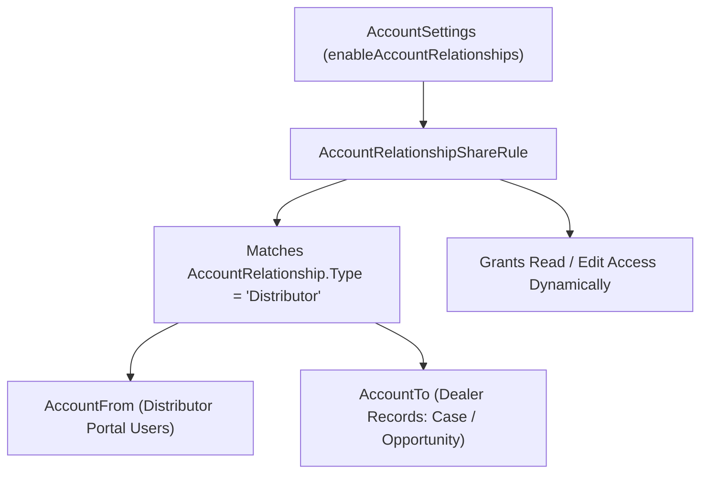

## Architectural Overview

The `AccountRelationshipShareRule` metadata type configures Account Relationship Data Sharing rules in Salesforce. In multi-tier B2B distribution models, franchise networks, and Experience Cloud Partner Central implementations, a distributor (`AccountFrom`) often needs visibility into Opportunities, Cases, Orders, or custom objects owned by or associated with a dealer (`AccountTo`), without merging the two Accounts or writing brittle Apex managed sharing triggers.

When an architect defines an `AccountRelationshipShareRule` for a specific `AccountRelationship.Type` picklist value, Salesforce's native sharing engine automatically calculates and maintains record shares whenever an `AccountRelationship` record of that type is created, modified, or deleted.



## Directory and File Conventions

In SFDX source format (`apiVersion` 68.0), `AccountRelationshipShareRule` components are stored in the `accountRelationshipShareRules` directory.

| Property | Value |
| :--- | :--- |
| **Metadata Type Name** | `AccountRelationshipShareRule` |
| **SFDX Folder** | `force-app/main/default/accountRelationshipShareRules/` |
| **File Suffix** | `.accountRelationshipShareRule-meta.xml` |
| **Wildcard Support (`*`)** | Supported in `package.xml` |

## Key Metadata Fields

The `AccountRelationshipShareRule` XML schema exposes the following core elements:

| Field Name | Field Type | Required | Architectural Description |
| :--- | :--- | :--- | :--- |
| `masterLabel` | `string` | Yes | Human-readable label of the Account Relationship data sharing rule in Setup. |
| `description` | `string` | No | Documents the business purpose and security intent of the rule. |
| `entityType` | `string` | Yes | API name of the object being shared (`Account`, `Opportunity`, `Case`, `Contact`, `Order`, or a custom object `__c`). |
| `accessLevel` | `ShareAccessLevelNoAll` | Yes | Level of access granted (`Read` or `Edit`). |
| `accountToCriteriaField` | `string` | Yes | Lookup field on `entityType` that points to the target Account (`AccountId`, `Dealer_Account__c`, etc.). |
| `type` | `string` | Yes | Picklist API value from `AccountRelationship.Type` that triggers this sharing rule. |
| `staticFormulaCriteria` | `string` | No | Optional filter condition limiting which records of `entityType` are shared. |

> [!NOTE]
> For custom objects to be eligible as `entityType` in an `AccountRelationshipShareRule`, their Organization-Wide Default (`sharingModel` on [CustomObject](/docs/metadata/custom-object-metadata-type/)) must be `Private` or `Read` (Public Read Only)—never `ControlledByParent`.

## Declarative XML and Package Manifest Examples

The following example shares dealer `Opportunity` records (`Read` access) with the parent distributor whenever an `AccountRelationship` record of type `Distributor_Dealer` connects the two Accounts:

```xml title="force-app/main/default/accountRelationshipShareRules/Distributor_Opportunity_Read.accountRelationshipShareRule-meta.xml"
<?xml version="1.0" encoding="UTF-8"?>
<AccountRelationshipShareRule xmlns="http://soap.sforce.com/2006/04/metadata">
    <accessLevel>Read</accessLevel>
    <accountToCriteriaField>AccountId</accountToCriteriaField>
    <description>Grants distributor partner users read access to dealer opportunities.</description>
    <entityType>Opportunity</entityType>
    <masterLabel>Distributor Opportunity Read Rule</masterLabel>
    <type>Distributor_Dealer</type>
</AccountRelationshipShareRule>
```

### Package Manifest (`package.xml`)

```xml title="manifest/package.xml"
<?xml version="1.0" encoding="UTF-8"?>
<Package xmlns="http://soap.sforce.com/2006/04/metadata">
    <types>
        <members>Distributor_Opportunity_Read</members>
        <name>AccountRelationshipShareRule</name>
    </types>
    <types>
        <members>Account</members>
        <name>Settings</name>
    </types>
    <version>68.0</version>
</Package>
```

## SOQL Queries and CLI Automation

You can query configured `AccountRelationshipShareRule` records via SOQL or retrieve and deploy them via Salesforce CLI:

```soql
SELECT Id, DeveloperName, MasterLabel, EntityType,
       AccessLevel, AccountToCriteriaField, Type
FROM AccountRelationshipShareRule
ORDER BY EntityType ASC, DeveloperName ASC
```

```bash
# Retrieve all AccountRelationshipShareRule components
sf project retrieve start --metadata "AccountRelationshipShareRule:*"

# Deploy a specific AccountRelationshipShareRule
sf project deploy start --metadata AccountRelationshipShareRule:Distributor_Opportunity_Read
```

## Architect Best Practices and Gotchas

- **Picklist Dependency on `AccountRelationship.Type`:** The `<type>` value in `AccountRelationshipShareRule` must exist as an active picklist value on `AccountRelationship.Type`. Deploy the `AccountRelationship` custom field picklist values before or alongside the share rule.
- **Prerequisite `AccountSettings`:** Ensure `<enableAccountRelationships>true</enableAccountRelationships>` is deployed in `Account.settings-meta.xml` before deploying `AccountRelationshipShareRule`.
- **Sharing Table Skew:** Connecting a single top-level Holding Account (`AccountFrom`) to thousands of high-volume dealer Accounts (`AccountTo`) via `AccountRelationship` can trigger heavy sharing recalculation times. Monitor sharing calculation latency alongside standard [SharingRules](/docs/metadata/sharing-rules-metadata-type/).

> [!WARNING]
> Deleting or changing the `type` on an active `AccountRelationshipShareRule` triggers an immediate recalculation that revokes implicit record shares across all matching `AccountRelationship` records. Test access changes in a Full Sandbox with Partner Community users before production deployment.
