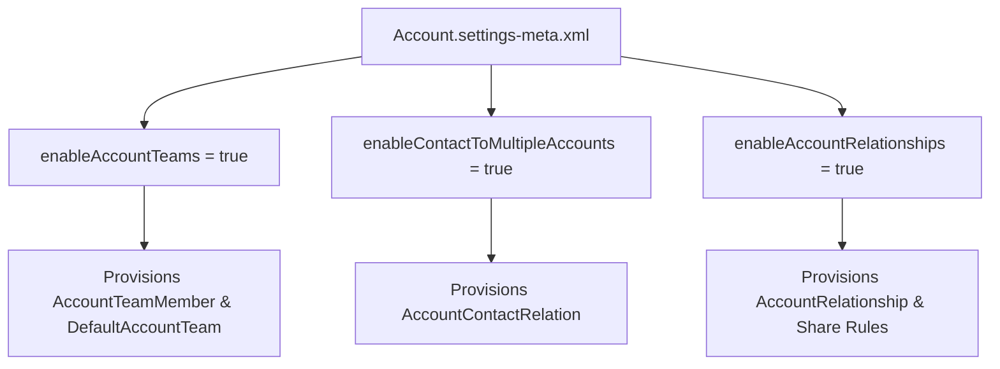

## Architectural Overview

The `AccountSettings` metadata type is one of the most consequential configuration files in any Salesforce DX repository. It controls the availability of major relational tables in the core CRM schema—most notably `AccountTeamMember` (Account Teams), `AccountContactRelation` (Contacts to Multiple Accounts), and `AccountRelationship` (Account Relationships).

In enterprise CI/CD and scratch org automation, failing to deploy `AccountSettings` before compiling schema and code is a leading cause of broken builds. Whenever an [ApexClass](/docs/metadata/apex-class-metadata-type/), Flow, or layout references `AccountTeamMember` or `AccountContactRelation`, `Account.settings-meta.xml` must be deployed first to provision those objects.



## Directory and File Conventions

In SFDX source format (`apiVersion` 68.0), `AccountSettings` is stored in the `settings/` directory and referenced as `Settings:Account`.

| Property | Value |
| :--- | :--- |
| **Metadata Type Name** | `Settings` (member: `Account`) / `AccountSettings` |
| **SFDX Folder** | `force-app/main/default/settings/` |
| **File Name** | `Account.settings-meta.xml` |
| **Scratch Org Setting Key** | `accountSettings` |

## Key Metadata Fields

The `AccountSettings` XML schema exposes the following architectural flags:

| Field Name | Field Type | Required | Architectural Description |
| :--- | :--- | :--- | :--- |
| `enableAccountTeams` | `boolean` | No | Enables Account Teams and provisions the `AccountTeamMember` and `UserAccountTeamMember` standard objects. |
| `enableAccountOwnerReport` | `boolean` | No | Allows all users to run the standard Account Owner report regardless of role hierarchy visibility. |
| `enableAccountRelationships` | `boolean` | No | Enables Account Relationships (`AccountRelationship` and `AccountRelationshipShareRule`) for B2B partner sharing. |
| `enableAccountHistoryTracking` | `boolean` | No | Enables field history tracking on the standard `Account` object (`AccountHistory`). |
| `showViewHierarchyLink` | `boolean` | No | Displays the "View Account Hierarchy" link on Account detail pages. |

> [!NOTE]
> Contacts to Multiple Accounts (`AccountContactRelation`) is controlled alongside `AccountSettings` and `AccountContactRelation` metadata; in scratch org definitions, add `"ContactsToMultipleAccounts"` to `"features"` in `project-scratch-def.json` in addition to your settings file.

## Declarative XML and Package Manifest Examples

Below is a production-hardened `Account.settings-meta.xml` file for an enterprise B2B org:

```xml title="force-app/main/default/settings/Account.settings-meta.xml"
<?xml version="1.0" encoding="UTF-8"?>
<AccountSettings xmlns="http://soap.sforce.com/2006/04/metadata">
    <enableAccountHistoryTracking>true</enableAccountHistoryTracking>
    <enableAccountOwnerReport>false</enableAccountOwnerReport>
    <enableAccountRelationships>true</enableAccountRelationships>
    <enableAccountTeams>true</enableAccountTeams>
    <showViewHierarchyLink>true</showViewHierarchyLink>
</AccountSettings>
```

### Scratch Org Configuration (`config/project-scratch-def.json`)

```json title="config/project-scratch-def.json"
{
  "orgName": "Enterprise B2B Sales Scratch Org",
  "edition": "Enterprise",
  "features": ["ContactsToMultipleAccounts"],
  "settings": {
    "accountSettings": {
      "enableAccountTeams": true,
      "enableAccountRelationships": true,
      "enableAccountHistoryTracking": true,
      "showViewHierarchyLink": true
    }
  }
}
```

### Package Manifest (`package.xml`)

```xml title="manifest/package.xml"
<?xml version="1.0" encoding="UTF-8"?>
<Package xmlns="http://soap.sforce.com/2006/04/metadata">
    <types>
        <members>Account</members>
        <name>Settings</name>
    </types>
    <version>68.0</version>
</Package>
```

## CLI Retrieval and Deployment Commands

Manage `AccountSettings` using the Salesforce CLI (`sf`):

```bash
# Retrieve Account.settings-meta.xml from the org
sf project retrieve start --metadata Settings:Account

# Deploy Account.settings-meta.xml to the target org
sf project deploy start --metadata Settings:Account
```

## Architect Best Practices and Gotchas

- **Security Exposure with `enableAccountOwnerReport`:** Keep `enableAccountOwnerReport` set to `false` when your `Account` OWD (`sharingModel` on [CustomObject](/docs/metadata/custom-object-metadata-type/)) is `Private` and customer existence is confidential. Setting it to `true` lets any user see basic Account names and owners across the org via standard reporting.
- **Irreversible Deletion Constraints:** You cannot set `enableAccountTeams` to `false` if any [ApexClass](/docs/metadata/apex-class-metadata-type/), trigger, or validation rule in the org references `AccountTeamMember`.

> [!WARNING]
> Disabling `enableAccountTeams` in an org where it is not blocked by code permanently deletes all existing `AccountTeamMember` records and strips implicit Account Team sharing across Opportunities and Cases.
