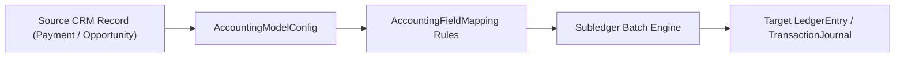

## Architectural Overview

The `AccountingFieldMapping` metadata type represents a custom field mapping between source operational objects (such as Opportunities, Payments, Refunds, or Order Summaries) and target accounting subledger records (`TransactionJournal` or `LedgerEntry`). In industries using Salesforce Accounting Subledger—including Nonprofit Cloud, Education Cloud, and Revenue Lifecycle Management—finance teams require operational attributes like department codes, fund allocations, and cost centers to flow automatically into generated ledger entries.

From an architectural perspective, `AccountingFieldMapping` eliminates custom Apex triggers that copy fields onto subledger records after batch generation. By defining these mappings declaratively in SFDX source control, architects ensure that when the Accounting Subledger nightly job runs, custom dimensions are stamped atomically during ledger creation.



## Directory and File Conventions

In SFDX source format (`apiVersion` 68.0), `AccountingFieldMapping` components are stored in the `accountingFieldMappings` directory.

| Property | Value |
| :--- | :--- |
| **Metadata Type Name** | `AccountingFieldMapping` |
| **SFDX Folder** | `force-app/main/default/accountingFieldMappings/` |
| **File Suffix** | `.accountingFieldMapping-meta.xml` |
| **Wildcard Support (`*`)** | Supported in `package.xml` |

## Key Metadata Fields

The `AccountingFieldMapping` XML schema exposes the following core elements:

| Field Name | Field Type | Required | Architectural Description |
| :--- | :--- | :--- | :--- |
| `accountingModelConfig` | `string` | Yes | DeveloperName of the parent `AccountingModelConfig` that owns this mapping. |
| `isForAllocationType` | `boolean` | No | Indicates whether the mapping applies to allocation-level records (`true`) or header transaction records (`false`). |
| `isForPaymentType` | `boolean` | No | Indicates whether the source field originates from a payment transaction record (`true`). |
| `isForTransactionType` | `boolean` | No | Indicates whether the source field originates from a primary revenue or commitment transaction (`true`). |
| `masterLabel` | `string` | Yes | Human-readable label for the field mapping in Setup. |
| `mappingBehavior` | `MappingBehaviorType` | Yes | Specifies how values transfer (for example, `PointToPoint`). |
| `sourceField` | `string` | Yes | API name of the source `CustomField` or standard field on the operational object. |
| `targetField` | `string` | Yes | API name of the target custom field on the subledger or journal entry object. |
| `isProtected` | `boolean` | No | Marks whether the component is protected inside a Second-Generation Managed Package (2GP). |

> [!NOTE]
> The `sourceField` and `targetField` values must reference existing fields in the target org. If you map a picklist to a text field, verify that target text lengths accommodate the longest API value of the source picklist.

## Declarative XML and Package Manifest Examples

Below is a production-ready `AccountingFieldMapping` source file that maps a custom `Cost_Center_Code__c` field from a source payment record onto the generated subledger entry:

```xml title="force-app/main/default/accountingFieldMappings/Payment_Cost_Center_Map.accountingFieldMapping-meta.xml"
<?xml version="1.0" encoding="UTF-8"?>
<AccountingFieldMapping xmlns="http://soap.sforce.com/2006/04/metadata">
    <accountingModelConfig>Enterprise_Accrual_Model</accountingModelConfig>
    <isForAllocationType>false</isForAllocationType>
    <isForPaymentType>true</isForPaymentType>
    <isForTransactionType>false</isForTransactionType>
    <mappingBehavior>PointToPoint</mappingBehavior>
    <masterLabel>Payment Cost Center Mapping</masterLabel>
    <sourceField>Cost_Center_Code__c</sourceField>
    <targetField>Ledger_Cost_Center__c</targetField>
</AccountingFieldMapping>
```

### Package Manifest (`package.xml`)

Include both the custom fields and the `AccountingFieldMapping` metadata type when promoting subledger mappings through your CI/CD pipeline:

```xml title="manifest/package.xml"
<?xml version="1.0" encoding="UTF-8"?>
<Package xmlns="http://soap.sforce.com/2006/04/metadata">
    <types>
        <members>Payment_Cost_Center_Map</members>
        <name>AccountingFieldMapping</name>
    </types>
    <types>
        <members>Enterprise_Accrual_Model</members>
        <name>AccountingModelConfig</name>
    </types>
    <version>68.0</version>
</Package>
```

## SOQL Queries and CLI Automation

You can inspect active field mappings via SOQL or retrieve and deploy them using Salesforce CLI (`sf`).

```soql
SELECT Id, DeveloperName, MasterLabel, SourceField, TargetField,
       MappingBehavior, IsForPaymentType, IsForAllocationType
FROM AccountingFieldMapping
ORDER BY DeveloperName ASC
```

```bash
# Retrieve all AccountingFieldMapping components from the target org
sf project retrieve start --metadata "AccountingFieldMapping:*"

# Deploy a specific field mapping definition
sf project deploy start --metadata AccountingFieldMapping:Payment_Cost_Center_Map
```

## Architect Best Practices and Gotchas

- **Immutable Historical Ledger Entries:** Modifying or adding an `AccountingFieldMapping` only affects **newly generated** subledger records. Existing `LedgerEntry` or `TransactionJournal` records are financially immutable and will not be retroactively updated.
- **Dependency Ordering:** Always deploy the target [CustomField](/docs/metadata/custom-field-metadata-type/) and parent `AccountingModelConfig` in the same transaction or prior to deploying `AccountingFieldMapping`, otherwise the deployment fails with an unresolved reference error.
- **Integration User FLS:** The automated user running the Accounting Subledger batch job must have Read access to `sourceField` and Edit access to `targetField` via a [PermissionSet](/docs/metadata/permission-set-metadata-type/), or mapped fields will silently evaluate to `null`.

> [!WARNING]
> Deleting a custom field referenced by an active `AccountingFieldMapping` is blocked by the platform. Remove or repoint the `AccountingFieldMapping` metadata before executing destructive changes on the underlying custom field.
