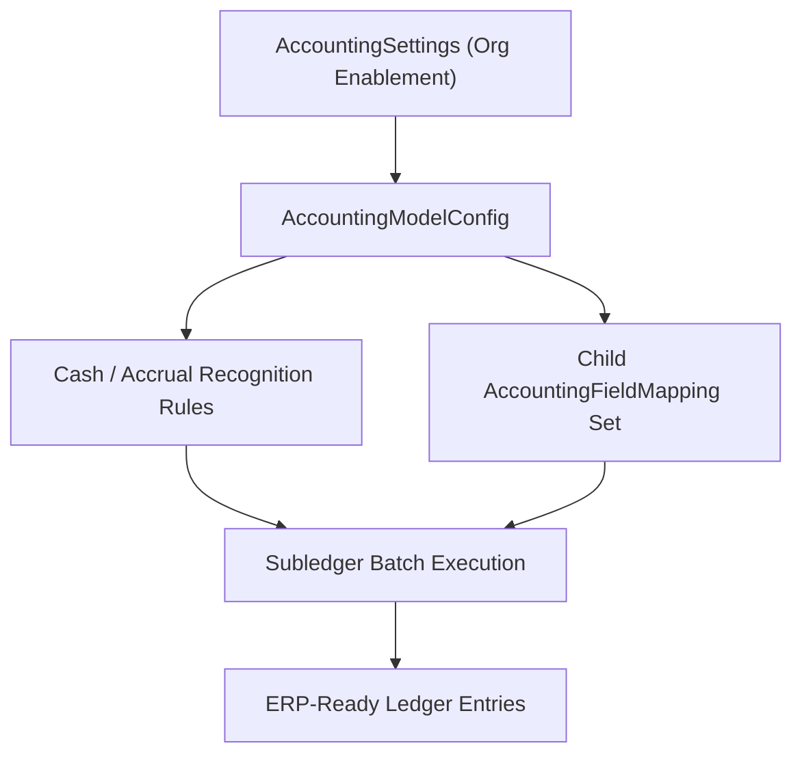

## Architectural Overview

The `AccountingModelConfig` metadata type defines the foundational rules for a Salesforce Accounting Subledger configuration. When enterprises bridge operational CRM workflows (such as donations, tuition billing, or order lifecycle management) with external Enterprise Resource Planning (ERP) general ledgers, `AccountingModelConfig` governs how and when Salesforce translates operational records into double-entry or single-entry accounting artifacts.

Architects use `AccountingModelConfig` to version-control critical financial boundaries: the earliest transaction date eligible for ledger generation, expected payment write-off states, cash versus accrual recognition behavior, and scheduled batch processing toggles.



## Directory and File Conventions

In SFDX source format, `AccountingModelConfig` files reside inside the `accountingModelConfigs` folder.

| Property | Value |
| :--- | :--- |
| **Metadata Type Name** | `AccountingModelConfig` |
| **SFDX Folder** | `force-app/main/default/accountingModelConfigs/` |
| **File Suffix** | `.accountingModelConfig-meta.xml` |
| **Wildcard Support (`*`)** | Supported in `package.xml` |

## Key Metadata Fields

The following XML elements control `AccountingModelConfig` behavior in API version `68.0`:

| Field Name | Field Type | Required | Architectural Description |
| :--- | :--- | :--- | :--- |
| `masterLabel` | `string` | Yes | Display name of the accounting model configuration in Setup. |
| `isActive` | `boolean` | No | Controls whether the subledger engine actively processes records using this model. |
| `runJobAutomatically` | `boolean` | No | Determines whether the nightly scheduled subledger batch job executes automatically for this model. |
| `earliestStartDate` | `date` | No | Cutoff date (`YYYY-MM-DD`); transactions dated prior to this date are ignored by the subledger generator. |
| `expectedPayDateField` | `string` | No | API name of the date field used to determine expected revenue or payment timing. |
| `writeOffStage` | `string` | No | Stage value that triggers write-off reversal entries in accrual accounting models. |
| `paidStageList` | `string` | No | Comma-separated list of stage or status values recognized as committed/paid. |
| `financeBookName` | `string` | No | Associates generated subledger entries with a named finance book or fund ledger. |

> [!TIP]
> Always set `earliestStartDate` to your go-live cutover date when migrating from a legacy subledger. Omitting a cutoff date can cause the initial batch run to generate millions of historical ledger entries for legacy records already reconciled in your ERP.

## Declarative XML and Package Manifest Examples

The following example defines an accrual-based accounting model configuration with an explicit go-live cutoff date and automated job execution disabled for initial UAT validation:

```xml title="force-app/main/default/accountingModelConfigs/Enterprise_Accrual_Model.accountingModelConfig-meta.xml"
<?xml version="1.0" encoding="UTF-8"?>
<AccountingModelConfig xmlns="http://soap.sforce.com/2006/04/metadata">
    <earliestStartDate>2026-01-01</earliestStartDate>
    <expectedPayDateField>CloseDate</expectedPayDateField>
    <financeBookName>Corporate_General_Ledger</financeBookName>
    <isActive>true</isActive>
    <masterLabel>Enterprise Accrual Model</masterLabel>
    <paidStageList>Closed Won,Committed</paidStageList>
    <runJobAutomatically>false</runJobAutomatically>
    <writeOffStage>Closed Lost</writeOffStage>
</AccountingModelConfig>
```

### Package Manifest (`package.xml`)

```xml title="manifest/package.xml"
<?xml version="1.0" encoding="UTF-8"?>
<Package xmlns="http://soap.sforce.com/2006/04/metadata">
    <types>
        <members>Enterprise_Accrual_Model</members>
        <name>AccountingModelConfig</name>
    </types>
    <version>68.0</version>
</Package>
```

## SOQL Queries and CLI Automation

Inspect configured accounting models using SOQL or manage them via Salesforce CLI:

```soql
SELECT Id, DeveloperName, MasterLabel, IsActive,
       EarliestStartDate, RunJobAutomatically, FinanceBookName
FROM AccountingModelConfig
ORDER BY IsActive DESC, DeveloperName ASC
```

```bash
# Retrieve all AccountingModelConfig definitions
sf project retrieve start --metadata "AccountingModelConfig:*"

# Deploy the Enterprise_Accrual_Model configuration
sf project deploy start --metadata AccountingModelConfig:Enterprise_Accrual_Model
```

## Architect Best Practices and Gotchas

- **Sandbox Refresh Safety:** Keep `runJobAutomatically` set to `false` in base sandbox branches or use environment-specific replacements so freshly refreshed Full Sandboxes do not immediately burn asynchronous Apex batch limits generating subledger rows.
- **Stage Picklist Alignment:** Values specified in `paidStageList` and `writeOffStage` must exactly match the API names of picklist values on your target transaction object. Mismatched stage names silently prevent ledger entry generation.
- **Prerequisite Settings:** The target org must have Accounting Subledger enabled via `AccountingSettings` and appropriate PSL (Permission Set License) entitlements before deploying `AccountingModelConfig`.

> [!WARNING]
> Once an `AccountingModelConfig` has generated production ledger entries, changing structural recognition rules or moving `earliestStartDate` forward can orphan open accrual balances. Coordinate any model changes with your finance controller during a closed accounting period.
