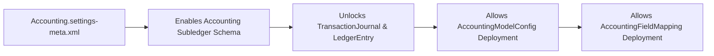

## Architectural Overview

The `AccountingSettings` metadata type manages org-wide preferences and feature switches for Salesforce Accounting Subledger. Before an architect can deploy `AccountingModelConfig` or `AccountingFieldMapping` components—or build Record-Triggered Flows that interact with `TransactionJournal` and `LedgerEntry` objects—the target environment must have `AccountingSettings` enabled.

In scratch org definitions (`project-scratch-def.json`) and CI/CD pipelines, `AccountingSettings` serves as the foundational dependency that unlocks subledger schema objects in the org database.



## Directory and File Conventions

Like all `*Settings` metadata types in Salesforce DX, `AccountingSettings` uses the `Settings` metadata type name in `package.xml` with member name `Accounting`.

| Property | Value |
| :--- | :--- |
| **Metadata Type Name** | `Settings` (member: `Accounting`) / `AccountingSettings` |
| **SFDX Folder** | `force-app/main/default/settings/` |
| **File Name** | `Accounting.settings-meta.xml` |
| **Scratch Org Setting Key** | `accountingSettings` |

## Key Metadata Fields

The `AccountingSettings` XML payload contains the following top-level configuration flags in API version `68.0`:

| Field Name | Field Type | Required | Architectural Description |
| :--- | :--- | :--- | :--- |
| `enableAccountingSubledger` | `boolean` | No | Master toggle (`true`/`false`) that enables Accounting Subledger features and standard objects in the org. |
| `enableAccountingSubledgerGrowth` | `boolean` | No | Enables Accounting Subledger Growth edition capabilities, including multi-model support and advanced custom object mapping. |
| `enableShadowTransactionJournal` | `boolean` | No | Enables shadow or staging transaction journal generation for validation prior to final ledger posting. |

> [!NOTE]
> Enabling `enableAccountingSubledger` or `enableAccountingSubledgerGrowth` requires the corresponding Accounting Subledger add-on license in the target production org, sandbox, or scratch org definition.

## Declarative XML and Package Manifest Examples

Below is the declarative `Accounting.settings-meta.xml` file used to enable Accounting Subledger in an SFDX repository:

```xml title="force-app/main/default/settings/Accounting.settings-meta.xml"
<?xml version="1.0" encoding="UTF-8"?>
<AccountingSettings xmlns="http://soap.sforce.com/2006/04/metadata">
    <enableAccountingSubledger>true</enableAccountingSubledger>
    <enableAccountingSubledgerGrowth>true</enableAccountingSubledgerGrowth>
</AccountingSettings>
```

### Scratch Org Definition (`config/project-scratch-def.json`)

When spinning up scratch orgs for automated testing, include `accountingSettings` under the `settings` node:

```json title="config/project-scratch-def.json"
{
  "orgName": "Subledger Architecture Scratch Org",
  "edition": "Enterprise",
  "features": ["AccountingSubledgerGrowth"],
  "settings": {
    "accountingSettings": {
      "enableAccountingSubledger": true,
      "enableAccountingSubledgerGrowth": true
    }
  }
}
```

### Package Manifest (`package.xml`)

```xml title="manifest/package.xml"
<?xml version="1.0" encoding="UTF-8"?>
<Package xmlns="http://soap.sforce.com/2006/04/metadata">
    <types>
        <members>Accounting</members>
        <name>Settings</name>
    </types>
    <version>68.0</version>
</Package>
```

## CLI Retrieval and Deployment Commands

Because `AccountingSettings` is a pure declarative settings component rather than a SOQL-queryable table, use the Salesforce CLI (`sf`) to retrieve and deploy it:

```bash
# Retrieve AccountingSettings from an authenticated org
sf project retrieve start --metadata Settings:Accounting

# Deploy AccountingSettings before deploying dependent subledger metadata
sf project deploy start --metadata Settings:Accounting
```

## Architect Best Practices and Gotchas

- **Staged CI/CD Deployment:** If your repository contains Apex classes, [Flows](/docs/metadata/flow-metadata-type/), or custom fields referencing `TransactionJournal` or `LedgerEntry`, deploy `Settings:Accounting` first (or ensure your scratch org definition enables it) so the platform provisions the standard subledger objects before compiling dependent metadata.
- **License Mismatch Errors:** Deploying `<enableAccountingSubledgerGrowth>true</enableAccountingSubledgerGrowth>` to a sandbox that only has the Starter license will fail with a `Required feature is not licensed` deployment error.

> [!TIP]
> After deploying `Settings:Accounting` for the first time, run `sf sobject describe --sobject TransactionJournal` to confirm that the subledger objects have been provisioned in your org schema.
