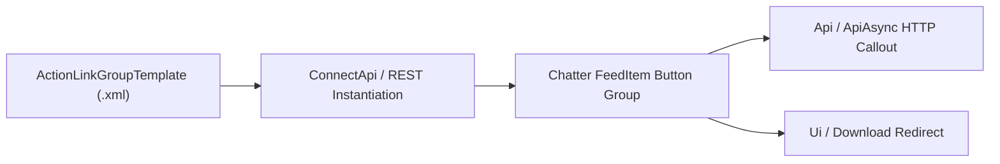

## Architectural Overview

The `ActionLinkGroupTemplate` metadata type defines reusable templates for **Chatter Action Links**—interactive buttons embedded directly inside Chatter feed posts or Experience Cloud streams. Using `ActionLinkGroupTemplate`, architects can allow users to approve an expense in an external ERP (`Api` / `ApiAsync`), download an external PDF (`Download`), or launch a deep link (`Ui`) with a single click from the feed, complete with dynamic merge variables such as `{!userId}` and `{!oAuthToken}`.

By defining the endpoint URL structure, HTTP method, headers, and execution limits (`executionsAllowed`) inside `ActionLinkGroupTemplate` metadata, developers can instantiate action link groups at runtime via `ConnectApi.ActionLinks.createActionLinkGroupDefinition()` without hardcoding endpoint shapes in Apex.



## Directory and File Conventions

In SFDX source format (`apiVersion` 68.0), `ActionLinkGroupTemplate` components are stored in the `actionLinkGroupTemplates` directory.

| Property | Value |
| :--- | :--- |
| **Metadata Type Name** | `ActionLinkGroupTemplate` |
| **SFDX Folder** | `force-app/main/default/actionLinkGroupTemplates/` |
| **File Suffix** | `.actionLinkGroupTemplate-meta.xml` |
| **Wildcard Support (`*`)** | Supported in `package.xml` |

## Key Metadata Fields

The `ActionLinkGroupTemplate` XML schema and its nested `<actionLinkTemplates>` elements include:

| Field Name | Field Type | Required | Architectural Description |
| :--- | :--- | :--- | :--- |
| `name` | `string` | Yes | Display name of the Action Link Group Template in Setup. |
| `category` | `PlatformActionGroupCategory` | Yes | Placement on the feed item: `Primary` (inside the feed body) or `Overflow` (inside the drop-down menu). |
| `executionsAllowed` | `ActionLinkExecutionsAllowed` | Yes | Controls whether links can be clicked `Once`, `OncePerUser`, or `Unlimited` times. |
| `hoursUntilExpiration` | `int` | No | Number of hours after instantiation before the action link group expires. |
| `isPublished` | `boolean` | Yes | Must be `true` for the template to be instantiated via Connect REST API or Apex. |
| `actionLinkTemplates` | `ActionLinkTemplate[]` | No | Child array defining individual buttons (`actionUrl`, `linkType`, `method`, `labelKey`, `userVisibility`). |

> [!NOTE]
> Mutually exclusive action links inside the same group are automatically disabled once a user clicks one of the options when `executionsAllowed` is set to `Once` or `OncePerUser`.

## Declarative XML and Package Manifest Examples

The following example defines a published `ActionLinkGroupTemplate` with two mutually exclusive `Api` buttons (`Approve` and `Reject`) that post back to an external webhook:

```xml title="force-app/main/default/actionLinkGroupTemplates/ERP_PO_Approval.actionLinkGroupTemplate-meta.xml"
<?xml version="1.0" encoding="UTF-8"?>
<ActionLinkGroupTemplate xmlns="http://soap.sforce.com/2006/04/metadata">
    <actionLinkTemplates>
        <actionUrl>https://api.enterprise.example.com/v1/po/{!Bindings.poId}/approve</actionUrl>
        <headers>Content-Type: application/json</headers>
        <isConfirmationRequired>true</isConfirmationRequired>
        <isGroupDefault>true</isGroupDefault>
        <labelKey>Approve</labelKey>
        <linkType>Api</linkType>
        <method>HttpPost</method>
        <position>0</position>
        <requestBody>{&quot;approverId&quot;: &quot;{!userId}&quot;, &quot;action&quot;: &quot;APPROVE&quot;}</requestBody>
        <userVisibility>Everyone</userVisibility>
    </actionLinkTemplates>
    <actionLinkTemplates>
        <actionUrl>https://api.enterprise.example.com/v1/po/{!Bindings.poId}/reject</actionUrl>
        <headers>Content-Type: application/json</headers>
        <isConfirmationRequired>true</isConfirmationRequired>
        <isGroupDefault>false</isGroupDefault>
        <labelKey>Reject</labelKey>
        <linkType>Api</linkType>
        <method>HttpPost</method>
        <position>1</position>
        <requestBody>{&quot;approverId&quot;: &quot;{!userId}&quot;, &quot;action&quot;: &quot;REJECT&quot;}</requestBody>
        <userVisibility>Everyone</userVisibility>
    </actionLinkTemplates>
    <category>Primary</category>
    <executionsAllowed>Once</executionsAllowed>
    <hoursUntilExpiration>72</hoursUntilExpiration>
    <isPublished>true</isPublished>
    <name>ERP Purchase Order Approval</name>
</ActionLinkGroupTemplate>
```

### Package Manifest (`package.xml`)

```xml title="manifest/package.xml"
<?xml version="1.0" encoding="UTF-8"?>
<Package xmlns="http://soap.sforce.com/2006/04/metadata">
    <types>
        <members>ERP_PO_Approval</members>
        <name>ActionLinkGroupTemplate</name>
    </types>
    <version>68.0</version>
</Package>
```

## SOQL Queries and CLI Automation

Inspect `ActionLinkGroupTemplate` records via SOQL or deploy them using the Salesforce CLI:

```soql
SELECT Id, DeveloperName, MasterLabel, Category,
       ExecutionsAllowed, HoursUntilExpiration, IsPublished
FROM ActionLinkGroupTemplate
ORDER BY DeveloperName ASC
```

```bash
# Retrieve all ActionLinkGroupTemplate components
sf project retrieve start --metadata "ActionLinkGroupTemplate:*"

# Deploy the ERP_PO_Approval template
sf project deploy start --metadata ActionLinkGroupTemplate:ERP_PO_Approval
```

## Architect Best Practices and Gotchas

- **Immutability After Publishing:** Once `isPublished` is `true`, Salesforce locks the structural properties (`linkType`, number of `<actionLinkTemplates>`, and `executionsAllowed`). If you need to add a third button in a future sprint, create a v2 `ActionLinkGroupTemplate` or delete and recreate the template in non-packaged orgs.
- **Environment-Specific Endpoints:** Avoid hardcoding sandbox vs. production hostnames in `<actionUrl>`; instead, use a `{!Bindings.baseUrl}` binding variable populated dynamically at runtime via [ApexClass](/docs/metadata/apex-class-metadata-type/) `ConnectApi` calls.

> [!WARNING]
> If `<requestBody>` or `<headers>` includes the `{!oAuthToken}` context variable and `actionUrl` points to an external third-party domain, the user's Salesforce session token is transmitted in that HTTP request. Only use `{!oAuthToken}` when calling back into Salesforce REST APIs on the same org domain.
