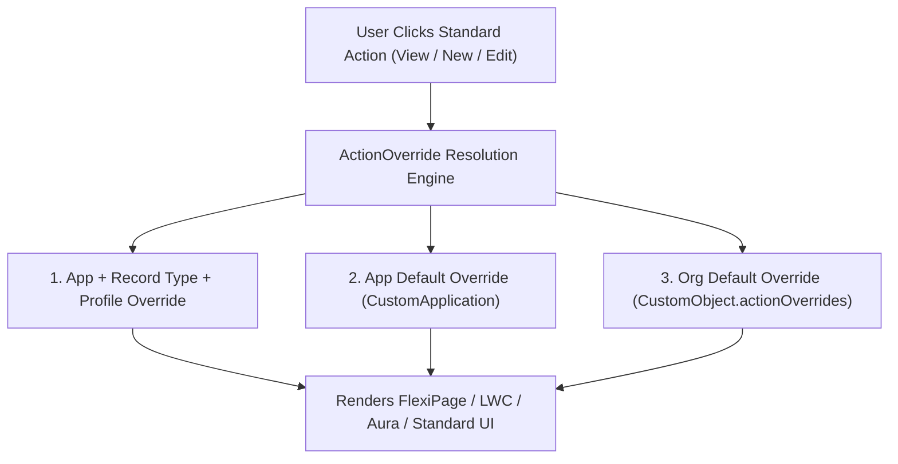

## Architectural Overview

The `ActionOverride` metadata type configures overrides for standard Salesforce object buttons and navigation entry points (`Accept`, `Clone`, `Delete`, `Edit`, `List`, `New`, `Tab`, and `View`). Rather than living in its own standalone folder, `ActionOverride` is an embedded metadata sub-type declared inside `<actionOverrides>` tags on [CustomObject](/docs/metadata/custom-object-metadata-type/) (`.object-meta.xml`) or `CustomApplication` (`.app-meta.xml`) files.

Understanding `ActionOverride` is essential for Salesforce Architects because activating a Lightning Record Page in Lightning App Builder at the **Org Default** or **App Default** level modifies the target `.object-meta.xml` or `.app-meta.xml` file by inserting `<actionOverrides>` blocks. Failing to commit these `<actionOverrides>` blocks is the #1 reason newly deployed [FlexiPage](/docs/metadata/flexipage-metadata-type/) record pages do not appear for end users in production.



## Directory and File Conventions

`ActionOverride` elements are embedded directly inside the parent object or application metadata file.

| Property | Value |
| :--- | :--- |
| **Metadata Sub-Type Name** | `ActionOverride` |
| **Parent Container** | `CustomObject` (`objects/<Object>/<Object>.object-meta.xml`) or `CustomApplication` (`applications/<App>.app-meta.xml`) |
| **XML Element Tag** | `<actionOverrides>` |
| **Supported Form Factors** | `Large` (Desktop), `Small` (Mobile), `null` (Classic / All) |

## Key Metadata Fields

Each `<actionOverrides>` block supports the following XML properties in API version `68.0`:

| Field Name | Field Type | Required | Architectural Description |
| :--- | :--- | :--- | :--- |
| `actionName` | `string` | Yes | Standard action to override: `Accept`, `Clone`, `Delete`, `Edit`, `List`, `New`, `Tab`, or `View`. |
| `type` | `ActionOverrideType` | Yes | Override target type: `Default`, `Flexipage`, `LightningComponent`, `Scontrol`, `Standard`, or `Visualforce`. |
| `content` | `string` | Conditional | API name of the target `FlexiPage`, Aura/LWC bundle, or `ApexPage` (required when `type` is not `Default` or `Standard`). |
| `formFactor` | `FormFactor` | No | Device form factor (`Large` for desktop, `Small` for phone). Required when `type` is `Flexipage` or `LightningComponent`. |
| `skipRecordTypeSelect` | `boolean` | No | When overriding `New`, bypasses the standard Record Type selection modal and passes the default Record Type ID (`true`). |
| `comment` | `string` | No | Audit comment describing why or how the override was configured. |

> [!TIP]
> When overriding `View` with a `Flexipage`, always define **two** `<actionOverrides>` blocks (or explicitly decide on mobile behavior): one for `<formFactor>Large</formFactor>` and one for `<formFactor>Small</formFactor>`, so mobile users are not stranded on the legacy standard layout.

## Declarative XML and Package Manifest Examples

The following `Invoice__c.object-meta.xml` excerpt configures Org Default `View` overrides for both Desktop (`Large`) and Mobile (`Small`) using a `FlexiPage`, plus a custom `New` override using a Lightning component:

```xml title="force-app/main/default/objects/Invoice__c/Invoice__c.object-meta.xml"
<?xml version="1.0" encoding="UTF-8"?>
<CustomObject xmlns="http://soap.sforce.com/2006/04/metadata">
    <actionOverrides>
        <actionName>View</actionName>
        <comment>Org default desktop Lightning Record Page</comment>
        <content>Invoice_Record_Page</content>
        <formFactor>Large</formFactor>
        <skipRecordTypeSelect>false</skipRecordTypeSelect>
        <type>Flexipage</type>
    </actionOverrides>
    <actionOverrides>
        <actionName>View</actionName>
        <comment>Org default mobile Lightning Record Page</comment>
        <content>Invoice_Record_Page</content>
        <formFactor>Small</formFactor>
        <skipRecordTypeSelect>false</skipRecordTypeSelect>
        <type>Flexipage</type>
    </actionOverrides>
    <actionOverrides>
        <actionName>New</actionName>
        <comment>Custom guided wizard for new invoices</comment>
        <content>c:invoiceCreationWizard</content>
        <formFactor>Large</formFactor>
        <skipRecordTypeSelect>true</skipRecordTypeSelect>
        <type>LightningComponent</type>
    </actionOverrides>
    <deploymentStatus>Deployed</deploymentStatus>
    <label>Invoice</label>
    <nameField>
        <displayFormat>INV-{00000}</displayFormat>
        <label>Invoice Number</label>
        <type>AutoNumber</type>
    </nameField>
    <pluralLabel>Invoices</pluralLabel>
    <sharingModel>Private</sharingModel>
</CustomObject>
```

### Package Manifest (`package.xml`)

Because `ActionOverride` is embedded inside `CustomObject`, retrieve and deploy the parent `CustomObject` alongside its target `FlexiPage`:

```xml title="manifest/package.xml"
<?xml version="1.0" encoding="UTF-8"?>
<Package xmlns="http://soap.sforce.com/2006/04/metadata">
    <types>
        <members>Invoice__c</members>
        <name>CustomObject</name>
    </types>
    <types>
        <members>Invoice_Record_Page</members>
        <name>FlexiPage</name>
    </types>
    <version>68.0</version>
</Package>
```

## CLI Retrieval and Deployment Commands

Use Salesforce CLI to deploy the parent object file containing your `<actionOverrides>`:

```bash
# Retrieve the CustomObject root file and target FlexiPage together
sf project retrieve start --metadata CustomObject:Invoice__c FlexiPage:Invoice_Record_Page

# Deploy only the object-meta.xml file to activate the ActionOverride
sf project deploy start --source-dir force-app/main/default/objects/Invoice__c/Invoice__c.object-meta.xml
```

## Architect Best Practices and Gotchas

- **Missing `<actionOverrides>` in Git:** When developers build a new [FlexiPage](/docs/metadata/flexipage-metadata-type/) and click **Activate -> Assign as Org Default** in Setup, Salesforce mutates `<Object>.object-meta.xml`. Always retrieve and commit `.object-meta.xml` alongside `.flexipage-meta.xml`.
- **Infinite Redirect Loops in `Edit` / `New` Overrides:** When overriding `New` or `Edit` with a Lightning component, using `lightning/navigation` to navigate back to `standard__objectPage` (`actionName: 'new'`) triggers the override again. Use the `nooverride=1` state parameter when falling back to standard modals.

> [!WARNING]
> To remove an existing `ActionOverride` in a target org via deployment, do not simply delete the `<actionOverrides>` block from `.object-meta.xml`—explicitly set `<type>Default</type>` (and remove `<content>` and `<formFactor>`) so the target org resets the button back to standard behavior.
