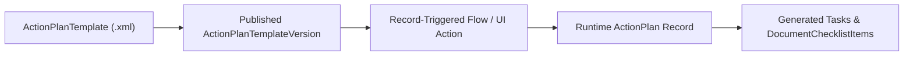

## Architectural Overview

The `ActionPlanTemplate` metadata type represents a reusable, auditable checklist of tasks and document checklist items in **Salesforce Action Plans**. Originally introduced for Financial Services Cloud and now widely used across Health Cloud, Public Sector Solutions, Consumer Goods Cloud, and core Enterprise add-ons, Action Plans enforce repeatable business processes such as KYC client onboarding, loan underwriting, store audits, and care plan execution.

Architecturally, `ActionPlanTemplate` packages both the template header and its child `ActionPlanTemplateItem` and `ActionPlanTemplateItemValue` entries into a single portable XML file, allowing release teams to promote compliance-approved task sequences from sandbox to production without manual re-entry.



## Directory and File Conventions

In SFDX source format (`apiVersion` 68.0), `ActionPlanTemplate` components reside in the `actionPlanTemplates` folder.

| Property | Value |
| :--- | :--- |
| **Metadata Type Name** | `ActionPlanTemplate` |
| **SFDX Folder** | `force-app/main/default/actionPlanTemplates/` |
| **File Suffix** | `.actionPlanTemplate-meta.xml` |
| **Wildcard Support (`*`)** | Supported in `package.xml` |

## Key Metadata Fields

The `ActionPlanTemplate` XML schema exposes the following core fields:

| Field Name | Field Type | Required | Architectural Description |
| :--- | :--- | :--- | :--- |
| `name` | `string` | Yes | Display name of the Action Plan Template shown to users and flows. |
| `uniqueName` | `string` | Yes | DeveloperName / API identifier of the template. |
| `targetEntityType` | `string` | Yes | API name of the object that Action Plans created from this template attach to (`Account`, `Opportunity`, `Case`, or custom object `__c`). |
| `actionPlanType` | `ActionPlanType` | Yes | Classification of the template (`Industries`, `Retail`, etc.). |
| `status` | `ActionPlanTemplateStatus` | Yes | Lifecycle state of the template version (`Draft`, `Published`, `Archived`). |
| `isAdHocItemCreationEnabled` | `boolean` | Yes | Controls whether users can add ad-hoc tasks to runtime Action Plans generated from this template. |
| `actionPlanTemplateItems` | `ActionPlanTemplateItem[]` | No | Child collection of tasks or document checklist items, including `itemEntityType`, `isRequired`, `displayOrder`, and field value bindings. |

> [!TIP]
> Always reference `ActionPlanTemplate` by `UniqueName` (rather than hardcoded 18-character `Id` values) inside your [Flow](/docs/metadata/flow-metadata-type/) `Get Records` elements so your automation survives sandbox refreshes and org-to-org deployments.

## Declarative XML and Package Manifest Examples

Below is a published `ActionPlanTemplate` for Commercial Client Onboarding on `Account` with a required KYC verification task due 3 days after plan start:

```xml title="force-app/main/default/actionPlanTemplates/Commercial_KYC_Onboarding.actionPlanTemplate-meta.xml"
<?xml version="1.0" encoding="UTF-8"?>
<ActionPlanTemplate xmlns="http://soap.sforce.com/2006/04/metadata">
    <actionPlanTemplateItems>
        <actionPlanTemplateItemValue>
            <itemEntityType>Task</itemEntityType>
            <name>Subject</name>
            <valueLiteral>Complete Beneficial Ownership KYC Review</valueLiteral>
        </actionPlanTemplateItemValue>
        <actionPlanTemplateItemValue>
            <itemEntityType>Task</itemEntityType>
            <name>Priority</name>
            <valueLiteral>High</valueLiteral>
        </actionPlanTemplateItemValue>
        <actionPlanTemplateItemValue>
            <itemEntityType>Task</itemEntityType>
            <name>ActivityDate</name>
            <valueFormula>StartDate + 3</valueFormula>
        </actionPlanTemplateItemValue>
        <displayOrder>1</displayOrder>
        <isRequired>true</isRequired>
        <itemEntityType>Task</itemEntityType>
        <name>Complete Beneficial Ownership KYC Review</name>
        <uniqueName>Complete_Beneficial_Ownership_KYC_Review</uniqueName>
    </actionPlanTemplateItems>
    <actionPlanType>Industries</actionPlanType>
    <description>Standardized KYC checklist for commercial banking accounts.</description>
    <isAdHocItemCreationEnabled>true</isAdHocItemCreationEnabled>
    <name>Commercial KYC Onboarding</name>
    <status>Published</status>
    <targetEntityType>Account</targetEntityType>
    <uniqueName>Commercial_KYC_Onboarding</uniqueName>
</ActionPlanTemplate>
```

### Package Manifest (`package.xml`)

```xml title="manifest/package.xml"
<?xml version="1.0" encoding="UTF-8"?>
<Package xmlns="http://soap.sforce.com/2006/04/metadata">
    <types>
        <members>Commercial_KYC_Onboarding</members>
        <name>ActionPlanTemplate</name>
    </types>
    <version>68.0</version>
</Package>
```

## SOQL Queries and CLI Automation

Query published `ActionPlanTemplate` versions via SOQL or deploy using Salesforce CLI:

```soql
SELECT Id, UniqueName, Name, TargetEntityType, Status,
       ActionPlanType, IsAdHocItemCreationEnabled
FROM ActionPlanTemplate
WHERE Status = 'Published'
ORDER BY Name ASC
```

```bash
# Retrieve all ActionPlanTemplate definitions
sf project retrieve start --metadata "ActionPlanTemplate:*"

# Deploy the Commercial_KYC_Onboarding template
sf project deploy start --metadata ActionPlanTemplate:Commercial_KYC_Onboarding
```

## Architect Best Practices and Gotchas

- **Assigned-To User / Queue Resolution:** Avoid assigning template tasks to specific User IDs inside `<actionPlanTemplateItemValue>`, as User IDs differ across sandboxes and scratch orgs. Instead, assign tasks to the **Action Plan Creator**, **Record Owner**, or a named **Queue**.
- **Permission Set License Requirement:** The deploying integration user must have the **Action Plans** Permission Set License (`ActionPlansPsl`) and Read/Create/Edit access on `ActionPlanTemplate`, `ActionPlanTemplateVersion`, and `ActionPlanTemplateItem`.

> [!WARNING]
> Once an `ActionPlanTemplate` is deployed with `<status>Published</status>`, subsequent deployments that attempt to modify `<actionPlanTemplateItems>` on the same published template will fail because published templates are immutable.
