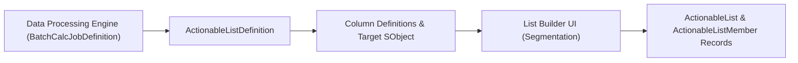

## Architectural Overview

The `ActionableListDefinition` metadata type is the structural blueprint for **Actionable List Management** across Salesforce Industry Clouds (Financial Services Cloud, Health Cloud, Automotive Cloud, and Manufacturing Cloud). Actionable Lists allow operations directors and marketing ops teams to segment millions of accounts, contacts, policies, or vehicles using Data Processing Engine (DPE) jobs and assign prioritized outreach queues to frontline relationship managers.

Architecturally, `ActionableListDefinition` bridges the gap between analytical calculation pipelines (`BatchCalcJobDefinition`) and operational CRM objects (`Account`, `Contact`, `Lead`, `Asset`), defining which columns are sortable, filterable, and visible in the List Builder UI.



## Directory and File Conventions

In SFDX source format (`apiVersion` 68.0), `ActionableListDefinition` files reside in the `actionableListDefinitions` folder.

| Property | Value |
| :--- | :--- |
| **Metadata Type Name** | `ActionableListDefinition` |
| **SFDX Folder** | `force-app/main/default/actionableListDefinitions/` |
| **File Suffix** | `.actionableListDefinition-meta.xml` |
| **Wildcard Support (`*`)** | Supported in `package.xml` |

## Key Metadata Fields

The `ActionableListDefinition` XML schema includes the following core properties:

| Field Name | Field Type | Required | Architectural Description |
| :--- | :--- | :--- | :--- |
| `masterLabel` | `string` | Yes | Display name of the Actionable List Definition in Setup and List Builder. |
| `batchCalcJobDefinition` | `string` | No | DeveloperName of the associated Data Processing Engine (DPE) definition that populates the staging dataset. |
| `objectName` | `string` | Yes | API name of the primary CRM object represented by list members (such as `Account`, `Contact`, or `Asset`). |
| `isActive` | `boolean` | No | Indicates whether list creators can actively build new Actionable Lists from this definition. |
| `datasetName` | `string` | No | API name of the CRM Analytics dataset generated by the DPE job and queried by List Builder. |
| `actionableListDatasetColumns` | `ActionableListDatasetColumn[]` | No | Collection of column mappings linking dataset fields to CRM fields and display preferences. |

> [!NOTE]
> The underlying `batchCalcJobDefinition` must be active and must have run at least once to materialize the target `datasetName` before users can preview records in List Builder.

## Declarative XML and Package Manifest Examples

The following example configures an `ActionableListDefinition` for wealth management client renewal outreach backed by a Data Processing Engine definition:

```xml title="force-app/main/default/actionableListDefinitions/Wealth_Client_Renewal_Def.actionableListDefinition-meta.xml"
<?xml version="1.0" encoding="UTF-8"?>
<ActionableListDefinition xmlns="http://soap.sforce.com/2006/04/metadata">
    <batchCalcJobDefinition>Wealth_AUM_Renewal_DPE</batchCalcJobDefinition>
    <datasetName>Wealth_Client_Renewal_Dataset</datasetName>
    <isActive>true</isActive>
    <masterLabel>Wealth Client Renewal Outreach</masterLabel>
    <objectName>Account</objectName>
</ActionableListDefinition>
```

### Package Manifest (`package.xml`)

```xml title="manifest/package.xml"
<?xml version="1.0" encoding="UTF-8"?>
<Package xmlns="http://soap.sforce.com/2006/04/metadata">
    <types>
        <members>Wealth_Client_Renewal_Def</members>
        <name>ActionableListDefinition</name>
    </types>
    <version>68.0</version>
</Package>
```

## SOQL Queries and CLI Automation

Inspect configured `ActionableListDefinition` metadata via SOQL or deploy using Salesforce CLI:

```soql
SELECT Id, DeveloperName, MasterLabel, ObjectName,
       DatasetName, IsActive
FROM ActionableListDefinition
ORDER BY IsActive DESC, MasterLabel ASC
```

```bash
# Retrieve all ActionableListDefinition components
sf project retrieve start --metadata "ActionableListDefinition:*"

# Deploy a specific ActionableListDefinition
sf project deploy start --metadata ActionableListDefinition:Wealth_Client_Renewal_Def
```

## Architect Best Practices and Gotchas

- **Permission Set Licenses (PSL):**Target orgs and deployment users must hold the **Actionable List Management** Permission Set License (`ActionableListManagementPsl`) and the **Data Processing Engine** permission set, or deployment will fail with an insufficient privileges or invalid type error.
- **Deployment Sequencing:** Always deploy the `BatchCalcJobDefinition` (Data Processing Engine) before or in the same package as `ActionableListDefinition`.

> [!WARNING]
> Deactivating an `ActionableListDefinition` prevents scheduled refreshes of existing `ActionableList` records linked to that definition. Coordinate deactivation windows with outreach campaign owners.
