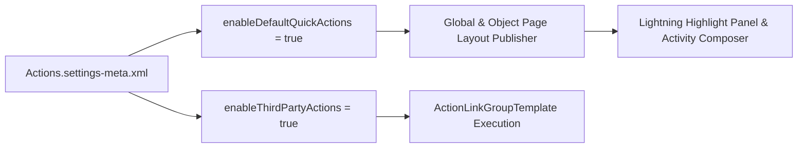

## Architectural Overview

The `ActionsSettings` metadata type manages org-wide settings for the Salesforce Action framework, including Chatter Publisher actions, default Quick Actions (`LogACall`, `NewTask`, `NewEvent`, `SendEmail`), and third-party Action Links.

In Lightning Experience and the Salesforce Mobile App, the highlight panel and activity composer rely on the interaction between `ActionsSettings`, Global Publisher Layouts, and object-specific [Layout](/docs/metadata/layout-metadata-type/) `<platformActionList>` blocks. Tracking `ActionsSettings` in version control ensures consistent action rendering across scratch orgs, sandboxes, and production.



## Directory and File Conventions

In SFDX source format (`apiVersion` 68.0), `ActionsSettings` lives in the `settings/` directory and is retrieved via `Settings:Actions`.

| Property | Value |
| :--- | :--- |
| **Metadata Type Name** | `Settings` (member: `Actions`) / `ActionsSettings` |
| **SFDX Folder** | `force-app/main/default/settings/` |
| **File Name** | `Actions.settings-meta.xml` |
| **Scratch Org Setting Key** | `actionsSettings` |

## Key Metadata Fields

The `ActionsSettings` XML schema exposes the following boolean flags:

| Field Name | Field Type | Required | Architectural Description |
| :--- | :--- | :--- | :--- |
| `enableDefaultQuickActions` | `boolean` | No | Enables (`true`) or disables (`false`) system-generated default quick actions across supported standard objects. |
| `enableThirdPartyActions` | `boolean` | No | Allows execution of third-party `ActionLinkGroupTemplate` actions in Chatter feeds and streams. |

> [!NOTE]
> Even when `enableDefaultQuickActions` is `true`, Dynamic Actions enabled on a [FlexiPage](/docs/metadata/flexipage-metadata-type/) highlight panel take precedence over page layout `<platformActionList>` assignments on desktop and mobile.

## Declarative XML and Package Manifest Examples

Below is the standard `Actions.settings-meta.xml` file:

```xml title="force-app/main/default/settings/Actions.settings-meta.xml"
<?xml version="1.0" encoding="UTF-8"?>
<ActionsSettings xmlns="http://soap.sforce.com/2006/04/metadata">
    <enableDefaultQuickActions>true</enableDefaultQuickActions>
    <enableThirdPartyActions>true</enableThirdPartyActions>
</ActionsSettings>
```

### Scratch Org Configuration (`config/project-scratch-def.json`)

```json title="config/project-scratch-def.json"
{
  "orgName": "Lightning Actions Scratch Org",
  "edition": "Enterprise",
  "settings": {
    "actionsSettings": {
      "enableDefaultQuickActions": true,
      "enableThirdPartyActions": true
    }
  }
}
```

### Package Manifest (`package.xml`)

```xml title="manifest/package.xml"
<?xml version="1.0" encoding="UTF-8"?>
<Package xmlns="http://soap.sforce.com/2006/04/metadata">
    <types>
        <members>Actions</members>
        <name>Settings</name>
    </types>
    <version>68.0</version>
</Package>
```

## CLI Retrieval and Deployment Commands

Retrieve and deploy `ActionsSettings` using Salesforce CLI:

```bash
# Retrieve Actions.settings-meta.xml from the org
sf project retrieve start --metadata Settings:Actions

# Deploy Actions.settings-meta.xml to the target org
sf project deploy start --metadata Settings:Actions
```

## Architect Best Practices and Gotchas

- **Migrate to Dynamic Actions on `FlexiPage`:** While `ActionsSettings` and [Layout](/docs/metadata/layout-metadata-type/) `<platformActionList>` govern legacy layout-driven buttons, modern Lightning architecture uses **Dynamic Actions** directly inside `FlexiPage` metadata so visibility rules can be evaluated per record field and permission without multiplying page layouts.
- **Email Deliverability Dependency:** The standard `SendEmail` quick action will remain hidden from users even when `enableDefaultQuickActions` is `true` if the target sandbox has **Email Deliverability** set to `No Access` or `System Email Only`.

> [!TIP]
> When troubleshooting missing Quick Actions in a recién refreshed sandbox, check Email Deliverability first, then verify `ActionsSettings` and Dynamic Actions visibility filters on the `FlexiPage`.
