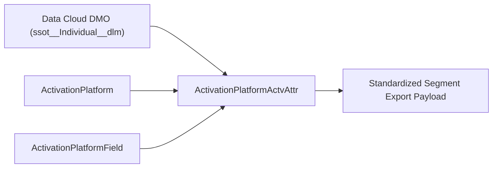

## Architectural Overview

The `ActivationPlatformActvAttr` (Activation Platform Activation Attribute) metadata type binds specific Data Cloud Data Model Object (DMO) fields to an external `ActivationPlatform`. When an enterprise or ISV partner designs a reusable activation target—such as an ad-network connector or cloud data warehouse feed—certain profile attributes (like `FirstName`, `LastName`, `Loyalty_Tier__c`, or `HasOptedOutSolicit`) must always be included and mapped to standardized destination field keys.

By declaring `ActivationPlatformActvAttr` records in SFDX source format, architects ensure that every activation created against that `ActivationPlatform` automatically inherits the required DMO-to-destination attribute mappings without manual field picking by marketing users.



## Directory and File Conventions

In SFDX source format (`apiVersion` 68.0), `ActivationPlatformActvAttr` components reside in the `activationPlatformActvAttrs` directory.

| Property | Value |
| :--- | :--- |
| **Metadata Type Name** | `ActivationPlatformActvAttr` |
| **SFDX Folder** | `force-app/main/default/activationPlatformActvAttrs/` |
| **File Suffix** | `.activationPlatformActvAttr-meta.xml` |
| **Wildcard Support (`*`)** | Supported in `package.xml` |

## Key Metadata Fields

The `ActivationPlatformActvAttr` XML schema exposes the following core fields:

| Field Name | Field Type | Required | Architectural Description |
| :--- | :--- | :--- | :--- |
| `masterLabel` | `string` | Yes | Human-readable label of the activation attribute mapping. |
| `activationPlatform` | `string` | Yes | DeveloperName of the parent `ActivationPlatform` component. |
| `activationPlatformField` | `string` | No | DeveloperName of the target `ActivationPlatformField` on the destination platform. |
| `entityName` | `string` | Yes | API name of the source Data Cloud Data Model Object (for example, `ssot__Individual__dlm`). |
| `fieldName` | `string` | Yes | API name of the source field on the DMO (for example, `ssot__FirstName__c`). |
| `destinationName` | `string` | No | Exported attribute key name in the generated JSON/CSV/Parquet payload. |
| `isRequired` | `boolean` | No | Enforces that the attribute cannot be removed by users configuring an activation (`true`/`false`). |
| `referenceAttrName` | `string` | No | Reference attribute path when traversing a related DMO relationship. |

> [!TIP]
> Mark privacy and consent flags (such as `HasOptedOutOfEmail` or `Global_Privacy_Control__c`) with `<isRequired>true</isRequired>` so marketing users cannot accidentally omit regulatory consent signals from downstream segment exports.

## Declarative XML and Package Manifest Examples

The following example maps the `ssot__FirstName__c` field from the Unified Individual DMO (`ssot__Individual__dlm`) to the `first_name` field on `Enterprise_DSP_Platform`:

```xml title="force-app/main/default/activationPlatformActvAttrs/DSP_Indiv_FirstName_Attr.activationPlatformActvAttr-meta.xml"
<?xml version="1.0" encoding="UTF-8"?>
<ActivationPlatformActvAttr xmlns="http://soap.sforce.com/2006/04/metadata">
    <activationPlatform>Enterprise_DSP_Platform</activationPlatform>
    <activationPlatformField>DSP_First_Name_Field</activationPlatformField>
    <destinationName>first_name</destinationName>
    <entityName>ssot__Individual__dlm</entityName>
    <fieldName>ssot__FirstName__c</fieldName>
    <isRequired>false</isRequired>
    <masterLabel>DSP Individual First Name Attribute</masterLabel>
</ActivationPlatformActvAttr>
```

### Package Manifest (`package.xml`)

```xml title="manifest/package.xml"
<?xml version="1.0" encoding="UTF-8"?>
<Package xmlns="http://soap.sforce.com/2006/04/metadata">
    <types>
        <members>Enterprise_DSP_Platform</members>
        <name>ActivationPlatform</name>
    </types>
    <types>
        <members>DSP_First_Name_Field</members>
        <name>ActivationPlatformField</name>
    </types>
    <types>
        <members>DSP_Indiv_FirstName_Attr</members>
        <name>ActivationPlatformActvAttr</name>
    </types>
    <version>68.0</version>
</Package>
```

## SOQL Queries and CLI Automation

Inspect `ActivationPlatformActvAttr` records via SOQL or deploy using Salesforce CLI:

```soql
SELECT Id, DeveloperName, MasterLabel, EntityName,
       FieldName, DestinationName, IsRequired
FROM ActivationPlatformActvAttr
ORDER BY DeveloperName ASC
```

```bash
# Retrieve all ActivationPlatformActvAttr components
sf project retrieve start --metadata "ActivationPlatformActvAttr:*"

# Deploy a specific ActivationPlatformActvAttr component
sf project deploy start --metadata ActivationPlatformActvAttr:DSP_Indiv_FirstName_Attr
```

## Architect Best Practices and Gotchas

- **DMO Prerequisite:** The DMO specified in `entityName` (`ssot__Individual__dlm` or custom DMO) and its `fieldName` must already exist in the target Data Cloud Data Space before deploying `ActivationPlatformActvAttr`.
- **Deploy Order:** Deploy `ActivationPlatform` and `ActivationPlatformField` prior to (or in the same transaction as) `ActivationPlatformActvAttr` so foreign key references resolve cleanly.

> [!WARNING]
> Renaming `destinationName` on an active `ActivationPlatformActvAttr` changes the JSON/CSV column header emitted by Data Cloud on the next segment publish, which can break downstream consumer parsers.
