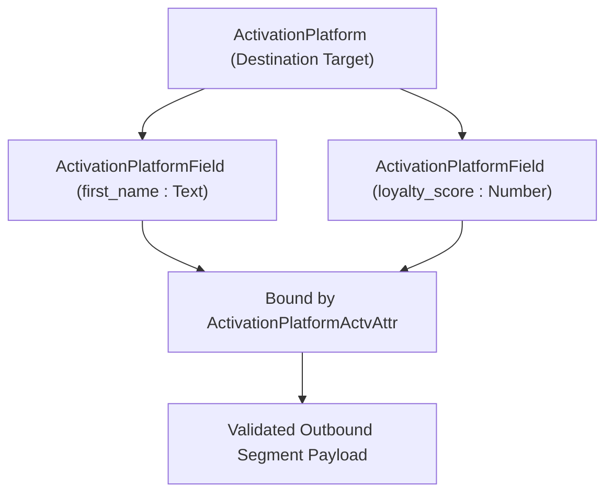

## Architectural Overview

The `ActivationPlatformField` metadata type defines the target field catalog for a **Salesforce Data Cloud** `ActivationPlatform`. When an external advertising network, DSP, or cloud warehouse expects a specific set of payload fields (such as `first_name`, `postal_code`, `loyalty_score`, or `hashed_email`), each expected destination field is modeled as an `ActivationPlatformField` component linked to the parent `ActivationPlatform`.

Separating `ActivationPlatformField` (the external target's field definition) from `ActivationPlatformActvAttr` (the internal Data Cloud DMO mapping) allows ISV partners and enterprise architects to define a strict destination schema contract even when different orgs map different internal DMO attributes to those target fields.



## Directory and File Conventions

In SFDX source format (`apiVersion` 68.0), `ActivationPlatformField` components are stored in the `activationPlatformFields` folder.

| Property | Value |
| :--- | :--- |
| **Metadata Type Name** | `ActivationPlatformField` |
| **SFDX Folder** | `force-app/main/default/activationPlatformFields/` |
| **File Suffix** | `.activationPlatformField-meta.xml` |
| **Wildcard Support (`*`)** | Supported in `package.xml` |

## Key Metadata Fields

The `ActivationPlatformField` XML schema includes the following fields:

| Field Name | Field Type | Required | Architectural Description |
| :--- | :--- | :--- | :--- |
| `masterLabel` | `string` | Yes | Display label of the target platform field in Data Cloud UI. |
| `activationPlatform` | `string` | Yes | DeveloperName of the parent `ActivationPlatform` that owns this field. |
| `type` | `string` | No | Data type expected by the external destination (for example, `Text`, `Number`, `Date`, `Boolean`). |
| `isRequired` | `boolean` | No | Specifies whether the destination platform requires this field in every activation payload (`true`/`false`). |
| `helpText` | `string` | No | Guidance displayed to users mapping Data Cloud attributes to this platform field. |

> [!NOTE]
> When `isRequired` is set to `true` on an `ActivationPlatformField`, Data Cloud prevents users from activating a segment to that platform unless a valid DMO attribute is mapped to the field.

## Declarative XML and Package Manifest Examples

Below is an `ActivationPlatformField` definition representing the `first_name` text attribute on `Enterprise_DSP_Platform`:

```xml title="force-app/main/default/activationPlatformFields/DSP_First_Name_Field.activationPlatformField-meta.xml"
<?xml version="1.0" encoding="UTF-8"?>
<ActivationPlatformField xmlns="http://soap.sforce.com/2006/04/metadata">
    <activationPlatform>Enterprise_DSP_Platform</activationPlatform>
    <helpText>Maps the recipient first name in UTF-8 plain text for DSP personalization.</helpText>
    <isRequired>false</isRequired>
    <masterLabel>DSP First Name</masterLabel>
    <type>Text</type>
</ActivationPlatformField>
```

### Package Manifest (`package.xml`)

```xml title="manifest/package.xml"
<?xml version="1.0" encoding="UTF-8"?>
<Package xmlns="http://soap.sforce.com/2006/04/metadata">
    <types>
        <members>Enterprise_DSP_Platform</members>
        <name>ActivationPlatform</name>
    </types>
    <types>
        <members>DSP_First_Name_Field</members>
        <name>ActivationPlatformField</name>
    </types>
    <version>68.0</version>
</Package>
```

## SOQL Queries and CLI Automation

Query `ActivationPlatformField` records via SOQL or retrieve and deploy them using Salesforce CLI:

```soql
SELECT Id, DeveloperName, MasterLabel, Type, IsRequired, HelpText
FROM ActivationPlatformField
ORDER BY MasterLabel ASC
```

```bash
# Retrieve all ActivationPlatformField components
sf project retrieve start --metadata "ActivationPlatformField:*"

# Deploy a specific ActivationPlatformField component
sf project deploy start --metadata ActivationPlatformField:DSP_First_Name_Field
```

## Architect Best Practices and Gotchas

- **Consistent Naming Conventions:** Prefix `ActivationPlatformField` developer names with an abbreviation of the parent `ActivationPlatform` (e.g., `DSP_First_Name_Field`) because `ActivationPlatformField` names share a global namespace across the org.
- **Type Compatibility:** Ensure the `type` declared on `ActivationPlatformField` matches the data type of the source DMO field mapped in `ActivationPlatformActvAttr` to avoid runtime type coercion failures during segment export.

> [!TIP]
> Always populate `<helpText>` on `ActivationPlatformField` components when building AppExchange Data Kits so marketing operations admins know whether the external platform expects raw values, ISO codes, or SHA-256 hashes.
