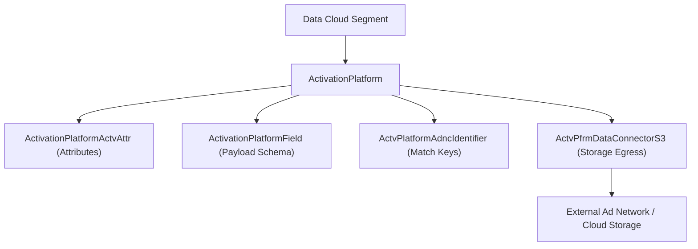

## Architectural Overview

The `ActivationPlatform` metadata type is the root configuration entity for an external **Activation Target Platform** in **Salesforce Data Cloud** (formerly Customer Data Platform / CDP). When marketers and data engineers build unified Unified Individual segments in Data Cloud and activate them to external destinations—such as Amazon S3 buckets, Google Ads, Meta Ads, or custom ISV ad-tech endpoints—`ActivationPlatform` defines the connector protocol, payload format (`CSV`, `JSON`, `PARQUET`), batch vs. streaming delivery cadence, and partner metadata.

For enterprise architects and ISV partners building Data Cloud Data Kits, `ActivationPlatform` coordinates four child metadata types that together describe the contract of an external activation destination:
- `ActivationPlatform` (the platform header and delivery settings)
- `ActivationPlatformActvAttr` (default activation attributes)
- `ActivationPlatformField` (supported payload schema fields)
- `ActvPfrmDataConnectorS3` (egress storage connector configuration)
- `ActvPlatformAdncIdentifier` (audience match identifiers such as hashed email or MAID)



## Directory and File Conventions

In SFDX source format (`apiVersion` 68.0), `ActivationPlatform` components are stored in the `activationPlatforms` folder.

| Property | Value |
| :--- | :--- |
| **Metadata Type Name** | `ActivationPlatform` |
| **SFDX Folder** | `force-app/main/default/activationPlatforms/` |
| **File Suffix** | `.activationPlatform-meta.xml` |
| **Wildcard Support (`*`)** | Supported in `package.xml` |

## Key Metadata Fields

The `ActivationPlatform` XML schema includes the following core properties:

| Field Name | Field Type | Required | Architectural Description |
| :--- | :--- | :--- | :--- |
| `masterLabel` | `string` | Yes | Display name of the activation platform in Data Cloud Setup and Activation Targets. |
| `connectorType` | `DataConnectorType` | Yes | Underlying transport connector type (such as `AmazonS3`, `GoogleAds`, `MetaAds`, or `Custom`). |
| `dataConnector` | `string` | No | Reference to the child connector metadata record (such as an `ActvPfrmDataConnectorS3` developer name). |
| `deliveryFrequency` | `ActivationPlatformCreationType` | No | Supported cadence (`Batch`, `Streaming`, or `Scheduled`). |
| `fileOutputFormat` | `ActivationFileOutputFormat` | No | Output serialization format for file-based activations (`CSV`, `JSON`, `Parquet`). |
| `enabled` | `boolean` | No | Controls whether users can create new Activation Targets from this platform definition. |
| `includeHeaders` | `boolean` | No | Specifies whether CSV file exports include a header row (`true`/`false`). |
| `logoUrl` | `string` | No | Static resource or URL path for the platform icon in Data Cloud UI. |
| `notes` | `string` | No | Architect or partner documentation notes visible during target setup. |
| `periodicFullRefresh` | `string` | No | Configures periodic full-refresh behavior versus incremental delta segment exports. |
| `platformProcessingType` | `ActivationPlatformProcessingType` | No | Execution mode (`Batch` or `Realtime`). |
| `platformType` | `ActivationPlatformType` | No | Category of destination (`Advertising`, `Marketing`, `CloudStorage`, `Analytics`). |

> [!TIP]
> When configuring high-volume lakehouse activations (over 10 million profiles per segment), prefer `<fileOutputFormat>JSON</fileOutputFormat>` or `Parquet` with incremental refresh enabled rather than uncompressed CSV exports to minimize egress transfer time.

## Declarative XML and Package Manifest Examples

The following example configures a custom S3-backed partner `ActivationPlatform` for omni-channel demand-side platform (DSP) audience delivery:

```xml title="force-app/main/default/activationPlatforms/Enterprise_DSP_Platform.activationPlatform-meta.xml"
<?xml version="1.0" encoding="UTF-8"?>
<ActivationPlatform xmlns="http://soap.sforce.com/2006/04/metadata">
    <connectorType>AmazonS3</connectorType>
    <dataConnector>Enterprise_DSP_S3_Connector</dataConnector>
    <deliveryFrequency>Batch</deliveryFrequency>
    <enabled>true</enabled>
    <fileOutputFormat>JSON</fileOutputFormat>
    <includeHeaders>true</includeHeaders>
    <masterLabel>Enterprise DSP Audience Platform</masterLabel>
    <notes>Delivers incremental unified individual segments to the Enterprise DSP S3 ingress bucket.</notes>
    <platformProcessingType>Batch</platformProcessingType>
    <platformType>Advertising</platformType>
</ActivationPlatform>
```

### Package Manifest (`package.xml`)

Deploy `ActivationPlatform` together with its child connector, field, attribute, and identifier definitions:

```xml title="manifest/package.xml"
<?xml version="1.0" encoding="UTF-8"?>
<Package xmlns="http://soap.sforce.com/2006/04/metadata">
    <types>
        <members>Enterprise_DSP_Platform</members>
        <name>ActivationPlatform</name>
    </types>
    <types>
        <members>Enterprise_DSP_S3_Connector</members>
        <name>ActvPfrmDataConnectorS3</name>
    </types>
    <version>68.0</version>
</Package>
```

## SOQL Queries and CLI Automation

Inspect `ActivationPlatform` records via SOQL or retrieve and deploy them via Salesforce CLI:

```soql
SELECT Id, DeveloperName, MasterLabel, ConnectorType,
       PlatformType, PlatformProcessingType, FileOutputFormat, Enabled
FROM ActivationPlatform
ORDER BY MasterLabel ASC
```

```bash
# Retrieve all ActivationPlatform definitions
sf project retrieve start --metadata "ActivationPlatform:*"

# Deploy the Enterprise_DSP_Platform component
sf project deploy start --metadata ActivationPlatform:Enterprise_DSP_Platform
```

## Architect Best Practices and Gotchas

- **Data Cloud Provisioning Prerequisite:** The target org must have an active **Data Cloud** license and provisioned Data Spaces before `ActivationPlatform` metadata can be deployed.
- **Credential Separation:** `ActivationPlatform` defines the structural platform template, not the production IAM access keys or OAuth tokens for a specific tenant's S3 bucket. Tenant-specific credentials are configured at runtime when an admin creates an **Activation Target** in Data Cloud Setup.

> [!WARNING]
> Changing `fileOutputFormat` or `connectorType` on an `ActivationPlatform` that already has live Activation Targets in production can break downstream ETL ingestion pipelines expecting a fixed schema format. Version a new `ActivationPlatform` when changing wire formats.
