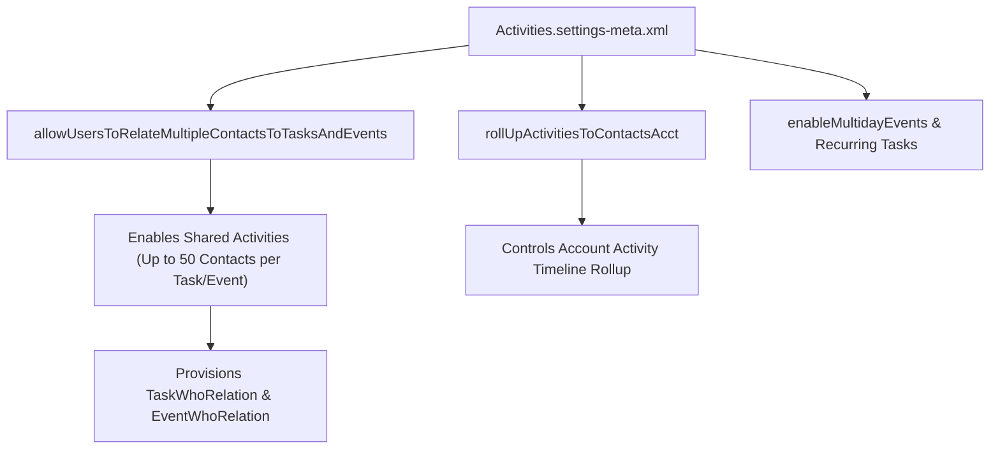

## Architectural Overview

The `ActivitiesSettings` metadata type governs the core database and UI behavior of `Task` and `Event` records across Salesforce. For Technical Architects, `ActivitiesSettings` is critical because it controls **Shared Activities** (`allowUsersToRelateMultipleContactsToTasksAndEvents`), activity timeline rollup behavior (`rollUpActivitiesToContactsAcct`), multiday events (`enableMultidayEvents`), and email/task notification defaults.

When Shared Activities is enabled in `ActivitiesSettings`, Salesforce alters the underlying polymorphism of the `WhoId` relationship, enabling junction records in `TaskRelation`, `EventRelation`, `TaskWhoRelation`, and `EventWhoRelation` so a single meeting or call log can link up to **50 Contacts** and **1 WhatId record**. Any [ApexClass](/docs/metadata/apex-class-metadata-type/) or [Flow](/docs/metadata/flow-metadata-type/) that queries `TaskWhoRelation` will fail to compile unless `Activities.settings-meta.xml` has Shared Activities enabled first.



## Directory and File Conventions

In SFDX source format (`apiVersion` 68.0), `ActivitiesSettings` is stored in the `settings/` folder and referenced via `Settings:Activities`.

| Property | Value |
| :--- | :--- |
| **Metadata Type Name** | `Settings` (member: `Activities`) / `ActivitiesSettings` |
| **SFDX Folder** | `force-app/main/default/settings/` |
| **File Name** | `Activities.settings-meta.xml` |
| **Scratch Org Setting Key** | `activitiesSettings` |

## Key Metadata Fields

The `ActivitiesSettings` XML schema exposes the following architectural flags:

| Field Name | Field Type | Required | Architectural Description |
| :--- | :--- | :--- | :--- |
| `allowUsersToRelateMultipleContactsToTasksAndEvents` | `boolean` | No | Enables **Shared Activities**, allowing up to 50 Contacts per `Task` or `Event`. Irreversible once enabled. |
| `rollUpActivitiesToContactsAcct` | `boolean` | No | Automatically rolls up Activities to a Contact's primary `Account` (`true`) or restricts rollup strictly to the explicit `WhatId` (`false`). |
| `enableActivityReminders` | `boolean` | No | Enables task and event reminder notifications in Lightning Experience. |
| `enableEmailTracking` | `boolean` | No | Enables HTML email open tracking for outbound emails logged as activities. |
| `enableGroupTasks` | `boolean` | No | Allows users to assign independent copies of a task to multiple users or public groups. |
| `enableMultidayEvents` | `boolean` | No | Allows `Event` records to span multiple consecutive calendar days (up to 14 days). |
| `enableSimpleTaskCreateUI` | `boolean` | No | Controls simplified task creation UI preferences. |
| `showEventDetailsMultiUserCalendar` | `boolean` | No | Displays event subject/details on multi-user calendars according to sharing settings. |

> [!WARNING]
> Setting `<allowUsersToRelateMultipleContactsToTasksAndEvents>true</allowUsersToRelateMultipleContactsToTasksAndEvents>` is **permanent and irreversible**. Once deployed to a sandbox or production org, it cannot be set back to `false`, and in large orgs the background data migration can take several hours to complete.

## Declarative XML and Package Manifest Examples

Below is a production-ready `Activities.settings-meta.xml` configuration for an enterprise Sales and Service Cloud implementation:

```xml title="force-app/main/default/settings/Activities.settings-meta.xml"
<?xml version="1.0" encoding="UTF-8"?>
<ActivitiesSettings xmlns="http://soap.sforce.com/2006/04/metadata">
    <allowUsersToRelateMultipleContactsToTasksAndEvents>true</allowUsersToRelateMultipleContactsToTasksAndEvents>
    <enableActivityReminders>true</enableActivityReminders>
    <enableClickCreateEvents>true</enableClickCreateEvents>
    <enableDragAndDropScheduling>true</enableDragAndDropScheduling>
    <enableEmailTracking>true</enableEmailTracking>
    <enableGroupTasks>true</enableGroupTasks>
    <enableListViewScheduling>true</enableListViewScheduling>
    <enableMultidayEvents>true</enableMultidayEvents>
    <enableRecurringEvents>true</enableRecurringEvents>
    <enableRecurringTasks>true</enableRecurringTasks>
    <rollUpActivitiesToContactsAcct>false</rollUpActivitiesToContactsAcct>
    <showEventDetailsMultiUserCalendar>true</showEventDetailsMultiUserCalendar>
</ActivitiesSettings>
```

### Scratch Org Configuration (`config/project-scratch-def.json`)

```json title="config/project-scratch-def.json"
{
  "orgName": "Enterprise Activities Scratch Org",
  "edition": "Enterprise",
  "settings": {
    "activitiesSettings": {
      "allowUsersToRelateMultipleContactsToTasksAndEvents": true,
      "rollUpActivitiesToContactsAcct": false,
      "enableMultidayEvents": true,
      "enableEmailTracking": true
    }
  }
}
```

### Package Manifest (`package.xml`)

```xml title="manifest/package.xml"
<?xml version="1.0" encoding="UTF-8"?>
<Package xmlns="http://soap.sforce.com/2006/04/metadata">
    <types>
        <members>Activities</members>
        <name>Settings</name>
    </types>
    <version>68.0</version>
</Package>
```

## CLI Retrieval and Deployment Commands

Manage `ActivitiesSettings` using Salesforce CLI:

```bash
# Retrieve Activities.settings-meta.xml from the org
sf project retrieve start --metadata Settings:Activities

# Deploy Activities.settings-meta.xml to the target org
sf project deploy start --metadata Settings:Activities
```

## Architect Best Practices and Gotchas

- **Controlling Account Data Skew with `rollUpActivitiesToContactsAcct`:** In B2B orgs that use Contacts to Multiple Accounts (`AccountContactRelation`) or placeholder bucket Accounts, set `<rollUpActivitiesToContactsAcct>false</rollUpActivitiesToContactsAcct>`. Leaving it `true` causes activities logged on a Contact for a partner deal (`WhatId`) to roll up and expose sensitive activity timelines on the Contact's primary employer Account.
- **Trigger Behavior with Shared Activities:** When Shared Activities is enabled, `Task.WhoId` holds only the **Primary Contact** ID, while additional contacts are inserted into `TaskRelation` (`IsWhat = false`). Write Apex triggers on `TaskRelation` or query `TaskWhoRelation` when you need to inspect all Contacts on a call log.

> [!TIP]
> Always include `activitiesSettings` with `allowUsersToRelateMultipleContactsToTasksAndEvents: true` in your `project-scratch-def.json` if your production org uses Shared Activities, ensuring `TaskWhoRelation` queries behave identically in automated CI tests.
