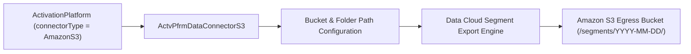

## Architectural Overview

The `ActvPfrmDataConnectorS3` metadata type configures the **Amazon S3 Egress Connector** for an `ActivationPlatform` in **Salesforce Data Cloud**. Many external demand-side platforms (DSPs), direct-mail fulfillment houses, and enterprise data lakes ingest audience segments via scheduled batch drops (JSON, CSV, or Parquet) into a dedicated Amazon S3 bucket and folder prefix.

In Data Cloud architecture, `ActvPfrmDataConnectorS3` encapsulates the S3 endpoint contract—bucket location, export folder path, and connector metadata—so it can be packaged alongside `ActivationPlatform` in SFDX repositories or AppExchange Data Kits.



## Directory and File Conventions

In SFDX source format (`apiVersion` 68.0), `ActvPfrmDataConnectorS3` files reside in the `actvPfrmDataConnectorS3s` directory.

| Property | Value |
| :--- | :--- |
| **Metadata Type Name** | `ActvPfrmDataConnectorS3` |
| **SFDX Folder** | `force-app/main/default/actvPfrmDataConnectorS3s/` |
| **File Suffix** | `.actvPfrmDataConnectorS3-meta.xml` |
| **Wildcard Support (`*`)** | Supported in `package.xml` |

## Key Metadata Fields

The `ActvPfrmDataConnectorS3` XML schema includes the following core properties:

| Field Name | Field Type | Required | Architectural Description |
| :--- | :--- | :--- | :--- |
| `masterLabel` | `string` | Yes | Human-readable label of the S3 data connector configuration. |
| `bucketName` | `string` | No | Target Amazon S3 bucket name where segment files are written. |
| `exportFolderName` | `string` | No | Subdirectory prefix inside the S3 bucket for exported segment files (for example, `outbound/audiences`). |
| `s3AccessKey` | `string` | No | Public AWS Access Key ID or placeholder reference configured for the platform connector. |
| `s3SecretKey` | `string` | No | Encrypted/masked secret key reference (never commit raw production AWS secrets to Git). |

> [!WARNING]
> Never commit live AWS IAM `s3AccessKey` or `s3SecretKey` credentials into Git inside `.actvPfrmDataConnectorS3-meta.xml`. Use environment replacement tokens in CI/CD or configure tenant credentials directly on the runtime **Activation Target** in Data Cloud Setup.

## Declarative XML and Package Manifest Examples

Below is an `ActvPfrmDataConnectorS3` metadata file defining the S3 egress folder structure for `Enterprise_DSP_Platform`:

```xml title="force-app/main/default/actvPfrmDataConnectorS3s/Enterprise_DSP_S3_Connector.actvPfrmDataConnectorS3-meta.xml"
<?xml version="1.0" encoding="UTF-8"?>
<ActvPfrmDataConnectorS3 xmlns="http://soap.sforce.com/2006/04/metadata">
    <bucketName>enterprise-dsp-audience-ingress</bucketName>
    <exportFolderName>datacloud/segments</exportFolderName>
    <masterLabel>Enterprise DSP S3 Connector</masterLabel>
</ActvPfrmDataConnectorS3>
```

### Package Manifest (`package.xml`)

```xml title="manifest/package.xml"
<?xml version="1.0" encoding="UTF-8"?>
<Package xmlns="http://soap.sforce.com/2006/04/metadata">
    <types>
        <members>Enterprise_DSP_S3_Connector</members>
        <name>ActvPfrmDataConnectorS3</name>
    </types>
    <types>
        <members>Enterprise_DSP_Platform</members>
        <name>ActivationPlatform</name>
    </types>
    <version>68.0</version>
</Package>
```

## SOQL Queries and CLI Automation

Inspect `ActvPfrmDataConnectorS3` records via SOQL or deploy them using Salesforce CLI:

```soql
SELECT Id, DeveloperName, MasterLabel, BucketName, ExportFolderName
FROM ActvPfrmDataConnectorS3
ORDER BY DeveloperName ASC
```

```bash
# Retrieve all ActvPfrmDataConnectorS3 definitions
sf project retrieve start --metadata "ActvPfrmDataConnectorS3:*"

# Deploy a specific S3 connector configuration
sf project deploy start --metadata ActvPfrmDataConnectorS3:Enterprise_DSP_S3_Connector
```

## Architect Best Practices and Gotchas

- **Least-Privilege S3 Bucket Policies:** Configure the target AWS S3 bucket policy and IAM role with least-privilege permissions (`s3:PutObject`, `s3:ListBucket`, `s3:GetBucketLocation`) scoped strictly to the `<exportFolderName>` prefix, and enforce server-side encryption (`SSE-S3` or `SSE-KMS`).
- **Environment Isolation:** Ensure sandbox Data Cloud orgs point to a non-production `bucketName` (such as `enterprise-dsp-audience-ingress-uat`) so UAT segment runs do not trigger live ad-spend campaigns in your production DSP.

> [!TIP]
> Deploy `ActvPfrmDataConnectorS3` before or in the same deployment transaction as its parent `ActivationPlatform` so the `<dataConnector>` reference resolves without error.
