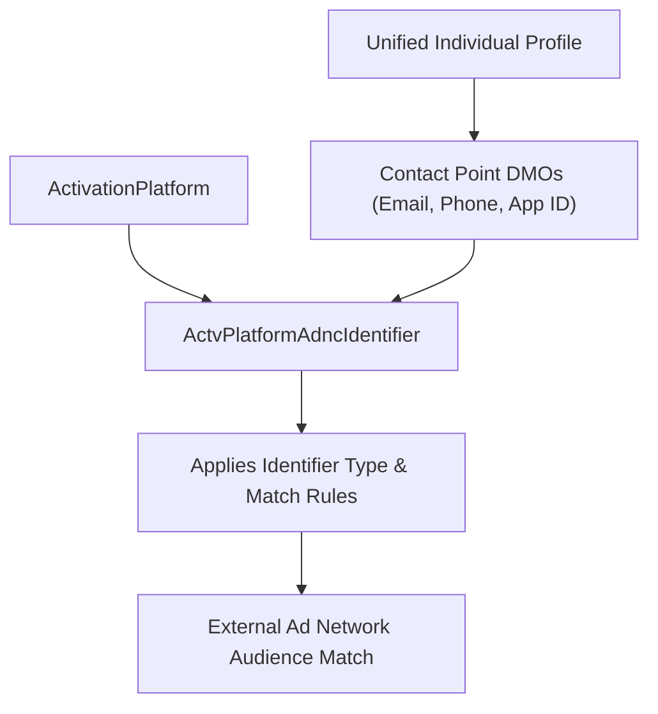

## Architectural Overview

The `ActvPlatformAdncIdentifier` (Activation Platform Audience Identifier) metadata type configures the **Contact Point and Identity Match Keys** for an `ActivationPlatform` in **Salesforce Data Cloud**. When activating a segment of Unified Individuals to an external advertising platform or clean room, the destination platform matches audience members using deterministic identifiers—such as SHA-256 hashed email addresses (`ContactPointEmail`), normalized E.164 phone numbers (`ContactPointPhone`), Mobile Advertiser IDs (`ContactPointApp` / IDFA / GAID), or external subscriber IDs (`PartyIdentification`).

By defining `ActvPlatformAdncIdentifier` components on an `ActivationPlatform`, architects codify which contact point DMO entities, identifier subtypes, and hashing/formatting rules the platform requires to resolve audience members.



## Directory and File Conventions

In SFDX source format (`apiVersion` 68.0), `ActvPlatformAdncIdentifier` files are stored in the `actvPlatformAdncIdentifiers` folder.

| Property | Value |
| :--- | :--- |
| **Metadata Type Name** | `ActvPlatformAdncIdentifier` |
| **SFDX Folder** | `force-app/main/default/actvPlatformAdncIdentifiers/` |
| **File Suffix** | `.actvPlatformAdncIdentifier-meta.xml` |
| **Wildcard Support (`*`)** | Supported in `package.xml` |

## Key Metadata Fields

The `ActvPlatformAdncIdentifier` XML schema includes the following core properties:

| Field Name | Field Type | Required | Architectural Description |
| :--- | :--- | :--- | :--- |
| `masterLabel` | `string` | Yes | Human-readable name of the audience identifier in Data Cloud Setup. |
| `activationPlatform` | `string` | Yes | DeveloperName of the parent `ActivationPlatform` that uses this identifier. |
| `activationPlatformField` | `string` | No | DeveloperName of the target `ActivationPlatformField` receiving the identifier value. |
| `entityName` | `string` | Yes | API name of the Contact Point or Identity DMO (such as `ssot__ContactPointEmail__dlm` or `ssot__ContactPointPhone__dlm`). |
| `fieldName` | `string` | Yes | API name of the identifier field on the DMO (such as `ssot__EmailAddress__c` or `ssot__FormattedE164PhoneNumber__c`). |
| `identifierType` | `string` | No | Classification of the match key (for example, `Email`, `Phone`, `MAID`, `OTT`, `FirstPartyId`). |
| `identifierSubType` | `string` | No | Granular sub-type (such as `IDFA`, `GAID`, or `SHA256`). |

> [!TIP]
> Include multiple `ActvPlatformAdncIdentifier` definitions (for example, both `ContactPointEmail` and `ContactPointPhone`) on advertising `ActivationPlatform` targets. Multi-key activation typically improves external DSP match rates by 15%–30% compared to email-only activation.

## Declarative XML and Package Manifest Examples

The following example configures a Contact Point Email audience identifier for `Enterprise_DSP_Platform`:

```xml title="force-app/main/default/actvPlatformAdncIdentifiers/DSP_Email_Identifier.actvPlatformAdncIdentifier-meta.xml"
<?xml version="1.0" encoding="UTF-8"?>
<ActvPlatformAdncIdentifier xmlns="http://soap.sforce.com/2006/04/metadata">
    <activationPlatform>Enterprise_DSP_Platform</activationPlatform>
    <activationPlatformField>DSP_Hashed_Email_Field</activationPlatformField>
    <entityName>ssot__ContactPointEmail__dlm</entityName>
    <fieldName>ssot__EmailAddress__c</fieldName>
    <identifierType>Email</identifierType>
    <masterLabel>DSP Hashed Email Identifier</masterLabel>
</ActvPlatformAdncIdentifier>
```

### Package Manifest (`package.xml`)

```xml title="manifest/package.xml"
<?xml version="1.0" encoding="UTF-8"?>
<Package xmlns="http://soap.sforce.com/2006/04/metadata">
    <types>
        <members>Enterprise_DSP_Platform</members>
        <name>ActivationPlatform</name>
    </types>
    <types>
        <members>DSP_Hashed_Email_Field</members>
        <name>ActivationPlatformField</name>
    </types>
    <types>
        <members>DSP_Email_Identifier</members>
        <name>ActvPlatformAdncIdentifier</name>
    </types>
    <version>68.0</version>
</Package>
```

## SOQL Queries and CLI Automation

Query `ActvPlatformAdncIdentifier` records via SOQL or deploy using Salesforce CLI:

```soql
SELECT Id, DeveloperName, MasterLabel, EntityName,
       FieldName, IdentifierType, IdentifierSubType
FROM ActvPlatformAdncIdentifier
ORDER BY MasterLabel ASC
```

```bash
# Retrieve all ActvPlatformAdncIdentifier components
sf project retrieve start --metadata "ActvPlatformAdncIdentifier:*"

# Deploy a specific audience identifier definition
sf project deploy start --metadata ActvPlatformAdncIdentifier:DSP_Email_Identifier
```

## Architect Best Practices and Gotchas

- **Identity Resolution Ruleset Alignment:** An `ActvPlatformAdncIdentifier` can only export contact points if the underlying `ssot__ContactPointEmail__dlm` or `ssot__ContactPointPhone__dlm` DMO is properly linked to `ssot__Individual__dlm` in your Data Cloud Data Space and Identity Resolution Ruleset.
- **Phone Number Normalization:** When configuring phone-based `ActvPlatformAdncIdentifier` components, always map `ssot__FormattedE164PhoneNumber__c` rather than raw unformatted phone strings so SHA-256 hashes match the E.164 normalization standard expected by Meta, Google, and DSP endpoints.

> [!WARNING]
> Removing an `ActvPlatformAdncIdentifier` from an `ActivationPlatform` that is actively used by scheduled segment activations can cause those activations to fail validation on their next scheduled publish run.
