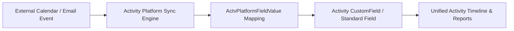

## Architectural Overview

In enterprise Salesforce orgs running Einstein Activity Capture (EAC) or unified Activity Platform integrations, standard calendar and email fields rarely capture all business-critical context. The `ActvPlatformFieldValue` metadata type defines the declarative field value mappings between external activity payloads (such as Microsoft Exchange or Google Workspace headers) and Salesforce activity fields.

Architecturally, managing `ActvPlatformFieldValue` in version control ensures that environment promotions from integration sandboxes to production maintain deterministic activity enrichment without manual post-deployment setup.



## SFDX Directory & File Suffix

| Property | Value |
| :--- | :--- |
| **Metadata Type Name** | `ActvPlatformFieldValue` |
| **SFDX Directory** | `force-app/main/default/actvPlatformFieldValues/` |
| **File Suffix** | `.actvPlatformFieldValue-meta.xml` |
| **API Version Introduced** | `58.0` (Verified on `68.0` / Winter '27) |

## Key Metadata Fields

| Field Name | Type | Required | Architectural Purpose |
| :--- | :--- | :--- | :--- |
| `masterLabel` | `string` | Yes | The human-readable label displayed in Setup for this activity platform field value mapping. |
| `developerName` | `string` | No | Unique API name used by the Metadata API and SFDX source tracking. |
| `actvPlatformField` | `string` | Yes | Reference to the parent `ActvPlatformField` definition that owns this value mapping. |
| `fieldValue` | `string` | Yes | The normalized value written or matched during activity synchronization. |
| `isActive` | `boolean` | No | Controls whether the activity platform actively evaluates this field value mapping during sync. |

> [!NOTE]
> Because `ActvPlatformFieldValue` depends on the unified Activity Platform schema, ensure Einstein Activity Capture or the corresponding Activity Platform feature license is provisioned in your scratch org definition file before pushing source.

## Declarative XML & `package.xml` Examples

### Sample `.actvPlatformFieldValue-meta.xml`

```xml title="force-app/main/default/actvPlatformFieldValues/Enterprise_Meeting_Category.actvPlatformFieldValue-meta.xml"
<?xml version="1.0" encoding="UTF-8"?>
<ActvPlatformFieldValue xmlns="http://soap.sforce.com/2006/04/metadata">
    <actvPlatformField>Meeting_Classification</actvPlatformField>
    <fieldValue>Executive_Briefing</fieldValue>
    <isActive>true</isActive>
    <masterLabel>Executive Briefing Category</masterLabel>
</ActvPlatformFieldValue>
```

### Sample `package.xml` Manifest

```xml title="manifest/package.xml"
<?xml version="1.0" encoding="UTF-8"?>
<Package xmlns="http://soap.sforce.com/2006/04/metadata">
    <types>
        <members>Enterprise_Meeting_Category</members>
        <name>ActvPlatformFieldValue</name>
    </types>
    <version>68.0</version>
</Package>
```

## SFDX CLI Retrieval & Inspection

Retrieve and deploy `ActvPlatformFieldValue` components directly via the Salesforce CLI (`sf`):

```bash
# Retrieve all ActvPlatformFieldValue components from the target org
sf project retrieve start --metadata "ActvPlatformFieldValue:*"

# Retrieve a specific activity platform field value definition
sf project retrieve start --metadata "ActvPlatformFieldValue:Enterprise_Meeting_Category"

# Validate deployment in a CI pipeline without committing changes
sf project deploy start --metadata "ActvPlatformFieldValue:Enterprise_Meeting_Category" --dry-run
```

## Senior Architect Best Practices & Gotchas

- **Dependency Ordering:** Always include the parent `ActvPlatformField` and any referenced [CustomField](/docs/metadata/custom-field-metadata-type/) on `Activity` in the same `package.xml` manifest when promoting across environments.
- **Deactivation Over Deletion:** In production orgs with historical synced activities, prefer setting `<isActive>false</isActive>` rather than destructively deleting `ActvPlatformFieldValue` records so historical audit mappings remain intact.
- **Scratch Org Parity:** Add `"EinsteinActivityCapture"` or the required activity sync features to `config/project-scratch-def.json` so automated CI builds do not fail with `Invalid type: ActvPlatformFieldValue`.

> [!TIP]
> Pair `ActvPlatformFieldValue` deployments with a dedicated [PermissionSet](/docs/metadata/permission-set-metadata-type/) granting read/edit access to any mapped custom activity fields so sales reps can immediately filter timelines by the synced values.
