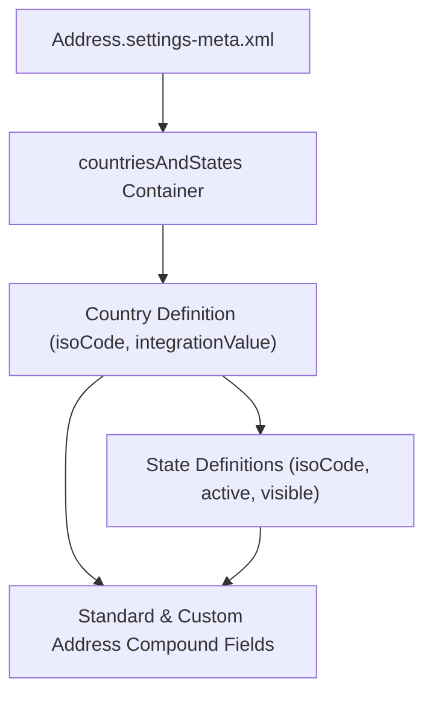

## Architectural Overview

Dirty address data breaks territory management, tax calculation engines, and ERP order syncs. The `AddressSettings` metadata type (`Address.settings-meta.xml`) lets architects declaratively enforce State and Country/Territory Picklists across all standard address compound fields (`BillingAddress`, `ShippingAddress`, `MailingAddress`) and Custom Address Fields.

By managing `AddressSettings` in Git, you guarantee that every scratch org, developer sandbox, and production environment shares the exact same ISO-3166 country codes, state picklist dependencies, and `integrationValue` mappings.



## SFDX Directory & File Suffix

| Property | Value |
| :--- | :--- |
| **Metadata Type Name** | `AddressSettings` (deployed via `Settings` type with member `Address`) |
| **SFDX Directory** | `force-app/main/default/settings/` |
| **File Name & Suffix** | `Address.settings-meta.xml` |
| **API Version Introduced** | `27.0` (Verified on `68.0` / Winter '27) |

## Key Metadata Fields

| Field Name | Type | Required | Architectural Purpose |
| :--- | :--- | :--- | :--- |
| `countriesAndStates` | `CountriesAndStates` | Yes | Root container holding the full list of `countries` and nested `states`. |
| `countries[].isoCode` | `string` | Yes | Two-letter ISO 3166-1 alpha-2 country code (e.g., `US`, `CA`, `IN`). |
| `countries[].integrationValue` | `string` | Yes | Text value matched when records are inserted via API/Apex (`United States`). |
| `countries[].active` | `boolean` | Yes | Determines if the country is active in the org database. |
| `countries[].visible` | `boolean` | Yes | Controls whether users can select the country in the UI picklist. Must be `false` if `active` is `false`. |
| `countries[].orgDefault` | `boolean` | No | Marks the default country pre-selected on new records. |
| `countries[].states` | `State[]` | No | Array of child states/provinces (`isoCode`, `label`, `integrationValue`, `active`, `visible`). |

> [!WARNING]
> A Country or State cannot have `<visible>true</visible>` when `<active>false</active>`. Doing so causes an immediate Metadata API validation failure during deployment.

## Declarative XML & `package.xml` Examples

### Sample `Address.settings-meta.xml`

```xml title="force-app/main/default/settings/Address.settings-meta.xml"
<?xml version="1.0" encoding="UTF-8"?>
<AddressSettings xmlns="http://soap.sforce.com/2006/04/metadata">
    <countriesAndStates>
        <countries>
            <active>true</active>
            <integrationValue>United States</integrationValue>
            <isoCode>US</isoCode>
            <label>United States</label>
            <orgDefault>true</orgDefault>
            <standard>true</standard>
            <states>
                <active>true</active>
                <integrationValue>California</integrationValue>
                <isoCode>CA</isoCode>
                <label>California</label>
                <standard>true</standard>
                <visible>true</visible>
            </states>
            <states>
                <active>true</active>
                <integrationValue>New York</integrationValue>
                <isoCode>NY</isoCode>
                <label>New York</label>
                <standard>true</standard>
                <visible>true</visible>
            </states>
            <visible>true</visible>
        </countries>
    </countriesAndStates>
</AddressSettings>
```

### Sample `package.xml` Manifest

```xml title="manifest/package.xml"
<?xml version="1.0" encoding="UTF-8"?>
<Package xmlns="http://soap.sforce.com/2006/04/metadata">
    <types>
        <members>Address</members>
        <name>Settings</name>
    </types>
    <version>68.0</version>
</Package>
```

## SFDX CLI Retrieval & Deployment

Use the `Settings:Address` specifier with the Salesforce CLI to retrieve or deploy address picklist configurations:

```bash
# Retrieve the org's complete Country and State picklist configuration
sf project retrieve start --metadata "Settings:Address"

# Deploy updated Country/State ISO codes and visibility rules
sf project deploy start --source-dir force-app/main/default/settings/Address.settings-meta.xml
```

## Senior Architect Best Practices & Gotchas

- **Integration Value Alignment:** External integrations (MuleSoft, ERP connectors, Marketing Cloud) often send full country names (`United States`) or ISO codes (`US`). Align `integrationValue` across all integrated systems before activating State and Country Picklists, or inbound DML operations will fail with `FIELD_INTEGRITY_EXCEPTION`.
- **Large XML File Size:** Retrieving `Settings:Address` pulls all 240+ standard countries and thousands of states. Never hand-edit the entire file from scratch; retrieve it from a clean org, adjust `visible` and `active` flags programmatically, and commit the full file so state definitions aren't inadvertently omitted.
- **Custom Address Fields (`Address` Data Type):** If your [CustomField](/docs/metadata/custom-field-metadata-type/) definitions use the compound `Address` field type, State and Country Picklists must be enabled first in the target org.

> [!TIP]
> When migrating legacy free-text state/country data, keep `integrationValue` mapped to the legacy full name while exposing `BillingCountryCode` and `BillingStateCode` (2-letter ISO codes) to modern [Flow](/docs/metadata/flow-metadata-type/) and Apex integrations.
