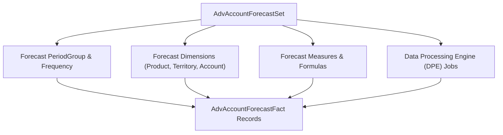

## Architectural Overview

Advanced Account Forecasting (AAF) powers multi-horizon demand and revenue planning across Manufacturing Cloud, Consumer Goods Cloud, and Enterprise Sales. The `AdvAccountForecastSet` metadata type is the core configuration blueprint that binds together your forecast periodicity, custom fact tables, dimensions (such as Product, Region, or Ship-To Location), measures, adjustment rules, and Data Processing Engine (DPE) calculation definitions.

For enterprise architects, treating `AdvAccountForecastSet` as version-controlled source code prevents formula drift and ensures that DPE regeneration jobs and rolling forecast rollups behave identically in UAT and production.



## SFDX Directory & File Suffix

| Property | Value |
| :--- | :--- |
| **Metadata Type Name** | `AdvAccountForecastSet` |
| **SFDX Directory** | `force-app/main/default/advAccountForecastSets/` |
| **File Suffix** | `.advAccountForecastSet-meta.xml` |
| **API Version Introduced** | `53.0` (Verified on `68.0` / Winter '27) |

## Key Metadata Fields

| Field Name | Type | Required | Architectural Purpose |
| :--- | :--- | :--- | :--- |
| `masterLabel` | `string` | Yes | Display name of the Advanced Account Forecast Set in Setup. |
| `status` | `AdvAcctForecastSetStatus` | Yes | Lifecycle state of the forecast set (`Active`, `Draft`, `Inactive`). |
| `calculationFrequency` | `string` | Yes | Defines how often forecast calculations run (`Monthly`, `Quarterly`, `Weekly`, `Yearly`). |
| `forecastFactObjectName` | `string` | Yes | API name of the fact object storing calculated forecast values (standard `AdvAcctForecastFact` or a custom [CustomObject](/docs/metadata/custom-object-metadata-type/)). |
| `generationDpeDefName` | `string` | No | DeveloperName of the Data Processing Engine job that generates forecast rows. |
| `recalculationDpeDefName` | `string` | No | DeveloperName of the DPE job that recalculates forecast measures. |
| `rolloverDpeDefName` | `string` | No | DeveloperName of the DPE job that rolls forecast periods forward. |
| `rolloverFrequency` | `string` | No | Frequency at which periods roll over (`Monthly`, `Quarterly`, `Yearly`). |

> [!NOTE]
> Modifying fundamental structural properties—such as `forecastFactObjectName` or dimension mappings—on an `Active` forecast set requires deactivating the set first (`<status>Inactive</status>`).

## Declarative XML & `package.xml` Examples

### Sample `.advAccountForecastSet-meta.xml`

```xml title="force-app/main/default/advAccountForecastSets/Global_OEM_Revenue_Forecast.advAccountForecastSet-meta.xml"
<?xml version="1.0" encoding="UTF-8"?>
<AdvAccountForecastSet xmlns="http://soap.sforce.com/2006/04/metadata">
    <calculationFrequency>Monthly</calculationFrequency>
    <description>Rolling 12-month OEM account revenue and quantity forecast set.</description>
    <forecastFactObjectName>AdvAcctForecastFact</forecastFactObjectName>
    <generationDpeDefName>Generate_OEM_Account_Forecast</generationDpeDefName>
    <masterLabel>Global OEM Revenue Forecast</masterLabel>
    <recalculationDpeDefName>Recalculate_OEM_Account_Forecast</recalculationDpeDefName>
    <rolloverDpeDefName>Rollover_OEM_Account_Forecast</rolloverDpeDefName>
    <rolloverFrequency>Monthly</rolloverFrequency>
    <status>Active</status>
</AdvAccountForecastSet>
```

### Sample `package.xml` Manifest

```xml title="manifest/package.xml"
<?xml version="1.0" encoding="UTF-8"?>
<Package xmlns="http://soap.sforce.com/2006/04/metadata">
    <types>
        <members>Global_OEM_Revenue_Forecast</members>
        <name>AdvAccountForecastSet</name>
    </types>
    <version>68.0</version>
</Package>
```

## SOQL Query & SFDX CLI Commands

### Inspect Active Forecast Sets via SOQL

```soql
SELECT Id, DeveloperName, MasterLabel, Status, CalculationFrequency,
       RolloverFrequency, ForecastFactObjectName
FROM AdvAccountForecastSet
WHERE Status = 'Active'
ORDER BY MasterLabel ASC
```

### Retrieve and Deploy via Salesforce CLI

```bash
# Retrieve all Advanced Account Forecast Sets
sf project retrieve start --metadata "AdvAccountForecastSet:*"

# Deploy a specific forecast set
sf project deploy start --metadata "AdvAccountForecastSet:Global_OEM_Revenue_Forecast"
```

## Senior Architect Best Practices & Gotchas

- **Deploy DPE Definitions First or Together:** An `AdvAccountForecastSet` references `BatchCalcJobDefinition` (Data Processing Engine) records for generation, recalculation, and rollover. Ensure those DPE definitions are activated before deploying the forecast set with `<status>Active</status>`.
- **Custom Fact Table Indexing:** When using a custom [CustomObject](/docs/metadata/custom-object-metadata-type/) as your `forecastFactObjectName`, mark key dimension lookup fields as External IDs or request custom indexes from Salesforce Support to avoid DPE job timeouts on multi-million-row fact tables.

> [!TIP]
> Trigger forecast recalculations automatically from record-triggered [Flow](/docs/metadata/flow-metadata-type/) orchestrations using the standard `Run Advanced Account Forecast Calculation` invocable action rather than hardcoding batch schedules.
