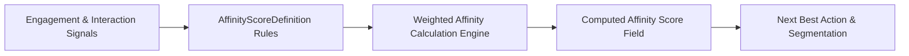

## Architectural Overview

Modern personalization and relationship intelligence rely on quantifying how strongly a customer, donor, or partner engages with specific product lines, topics, or channels. The `AffinityScoreDefinition` metadata type encapsulates the declarative scoring parameters, signal mappings, and status flags that drive automated affinity calculation engines in Salesforce.

By storing `AffinityScoreDefinition` files in SFDX source format, architects can version-control scoring threshold adjustments and promote tested affinity models through staging and production pipelines with zero manual reconfiguration.



## SFDX Directory & File Suffix

| Property | Value |
| :--- | :--- |
| **Metadata Type Name** | `AffinityScoreDefinition` |
| **SFDX Directory** | `force-app/main/default/affinityScoreDefinitions/` |
| **File Suffix** | `.affinityScoreDefinition-meta.xml` |
| **API Version Introduced** | `60.0` (Verified on `68.0` / Winter '27) |

## Key Metadata Fields

| Field Name | Type | Required | Architectural Purpose |
| :--- | :--- | :--- | :--- |
| `masterLabel` | `string` | Yes | The user-facing name of the affinity score definition in Setup. |
| `developerName` | `string` | No | Unique API identifier used across Metadata API and SFDX deployments. |
| `description` | `string` | No | Documents the business purpose, signal sources, and decay assumptions of the score. |
| `isActive` | `boolean` | No | Indicates whether the affinity score definition is actively evaluated by scheduled scoring jobs. |

> [!NOTE]
> Always document your signal weighting logic and business owner inside the `<description>` element so data science and CRM admin teams understand how the score is derived.

## Declarative XML & `package.xml` Examples

### Sample `.affinityScoreDefinition-meta.xml`

```xml title="force-app/main/default/affinityScoreDefinitions/Enterprise_Cloud_Product_Affinity.affinityScoreDefinition-meta.xml"
<?xml version="1.0" encoding="UTF-8"?>
<AffinityScoreDefinition xmlns="http://soap.sforce.com/2006/04/metadata">
    <description>Calculates account stakeholder affinity for Enterprise Cloud products based on interaction signals.</description>
    <isActive>true</isActive>
    <masterLabel>Enterprise Cloud Product Affinity</masterLabel>
</AffinityScoreDefinition>
```

### Sample `package.xml` Manifest

```xml title="manifest/package.xml"
<?xml version="1.0" encoding="UTF-8"?>
<Package xmlns="http://soap.sforce.com/2006/04/metadata">
    <types>
        <members>Enterprise_Cloud_Product_Affinity</members>
        <name>AffinityScoreDefinition</name>
    </types>
    <version>68.0</version>
</Package>
```

## SFDX CLI Retrieval & Deployment

Manage `AffinityScoreDefinition` metadata from your terminal using the Salesforce CLI:

```bash
# Retrieve all AffinityScoreDefinition components from the org
sf project retrieve start --metadata "AffinityScoreDefinition:*"

# Deploy a specific AffinityScoreDefinition to a target environment
sf project deploy start --metadata "AffinityScoreDefinition:Enterprise_Cloud_Product_Affinity"
```

## Senior Architect Best Practices & Gotchas

- **Schema Dependencies:** Ensure any custom interaction objects or output score [CustomField](/docs/metadata/custom-field-metadata-type/) definitions referenced by the scoring model are deployed prior to or alongside `AffinityScoreDefinition`.
- **Sandbox Testing Before Activation:** Deploy new affinity score definitions with `<isActive>false</isActive>` when validating schema dependencies in full-copy sandboxes, then activate them once sample interaction datasets are loaded to prevent skewed initial scores.
- **Analytics Visibility:** Surface computed affinity scores in standard [Report](/docs/metadata/report-metadata-type/) types so marketing and account teams can audit score distributions before wiring them into automated campaigns.

> [!TIP]
> Version-control your `AffinityScoreDefinition` alongside downstream [Flow](/docs/metadata/flow-metadata-type/) or Next Best Action strategies so threshold changes and automation triggers stay synchronized in a single pull request.
