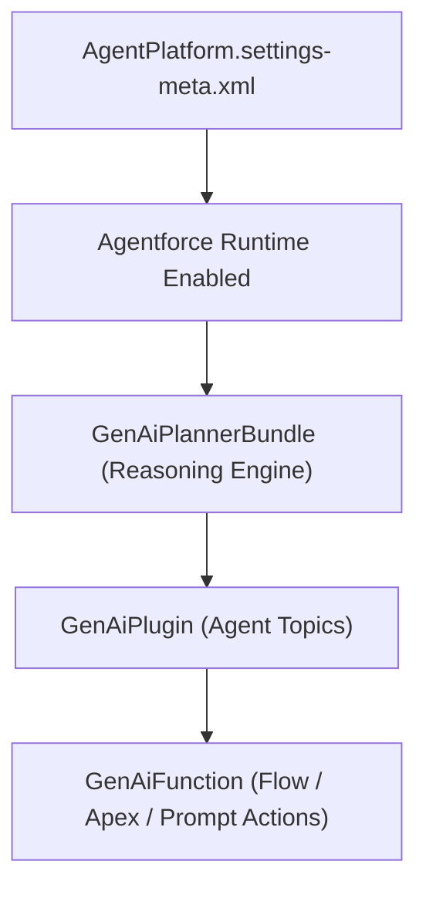

## Architectural Overview

Before any autonomous AI agent, reasoning planner, topic (`GenAiPlugin`), or action (`GenAiFunction`) can be deployed or executed in Salesforce, the underlying Agentforce runtime must be enabled at the org level. The `AgentPlatformSettings` metadata type (`AgentPlatform.settings-meta.xml`) serves as this master architectural switch.

In CI/CD pipelines that spin up scratch orgs or promote Agentforce solutions to testing sandboxes, `AgentPlatformSettings` must be deployed as the foundational prerequisite before any downstream AI agent metadata.



## SFDX Directory & File Suffix

| Property | Value |
| :--- | :--- |
| **Metadata Type Name** | `AgentPlatformSettings` (`Settings:AgentPlatform`) |
| **SFDX Directory** | `force-app/main/default/settings/` |
| **File Name & Suffix** | `AgentPlatform.settings-meta.xml` |
| **API Version Introduced** | `62.0` (Verified on `68.0` / Winter '27) |

> [!RELEASE] Winter '27
> In API version `68.0` (Winter '27), `AgentPlatformSettings` remains the primary prerequisite setting for activating the Agentforce reasoning engine and Agent Builder components.

## Key Metadata Fields

| Field Name | Type | Required | Architectural Purpose |
| :--- | :--- | :--- | :--- |
| `enableAgentPlatform` | `boolean` | No | Master toggle (`true` or `false`) that enables the Agentforce platform runtime in the org. |

## Declarative XML & `package.xml` Examples

### Sample `AgentPlatform.settings-meta.xml`

```xml title="force-app/main/default/settings/AgentPlatform.settings-meta.xml"
<?xml version="1.0" encoding="UTF-8"?>
<AgentPlatformSettings xmlns="http://soap.sforce.com/2006/04/metadata">
    <enableAgentPlatform>true</enableAgentPlatform>
</AgentPlatformSettings>
```

### Sample `package.xml` Manifest

```xml title="manifest/package.xml"
<?xml version="1.0" encoding="UTF-8"?>
<Package xmlns="http://soap.sforce.com/2006/04/metadata">
    <types>
        <members>AgentPlatform</members>
        <name>Settings</name>
    </types>
    <version>68.0</version>
</Package>
```

## SFDX CLI Retrieval & Deployment

Retrieve and deploy `AgentPlatformSettings` via the Salesforce CLI:

```bash
# Retrieve AgentPlatformSettings from the target org
sf project retrieve start --metadata "Settings:AgentPlatform"

# Deploy AgentPlatformSettings prior to deploying agent definitions
sf project deploy start --metadata "Settings:AgentPlatform"
```

## Senior Architect Best Practices & Gotchas

- **Staged Deployment Pipeline:** In automated CI/CD workflows, deploy `Settings:AgentPlatform` (and Einstein Generative AI settings) in a pre-deployment stage before deploying [GenAiPlannerBundle](/docs/metadata/genai-planner-bundle-metadata-type/), [GenAiPlugin](/docs/metadata/genai-plugin-metadata-type/), and [GenAiFunction](/docs/metadata/genai-function-metadata-type/) components.
- **Avoid Accidental Deactivation:** Never deploy `<enableAgentPlatform>false</enableAgentPlatform>` to an active staging or production org—doing so immediately halts active Service Agents and Employee Agents across all channels.
- **Agent User Security:** Enabling the platform is only step one; ensure your autonomous agents execute under least-privilege user contexts governed by dedicated [PermissionSet](/docs/metadata/permission-set-metadata-type/) assignments.

> [!TIP]
> Add `agentPlatformSettings` to your `config/project-scratch-def.json` file so every ephemeral scratch org created for pull request validation automatically activates the Agentforce runtime.
