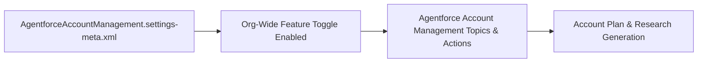

## Architectural Overview

Agentforce Account Management empowers sales and strategic account teams with autonomous AI capabilities for account research, whitespace analysis, and key account plan generation. The `AgentforceAccountManagementSettings` metadata type (`AgentforceAccountManagement.settings-meta.xml`) governs the org-wide feature switches that activate these capabilities.

Including `AgentforceAccountManagementSettings` in your SFDX repository allows DevOps pipelines to declaratively enable Account Management agent features across scratch orgs, UAT sandboxes, and production alongside the supporting agent topics and actions.



## SFDX Directory & File Suffix

| Property | Value |
| :--- | :--- |
| **Metadata Type Name** | `AgentforceAccountManagementSettings` (`Settings:AgentforceAccountManagement`) |
| **SFDX Directory** | `force-app/main/default/settings/` |
| **File Name & Suffix** | `AgentforceAccountManagement.settings-meta.xml` |
| **API Version Introduced** | `62.0` (Verified on `68.0` / Winter '27) |

> [!RELEASE] Winter '27
> Verified for API version `68.0` (Winter '27). Use `Settings:AgentforceAccountManagement` in SFDX CLI commands and `package.xml` manifests to manage org-level Agentforce Account Management flags.

## Key Metadata Fields

| Field Name | Type | Required | Architectural Purpose |
| :--- | :--- | :--- | :--- |
| `enableAgentforceAccountManagement` | `boolean` | No | Enables (`true`) or disables (`false`) Agentforce Account Management features across the org. |

## Declarative XML & `package.xml` Examples

### Sample `AgentforceAccountManagement.settings-meta.xml`

```xml title="force-app/main/default/settings/AgentforceAccountManagement.settings-meta.xml"
<?xml version="1.0" encoding="UTF-8"?>
<AgentforceAccountManagementSettings xmlns="http://soap.sforce.com/2006/04/metadata">
    <enableAgentforceAccountManagement>true</enableAgentforceAccountManagement>
</AgentforceAccountManagementSettings>
```

### Sample `package.xml` Manifest

```xml title="manifest/package.xml"
<?xml version="1.0" encoding="UTF-8"?>
<Package xmlns="http://soap.sforce.com/2006/04/metadata">
    <types>
        <members>AgentforceAccountManagement</members>
        <name>Settings</name>
    </types>
    <version>68.0</version>
</Package>
```

## SFDX CLI Retrieval & Deployment

Retrieve and deploy `AgentforceAccountManagementSettings` using the `Settings` metadata type:

```bash
# Retrieve Agentforce Account Management settings from the target org
sf project retrieve start --metadata "Settings:AgentforceAccountManagement"

# Deploy the settings file to enable the feature in a target environment
sf project deploy start --metadata "Settings:AgentforceAccountManagement"
```

## Senior Architect Best Practices & Gotchas

- **Prerequisite Generative AI Setup:** Enabling `AgentforceAccountManagementSettings` requires Einstein Generative AI and Agentforce to be turned on in the org first. Deploy `AgentPlatformSettings` and Einstein settings prior to or in the same deployment transaction.
- **Permission Set Assignment:** Turning on the org-level setting does not automatically grant end users access to Agentforce Account Management actions. Always pair this setting with a [PermissionSet](/docs/metadata/permission-set-metadata-type/) that grants the relevant Agentforce and Account Plan permissions.
- **Custom Topic Extensibility:** Once enabled, extend the out-of-the-box account management experience by linking custom [GenAiPlugin](/docs/metadata/genai-plugin-metadata-type/) topics to your planner bundle.

> [!TIP]
> In scratch org definitions (`project-scratch-def.json`), include `agentforceAccountManagementSettings` inside the `settings` block so new scratch orgs spin up with Account Management AI pre-enabled.
