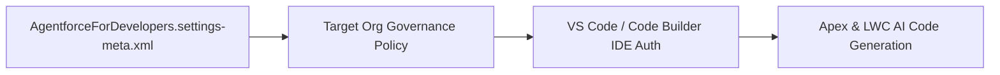

## Architectural Overview

Agentforce for Developers (formerly Einstein for Developers) provides AI-powered Apex and Lightning Web Component (LWC) code generation, inline autocomplete, and unit test scaffolding inside VS Code and Code Builder. When developers authenticate their IDE to a Salesforce org, the IDE checks the org's `AgentforceForDevelopersSettings` metadata (`AgentforceForDevelopers.settings-meta.xml`) to determine if AI coding assistance is permitted.

For regulated enterprises, controlling `AgentforceForDevelopersSettings` via SFDX ensures consistent AI governance across developer sandboxes, scratch orgs, and production environments.



## SFDX Directory & File Suffix

| Property | Value |
| :--- | :--- |
| **Metadata Type Name** | `AgentforceForDevelopersSettings` (`Settings:AgentforceForDevelopers`) |
| **SFDX Directory** | `force-app/main/default/settings/` |
| **File Name & Suffix** | `AgentforceForDevelopers.settings-meta.xml` |
| **API Version Introduced** | `62.0` (Verified on `68.0` / Winter '27) |

## Key Metadata Fields

| Field Name | Type | Required | Architectural Purpose |
| :--- | :--- | :--- | :--- |
| `enableAgentforceForDevelopers` | `boolean` | No | Enables (`true`) or disables (`false`) Agentforce for Developers across the authenticated org. |

> [!NOTE]
> Even if a developer has the Agentforce for Developers extension installed in VS Code, AI features are governed by the default org authenticated in their SFDX workspace.

## Declarative XML & `package.xml` Examples

### Sample `AgentforceForDevelopers.settings-meta.xml`

```xml title="force-app/main/default/settings/AgentforceForDevelopers.settings-meta.xml"
<?xml version="1.0" encoding="UTF-8"?>
<AgentforceForDevelopersSettings xmlns="http://soap.sforce.com/2006/04/metadata">
    <enableAgentforceForDevelopers>true</enableAgentforceForDevelopers>
</AgentforceForDevelopersSettings>
```

### Sample `package.xml` Manifest

```xml title="manifest/package.xml"
<?xml version="1.0" encoding="UTF-8"?>
<Package xmlns="http://soap.sforce.com/2006/04/metadata">
    <types>
        <members>AgentforceForDevelopers</members>
        <name>Settings</name>
    </types>
    <version>68.0</version>
</Package>
```

## SFDX CLI Retrieval & Deployment

Retrieve and deploy `AgentforceForDevelopersSettings` using the `sf` CLI:

```bash
# Retrieve Agentforce for Developers settings from an org
sf project retrieve start --metadata "Settings:AgentforceForDevelopers"

# Deploy Agentforce for Developers settings to a sandbox or scratch org
sf project deploy start --metadata "Settings:AgentforceForDevelopers"
```

## Senior Architect Best Practices & Gotchas

- **Scratch Org Default Enablement:** Developers spend most of their time authenticated against scratch orgs. Include `agentforceForDevelopersSettings: { enableAgentforceForDevelopers: true }` inside `config/project-scratch-def.json` so developers don't lose AI assistance when switching to a newly created scratch org.
- **Generated Code Review Standards:** While Agentforce for Developers accelerates [ApexClass](/docs/metadata/apex-class-metadata-type/) authoring, enforce static code analysis (PMD / Salesforce Code Analyzer) in your PR pipelines to verify bulkification and `WITH USER_MODE` enforcement on all AI-assisted code.

> [!TIP]
> Combine `AgentforceForDevelopersSettings` with well-documented Apex interfaces and clear `description` tags on your custom objects and fields—Agentforce uses your local SFDX schema metadata to ground its code suggestions.
