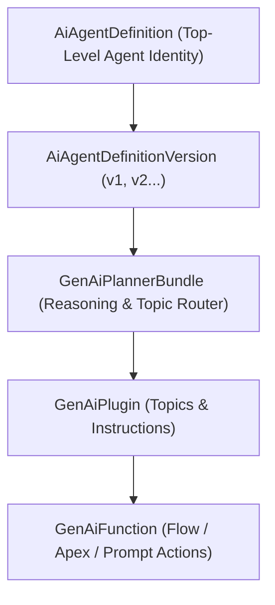

## Architectural Overview

In Salesforce Agentforce, an autonomous agent is more than a prompt—it is a governed identity with a defined role, channel bindings, security context, and reasoning engine. The `AiAgentDefinition` metadata type represents the top-level header definition of an AI agent in Agent Builder.

Architecturally, `AiAgentDefinition` separates the persistent identity of the agent (its API name, agent classification such as Service Agent or Employee Agent, and company context) from its versioned implementation (`AiAgentDefinitionVersion`) and reasoning bundle ([GenAiPlannerBundle](/docs/metadata/genai-planner-bundle-metadata-type/)).



## SFDX Directory & File Suffix

| Property | Value |
| :--- | :--- |
| **Metadata Type Name** | `AiAgentDefinition` |
| **SFDX Directory** | `force-app/main/default/aiAgentDefinitions/` |
| **File Suffix** | `.aiAgentDefinition-meta.xml` |
| **API Version Introduced** | `62.0` (Verified on `68.0` / Winter '27) |

## Key Metadata Fields

| Field Name | Type | Required | Architectural Purpose |
| :--- | :--- | :--- | :--- |
| `masterLabel` | `string` | Yes | Human-readable name of the Agentforce agent displayed in Agent Builder. |
| `developerName` | `string` | No | Unique API name of the agent definition. |
| `agentType` | `string` | Yes | Classification of the agent (e.g., `ServiceAgent`, `EmployeeAgent`, `SalesAgent`). |
| `description` | `string` | No | High-level summary of the agent's business responsibility and scope. |
| `companyDescription` | `string` | No | Grounding context describing the organization the agent represents. |
| `roleDescription` | `string` | No | Defines the persona, boundaries, and behavioral expectations of the agent. |

> [!RELEASE] Winter '27
> In Winter '27 (API `68.0`), `AiAgentDefinition` works alongside `AiAuthoringBundle` and `GenAiPlannerBundle` to support multi-environment CI/CD promotion of autonomous agents.

## Declarative XML & `package.xml` Examples

### Sample `.aiAgentDefinition-meta.xml`

```xml title="force-app/main/default/aiAgentDefinitions/Enterprise_Order_Support_Agent.aiAgentDefinition-meta.xml"
<?xml version="1.0" encoding="UTF-8"?>
<AiAgentDefinition xmlns="http://soap.sforce.com/2006/04/metadata">
    <agentType>ServiceAgent</agentType>
    <companyDescription>Global B2B industrial equipment manufacturer providing 24/7 order and warranty support.</companyDescription>
    <description>Autonomous service agent handling order status inquiries, RMA initiation, and shipment tracking.</description>
    <masterLabel>Enterprise Order Support Agent</masterLabel>
    <roleDescription>You are a helpful, concise B2B Customer Support Specialist assisting verified account contacts with orders and returns.</roleDescription>
</AiAgentDefinition>
```

### Sample `package.xml` Manifest

```xml title="manifest/package.xml"
<?xml version="1.0" encoding="UTF-8"?>
<Package xmlns="http://soap.sforce.com/2006/04/metadata">
    <types>
        <members>Enterprise_Order_Support_Agent</members>
        <name>AiAgentDefinition</name>
    </types>
    <version>68.0</version>
</Package>
```

## SFDX CLI Retrieval & Deployment

Retrieve and deploy `AiAgentDefinition` components using the Salesforce CLI:

```bash
# Retrieve all AI Agent Definitions in the org
sf project retrieve start --metadata "AiAgentDefinition:*"

# Deploy a specific AI Agent Definition
sf project deploy start --metadata "AiAgentDefinition:Enterprise_Order_Support_Agent"
```

## Senior Architect Best Practices & Gotchas

- **Least-Privilege Execution Context:** Service Agents execute under a dedicated Einstein Agent User license. Provision a tailored [PermissionSet](/docs/metadata/permission-set-metadata-type/) granting access only to the objects, fields, Apex classes, and Flows required by the agent's [GenAiFunction](/docs/metadata/genai-function-metadata-type/) actions.
- **Keep Role & Company Descriptions Crisp:** The `roleDescription` and `companyDescription` fields are injected into the planner's system prompt on every turn. Avoid bloated paragraphs that consume context window tokens; keep instructions specific and conflict-free with topic-level instructions in [GenAiPlugin](/docs/metadata/genai-plugin-metadata-type/).
- **Full Bundle Promotion:** Always retrieve and deploy `AiAgentDefinition`, `AiAgentDefinitionVersion`, and `GenAiPlannerBundle` together so version pointers remain synchronized across sandboxes.

> [!TIP]
> Validate your `AiAgentDefinition` changes automatically before activating in production by running an `AiEvaluationDefinition` test suite in your UAT sandbox.
