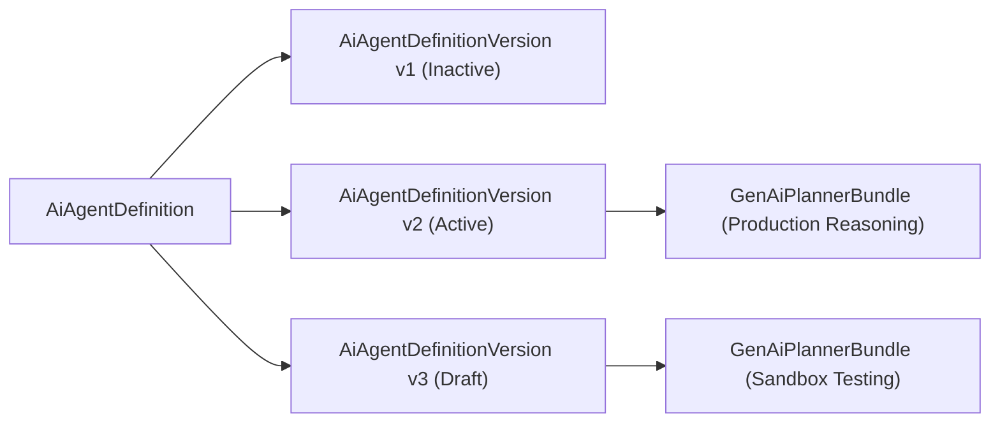

## Architectural Overview

Much like Salesforce [Flow](/docs/metadata/flow-metadata-type/) separates `FlowDefinition` from individual `Flow` versions, Agentforce separates the parent `AiAgentDefinition` from `AiAgentDefinitionVersion`. Each `AiAgentDefinitionVersion` represents a discrete, testable iteration of an autonomous agent—binding a specific version number and lifecycle status (`Active`, `Draft`, `Inactive`) to a [GenAiPlannerBundle](/docs/metadata/genai-planner-bundle-metadata-type/).

This versioning architecture is essential for zero-downtime AI DevOps: teams can iterate on new topics and actions in a draft version, run automated evaluations, and cut over traffic cleanly.



## SFDX Directory & File Suffix

| Property | Value |
| :--- | :--- |
| **Metadata Type Name** | `AiAgentDefinitionVersion` |
| **SFDX Directory** | `force-app/main/default/aiAgentDefinitionVersions/` |
| **File Suffix** | `.aiAgentDefinitionVersion-meta.xml` |
| **API Version Introduced** | `62.0` (Verified on `68.0` / Winter '27) |

## Key Metadata Fields

| Field Name | Type | Required | Architectural Purpose |
| :--- | :--- | :--- | :--- |
| `aiAgentDefinition` | `string` | Yes | DeveloperName of the parent `AiAgentDefinition` record. |
| `versionNumber` | `int` | Yes | Sequential integer identifying the agent version (`1`, `2`, `3`). |
| `status` | `string` | Yes | Lifecycle state of this version (`Draft`, `Active`, `Inactive`). Only one version per agent can be `Active` at a time. |
| `genAiPlanner` | `string` | No | DeveloperName of the [GenAiPlannerBundle](/docs/metadata/genai-planner-bundle-metadata-type/) orchestrating topics and actions for this version. |
| `description` | `string` | No | Release notes documenting the topic, prompt, or guardrail changes introduced in this version. |

> [!WARNING]
> Deploying an `AiAgentDefinitionVersion` with `<status>Active</status>` when its referenced `genAiPlanner` or child [GenAiPlugin](/docs/metadata/genai-plugin-metadata-type/) topics have validation errors will fail the entire deployment transaction.

## Declarative XML & `package.xml` Examples

### Sample `.aiAgentDefinitionVersion-meta.xml`

```xml title="force-app/main/default/aiAgentDefinitionVersions/Enterprise_Order_Support_Agent_v2.aiAgentDefinitionVersion-meta.xml"
<?xml version="1.0" encoding="UTF-8"?>
<AiAgentDefinitionVersion xmlns="http://soap.sforce.com/2006/04/metadata">
    <aiAgentDefinition>Enterprise_Order_Support_Agent</aiAgentDefinition>
    <description>Added automated RMA eligibility verification topic and stricter refund guardrails.</description>
    <genAiPlanner>Enterprise_Order_Support_Planner_v2</genAiPlanner>
    <status>Active</status>
    <versionNumber>2</versionNumber>
</AiAgentDefinitionVersion>
```

### Sample `package.xml` Manifest

```xml title="manifest/package.xml"
<?xml version="1.0" encoding="UTF-8"?>
<Package xmlns="http://soap.sforce.com/2006/04/metadata">
    <types>
        <members>Enterprise_Order_Support_Agent</members>
        <name>AiAgentDefinition</name>
    </types>
    <types>
        <members>Enterprise_Order_Support_Agent_v2</members>
        <name>AiAgentDefinitionVersion</name>
    </types>
    <version>68.0</version>
</Package>
```

## SFDX CLI Retrieval & Deployment

Retrieve and deploy agent versions using the Salesforce CLI:

```bash
# Retrieve all AI Agent Definition Versions
sf project retrieve start --metadata "AiAgentDefinitionVersion:*"

# Deploy the parent definition and specific version together
sf project deploy start --metadata "AiAgentDefinition:Enterprise_Order_Support_Agent" "AiAgentDefinitionVersion:Enterprise_Order_Support_Agent_v2"
```

## Senior Architect Best Practices & Gotchas

- **Immutable Active Versions:** Once an `AiAgentDefinitionVersion` is `Active` in an org, attempting to overwrite its planner bindings without first deactivating it or incrementing `versionNumber` can trigger Metadata API lock errors.
- **Source Control Pruning:** Keep only the current active version (and optionally one previous rollback version) in your `main` Git branch so your repository doesn't accumulate dozens of obsolete draft versions.

> [!TIP]
> Always populate `<description>` with the Git commit SHA or Jira ticket ID during CI/CD builds so admins looking at Agent Builder in production know exactly which release deployed the active agent version.
