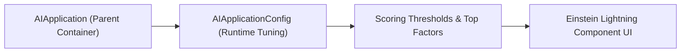

## Architectural Overview

While `AIApplication` defines the high-level identity and type of an Einstein AI solution, `AIApplicationConfig` governs how that application behaves at runtime—controlling scoring thresholds, top factor display limits, and feature-specific toggles.

Separating `AIApplicationConfig` from the base `AIApplication` allows architects to tune operational parameters (such as confidence thresholds or explanation display settings) in production or staging without redeploying the underlying machine learning data definitions.



## SFDX Directory & File Suffix

| Property | Value |
| :--- | :--- |
| **Metadata Type Name** | `AIApplicationConfig` |
| **SFDX Directory** | `force-app/main/default/aiApplicationConfigs/` |
| **File Suffix** | `.aiApplicationConfig-meta.xml` |
| **API Version Introduced** | `51.0` (Verified on `68.0` / Winter '27) |

## Key Metadata Fields

| Field Name | Type | Required | Architectural Purpose |
| :--- | :--- | :--- | :--- |
| `aiApplicationDeveloperName` | `string` | Yes | DeveloperName of the parent `AIApplication` that owns this configuration. |
| `developerName` | `string` | No | Unique API identifier for this configuration record. |
| `masterLabel` | `string` | Yes | Human-readable label displayed in Setup. |
| `applicationId` | `string` | No | Internal or external application identifier associated with the config. |

> [!NOTE]
> Always retrieve `AIApplication` and `AIApplicationConfig` together in the same `package.xml` manifest so parent-child `aiApplicationDeveloperName` references stay intact.

## Declarative XML & `package.xml` Examples

### Sample `.aiApplicationConfig-meta.xml`

```xml title="force-app/main/default/aiApplicationConfigs/Customer_Churn_App_Runtime_Config.aiApplicationConfig-meta.xml"
<?xml version="1.0" encoding="UTF-8"?>
<AIApplicationConfig xmlns="http://soap.sforce.com/2006/04/metadata">
    <aiApplicationDeveloperName>Customer_Churn_Prediction_App</aiApplicationDeveloperName>
    <developerName>Customer_Churn_App_Runtime_Config</developerName>
    <masterLabel>Customer Churn App Runtime Config</masterLabel>
</AIApplicationConfig>
```

### Sample `package.xml` Manifest

```xml title="manifest/package.xml"
<?xml version="1.0" encoding="UTF-8"?>
<Package xmlns="http://soap.sforce.com/2006/04/metadata">
    <types>
        <members>Customer_Churn_Prediction_App</members>
        <name>AIApplication</name>
    </types>
    <types>
        <members>Customer_Churn_App_Runtime_Config</members>
        <name>AIApplicationConfig</name>
    </types>
    <version>68.0</version>
</Package>
```

## SOQL Query & SFDX CLI Commands

### Inspect AIApplicationConfig Records via SOQL

```soql
SELECT Id, DeveloperName, MasterLabel, AIApplicationId, CreatedDate
FROM AIApplicationConfig
ORDER BY CreatedDate DESC
```

### Retrieve and Deploy via Salesforce CLI

```bash
# Retrieve all AIApplicationConfig records
sf project retrieve start --metadata "AIApplicationConfig:*"

# Deploy a specific AIApplicationConfig
sf project deploy start --metadata "AIApplicationConfig:Customer_Churn_App_Runtime_Config"
```

## Senior Architect Best Practices & Gotchas

- **Cross-Environment Portability:** Never hardcode 15- or 18-character Salesforce record IDs inside configuration XML; always reference the parent application by its portable `aiApplicationDeveloperName`.
- **UI Component Visibility:** When configuring Einstein prediction explanations or top factors via `AIApplicationConfig`, ensure end users have a [PermissionSet](/docs/metadata/permission-set-metadata-type/) granting read access to the target prediction fields on the [CustomObject](/docs/metadata/custom-object-metadata-type/).

> [!TIP]
> Audit changes to `AIApplicationConfig` in your Git pull requests whenever business stakeholders request changes to Einstein confidence cutoffs so you maintain a clear compliance trail of AI decision thresholds.
