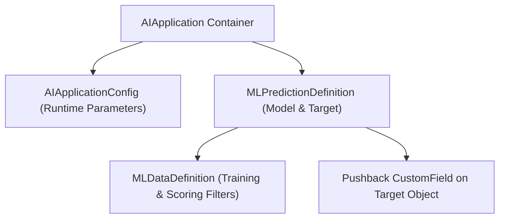

## Architectural Overview

Across Salesforce's predictive and generative AI stack—including Einstein Prediction Builder, Case Classification, Opportunity Scoring, and industry-specific AI—the platform organizes machine learning models inside an `AIApplication` container. Each `AIApplication` groups one or more `MLPredictionDefinition` and `MLDataDefinition` records under a unified lifecycle status.

Understanding and version-controlling `AIApplication` metadata allows architects to promote trained model definitions and writeback field mappings cleanly from staging sandboxes to production without rebuilding prediction schemas manually.



## SFDX Directory & File Suffix

| Property | Value |
| :--- | :--- |
| **Metadata Type Name** | `AIApplication` |
| **SFDX Directory** | `force-app/main/default/aiApplications/` |
| **File Suffix** | `.ai-meta.xml` / `.aiApplication-meta.xml` |
| **API Version Introduced** | `50.0` (Verified on `68.0` / Winter '27) |

## Key Metadata Fields

| Field Name | Type | Required | Architectural Purpose |
| :--- | :--- | :--- | :--- |
| `masterLabel` | `string` | Yes | Display name of the Einstein AI Application in Setup. |
| `developerName` | `string` | No | Unique API identifier for the `AIApplication`. |
| `status` | `AIApplicationStatus` | Yes | Operational state of the application (`Enabled`, `Disabled`, `Draft`, `Migrated`). |
| `type` | `AIApplicationType` | Yes | Categorizes the AI engine (`PredictionBuilder`, `CaseClassification`, `RecommendationBuilder`, etc.). |

> [!NOTE]
> Deploying an `AIApplication` transfers the declarative model definition and metadata structure—not the trained statistical weights from sandbox data. The model must be retrained against production data after deployment.

## Declarative XML & `package.xml` Examples

### Sample `.ai-meta.xml`

```xml title="force-app/main/default/aiApplications/Customer_Churn_Prediction_App.ai-meta.xml"
<?xml version="1.0" encoding="UTF-8"?>
<AIApplication xmlns="http://soap.sforce.com/2006/04/metadata">
    <developerName>Customer_Churn_Prediction_App</developerName>
    <masterLabel>Customer Churn Prediction App</masterLabel>
    <status>Enabled</status>
    <type>PredictionBuilder</type>
</AIApplication>
```

### Sample `package.xml` Manifest

```xml title="manifest/package.xml"
<?xml version="1.0" encoding="UTF-8"?>
<Package xmlns="http://soap.sforce.com/2006/04/metadata">
    <types>
        <members>Customer_Churn_Prediction_App</members>
        <name>AIApplication</name>
    </types>
    <version>68.0</version>
</Package>
```

## SOQL Query & SFDX CLI Commands

### Query Installed AI Applications via SOQL

```soql
SELECT Id, DeveloperName, MasterLabel, Type, Status, CreatedDate, LastModifiedDate
FROM AIApplication
ORDER BY CreatedDate DESC
```

### Retrieve and Deploy via Salesforce CLI

```bash
# Retrieve all AIApplication definitions
sf project retrieve start --metadata "AIApplication:*"

# Deploy a specific AIApplication to the target org
sf project deploy start --metadata "AIApplication:Customer_Churn_Prediction_App"
```

## Senior Architect Best Practices & Gotchas

- **Deploy Writeback Custom Fields First:** If your `AIApplication` and child `MLPredictionDefinition` write scores back to a custom AI Prediction field ([CustomField](/docs/metadata/custom-field-metadata-type/) with `<isAiPredictionField>true</isAiPredictionField>`), include that `CustomField` in the same deployment package.
- **Minimum Data Volume for Training:** Deploying an `AIApplication` with `<status>Enabled</status>` to a partial sandbox or scratch org with fewer than 400 historical positive/negative examples will cause model training to fail post-deployment. Deploy as `Draft` in low-data environments.

> [!TIP]
> Combine `AIApplication` score writebacks with record-triggered [Flow](/docs/metadata/flow-metadata-type/) automations that trigger retention tasks only when the prediction score crosses a high-confidence threshold (for example, `Churn_Score__c >= 80`).
