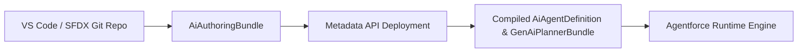

## Architectural Overview

As enterprise engineering teams scale Agentforce adoption, authoring agents solely via point-and-click UI builders creates bottlenecks in multi-developer Git workflows. The `AiAuthoringBundle` metadata type enables pro-code and hybrid development teams to define, version, and review Agentforce agent authoring specifications as a cohesive metadata bundle in Salesforce DX.

Architecturally, `AiAuthoringBundle` acts as the developer-friendly authoring representation that compiles and synchronizes with the runtime `AiAgentDefinition` and [GenAiPlannerBundle](/docs/metadata/genai-planner-bundle-metadata-type/) execution engine.



## SFDX Directory & File Suffix

| Property | Value |
| :--- | :--- |
| **Metadata Type Name** | `AiAuthoringBundle` |
| **SFDX Directory** | `force-app/main/default/aiAuthoringBundles/<BundleName>/` |
| **File Suffix** | `.aiAuthoringBundle-meta.xml` |
| **API Version Introduced** | `63.0` (Verified on `68.0` / Winter '27) |

> [!RELEASE] Winter '27
> Verified for API version `68.0` (Winter '27). `AiAuthoringBundle` streamlines source-driven agent lifecycle management across scratch orgs and CI/CD pipelines.

## Key Metadata Fields

| Field Name | Type | Required | Architectural Purpose |
| :--- | :--- | :--- | :--- |
| `masterLabel` | `string` | Yes | Display name of the AI authoring bundle in Setup and Agent Builder. |
| `developerName` | `string` | No | Unique API name of the authoring bundle. |
| `description` | `string` | No | Documents the agent specification purpose, target persona, and owning team. |

## Declarative XML & `package.xml` Examples

### Sample `.aiAuthoringBundle-meta.xml`

```xml title="force-app/main/default/aiAuthoringBundles/B2B_Quote_Assistant_Bundle/B2B_Quote_Assistant_Bundle.aiAuthoringBundle-meta.xml"
<?xml version="1.0" encoding="UTF-8"?>
<AiAuthoringBundle xmlns="http://soap.sforce.com/2006/04/metadata">
    <description>Source-driven authoring bundle for the B2B CPQ Quote Assistant agent.</description>
    <masterLabel>B2B Quote Assistant Bundle</masterLabel>
</AiAuthoringBundle>
```

### Sample `package.xml` Manifest

```xml title="manifest/package.xml"
<?xml version="1.0" encoding="UTF-8"?>
<Package xmlns="http://soap.sforce.com/2006/04/metadata">
    <types>
        <members>B2B_Quote_Assistant_Bundle</members>
        <name>AiAuthoringBundle</name>
    </types>
    <version>68.0</version>
</Package>
```

## SFDX CLI Retrieval & Deployment

Use the `sf` CLI to retrieve, validate, and deploy `AiAuthoringBundle` directories:

```bash
# Retrieve all AiAuthoringBundle components from the org
sf project retrieve start --metadata "AiAuthoringBundle:*"

# Retrieve a specific AiAuthoringBundle by name
sf project retrieve start --metadata "AiAuthoringBundle:B2B_Quote_Assistant_Bundle"

# Deploy the bundle directory directly
sf project deploy start --source-dir force-app/main/default/aiAuthoringBundles/B2B_Quote_Assistant_Bundle
```

## Senior Architect Best Practices & Gotchas

- **Verify Action Targets Before Deploying:** An `AiAuthoringBundle` frequently references [GenAiFunction](/docs/metadata/genai-function-metadata-type/) actions backed by autolaunched Flows or invocable Apex classes. Ensure all underlying Flows and Apex classes are deployed in the same transaction or already present in the target org.
- **Avoid Mixed Authoring Collisions:** Establish a clear team governance rule: if an agent is managed via `AiAuthoringBundle` in Git, restrict hotfix edits in the production Agent Builder UI so local SFDX bundles remain the single source of truth.

> [!TIP]
> Pair every pull request touching an `AiAuthoringBundle` with an automated `AiEvaluationDefinition` test run to catch topic-routing regressions before merging to `main`.
