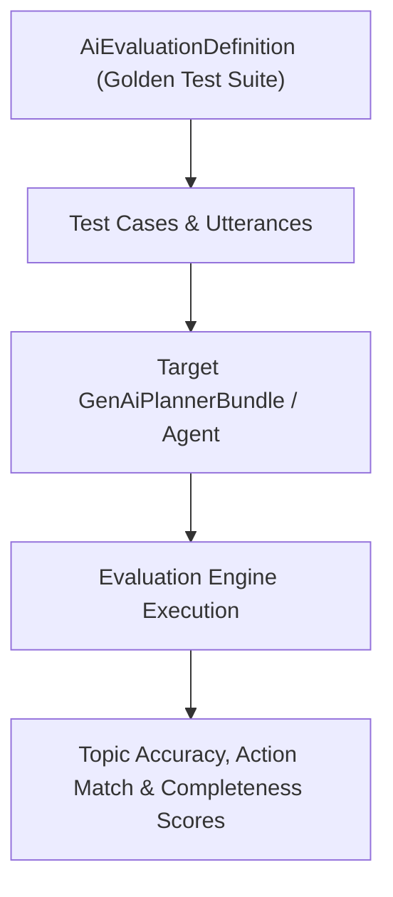

## Architectural Overview

Deterministic Apex code relies on `@IsTest` unit tests to guarantee 75%+ coverage, but autonomous AI agents require behavioral evaluation. The `AiEvaluationDefinition` metadata type powers the **Agentforce Testing Center**, allowing architects to define golden test datasets (customer utterances, expected [GenAiPlugin](/docs/metadata/genai-plugin-metadata-type/) topic selections, expected [GenAiFunction](/docs/metadata/genai-function-metadata-type/) invocations, and response quality metrics) as declarative metadata.

Storing `AiEvaluationDefinition` in SFDX lets your CI/CD pipeline deploy golden test suites alongside agent changes into every staging sandbox.



## SFDX Directory & File Suffix

| Property | Value |
| :--- | :--- |
| **Metadata Type Name** | `AiEvaluationDefinition` |
| **SFDX Directory** | `force-app/main/default/aiEvaluationDefinitions/` |
| **File Suffix** | `.aiEvaluationDefinition-meta.xml` |
| **API Version Introduced** | `63.0` (Verified on `68.0` / Winter '27) |

> [!RELEASE] Winter '27
> In API version `68.0` (Winter '27), `AiEvaluationDefinition` is a core pillar of enterprise Agentforce DevOps, enabling repeatable regression testing across agent versions.

## Key Metadata Fields

| Field Name | Type | Required | Architectural Purpose |
| :--- | :--- | :--- | :--- |
| `masterLabel` | `string` | Yes | Human-readable title of the evaluation test suite in the Testing Center. |
| `developerName` | `string` | No | Unique API identifier for the evaluation definition. |
| `description` | `string` | No | Explains the test coverage scope, target agent persona, and pass/fail criteria. |
| `subjectType` | `string` | No | Specifies the target entity type under evaluation (such as an Agent or Planner). |
| `subjectName` | `string` | No | DeveloperName of the target agent or planner being evaluated. |

## Declarative XML & `package.xml` Examples

### Sample `.aiEvaluationDefinition-meta.xml`

```xml title="force-app/main/default/aiEvaluationDefinitions/Order_Support_Agent_Regression_Suite.aiEvaluationDefinition-meta.xml"
<?xml version="1.0" encoding="UTF-8"?>
<AiEvaluationDefinition xmlns="http://soap.sforce.com/2006/04/metadata">
    <description>Golden regression evaluation suite verifying order lookup, RMA initiation, and off-topic guardrail refusal.</description>
    <masterLabel>Order Support Agent Regression Suite</masterLabel>
    <subjectName>Enterprise_Order_Support_Agent</subjectName>
    <subjectType>Agent</subjectType>
</AiEvaluationDefinition>
```

### Sample `package.xml` Manifest

```xml title="manifest/package.xml"
<?xml version="1.0" encoding="UTF-8"?>
<Package xmlns="http://soap.sforce.com/2006/04/metadata">
    <types>
        <members>Order_Support_Agent_Regression_Suite</members>
        <name>AiEvaluationDefinition</name>
    </types>
    <version>68.0</version>
</Package>
```

## SFDX CLI Retrieval & Deployment

Retrieve and deploy `AiEvaluationDefinition` suites via the Salesforce CLI:

```bash
# Retrieve all AI Evaluation Definitions from the org
sf project retrieve start --metadata "AiEvaluationDefinition:*"

# Deploy the regression evaluation suite to a UAT sandbox
sf project deploy start --metadata "AiEvaluationDefinition:Order_Support_Agent_Regression_Suite"
```

## Senior Architect Best Practices & Gotchas

- **Test Adversarial & Edge Utterances:** Don't only test happy-path utterances. Include prompt-injection attempts, ambiguous multi-intent questions, and out-of-scope requests in your `AiEvaluationDefinition` to verify that the planner routes to the off-topic guardrail rather than hallucinating actions.
- **Seed Synthetic Test Data First:** If the actions under evaluation query `Order` or `Case` records via [Flow](/docs/metadata/flow-metadata-type/) or Apex, run a pre-test data seeding script in your UAT sandbox so action execution outputs match your evaluation assertions.

> [!TIP]
> Gate production promotions of any [GenAiPlannerBundle](/docs/metadata/genai-planner-bundle-metadata-type/) change on a 100% pass rate for topic classification and action selection in your `AiEvaluationDefinition` suite.
