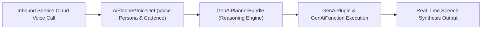

## Architectural Overview

When an autonomous Agentforce agent moves from text chat to live telephony channels (Service Cloud Voice), latency, speech cadence, barge-in handling, and acoustic persona become critical architectural concerns. The `AiPlannerVoiceDef` metadata type defines the voice configuration attached to an Agentforce planner ([GenAiPlannerBundle](/docs/metadata/genai-planner-bundle-metadata-type/)).

By isolating voice synthesis and telephony tuning inside `AiPlannerVoiceDef`, architects can reuse the same underlying topics and actions across digital chat and voice while tailoring vocal delivery and turn-taking parameters specifically for callers.



## SFDX Directory & File Suffix

| Property | Value |
| :--- | :--- |
| **Metadata Type Name** | `AiPlannerVoiceDef` |
| **SFDX Directory** | `force-app/main/default/aiPlannerVoiceDefs/` |
| **File Suffix** | `.aiPlannerVoiceDef-meta.xml` |
| **API Version Introduced** | `63.0` (Verified on `68.0` / Winter '27) |

> [!RELEASE] Winter '27
> Verified for API version `68.0` (Winter '27). Use `AiPlannerVoiceDef` to version-control voice persona and telephony speech parameters across environments.

## Key Metadata Fields

| Field Name | Type | Required | Architectural Purpose |
| :--- | :--- | :--- | :--- |
| `masterLabel` | `string` | Yes | Human-readable label for the planner voice definition in Setup. |
| `developerName` | `string` | No | Unique API name of the `AiPlannerVoiceDef` component. |
| `planner` | `string` | No | DeveloperName of the parent [GenAiPlannerBundle](/docs/metadata/genai-planner-bundle-metadata-type/) to which this voice configuration applies. |
| `description` | `string` | No | Documents the voice persona, locale, and target telephony channel. |

## Declarative XML & `package.xml` Examples

### Sample `.aiPlannerVoiceDef-meta.xml`

```xml title="force-app/main/default/aiPlannerVoiceDefs/Enterprise_Order_Support_Voice_Def.aiPlannerVoiceDef-meta.xml"
<?xml version="1.0" encoding="UTF-8"?>
<AiPlannerVoiceDef xmlns="http://soap.sforce.com/2006/04/metadata">
    <description>Natural conversational US English voice profile for the Enterprise Order Support telephony agent.</description>
    <masterLabel>Enterprise Order Support Voice Profile</masterLabel>
    <planner>Enterprise_Order_Support_Planner_v2</planner>
</AiPlannerVoiceDef>
```

### Sample `package.xml` Manifest

```xml title="manifest/package.xml"
<?xml version="1.0" encoding="UTF-8"?>
<Package xmlns="http://soap.sforce.com/2006/04/metadata">
    <types>
        <members>Enterprise_Order_Support_Voice_Def</members>
        <name>AiPlannerVoiceDef</name>
    </types>
    <version>68.0</version>
</Package>
```

## SFDX CLI Retrieval & Deployment

Retrieve and deploy `AiPlannerVoiceDef` components via the Salesforce CLI:

```bash
# Retrieve all AiPlannerVoiceDef records from the org
sf project retrieve start --metadata "AiPlannerVoiceDef:*"

# Deploy a specific planner voice definition
sf project deploy start --metadata "AiPlannerVoiceDef:Enterprise_Order_Support_Voice_Def"
```

## Senior Architect Best Practices & Gotchas

- **Optimize Action Latency for Voice:** Callers on a phone line will not tolerate 15-second silences while an Apex callout runs. Ensure every [GenAiFunction](/docs/metadata/genai-function-metadata-type/) invoked by a voice-enabled planner executes in sub-second time or uses progress acknowledgments.
- **Avoid Markdown in Voice Outputs:** Instruct your voice-enabled [GenAiPlugin](/docs/metadata/genai-plugin-metadata-type/) topics to output concise, spoken-style sentences rather than markdown tables or bulleted lists that sound unnatural when read aloud by text-to-speech engines.

> [!TIP]
> Always deploy the referenced [GenAiPlannerBundle](/docs/metadata/genai-planner-bundle-metadata-type/) prior to or in the same `package.xml` manifest as `AiPlannerVoiceDef` to avoid broken planner dependency errors.
