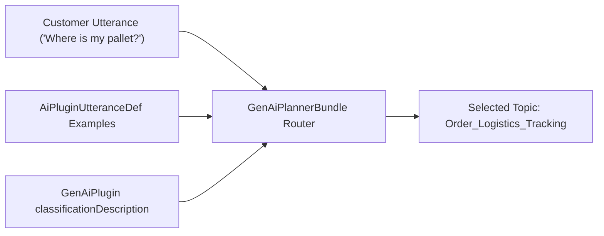

## Architectural Overview

In complex enterprise Agentforce implementations with 10+ topics ([GenAiPlugin](/docs/metadata/genai-plugin-metadata-type/)), two topics may have closely related boundaries—such as *Order Status Inquiry* versus *Order Modification & Cancellation*. While the topic's `classificationDescription` is the primary semantic signal, the `AiPluginUtteranceDef` metadata type allows architects to bind explicit sample utterances to a topic.

These utterances serve as high-signal few-shot routing examples for the [GenAiPlannerBundle](/docs/metadata/genai-planner-bundle-metadata-type/) reasoning engine, dramatically reducing topic misclassifications on domain-specific jargon or colloquial customer phrasing.



## SFDX Directory & File Suffix

| Property | Value |
| :--- | :--- |
| **Metadata Type Name** | `AiPluginUtteranceDef` |
| **SFDX Directory** | `force-app/main/default/aiPluginUtteranceDefs/` |
| **File Suffix** | `.aiPluginUtteranceDef-meta.xml` |
| **API Version Introduced** | `62.0` (Verified on `68.0` / Winter '27) |

## Key Metadata Fields

| Field Name | Type | Required | Architectural Purpose |
| :--- | :--- | :--- | :--- |
| `masterLabel` | `string` | Yes | Human-readable label for the utterance definition in Setup. |
| `developerName` | `string` | No | Unique API name of the `AiPluginUtteranceDef` record. |
| `plugin` | `string` | Yes | DeveloperName of the parent [GenAiPlugin](/docs/metadata/genai-plugin-metadata-type/) topic this utterance belongs to. |
| `utterance` | `string` | Yes | The exact sample phrase or question a user might say to trigger the topic. |
| `language` | `string` | No | Locale code of the utterance (for example, `en_US`). |

> [!WARNING]
> Never assign identical or near-identical `<utterance>` strings to two different `GenAiPlugin` topics inside the same planner—doing so introduces routing ambiguity and non-deterministic topic switching.

## Declarative XML & `package.xml` Examples

### Sample `.aiPluginUtteranceDef-meta.xml`

```xml title="force-app/main/default/aiPluginUtteranceDefs/Track_Freight_Pallet_Utterance.aiPluginUtteranceDef-meta.xml"
<?xml version="1.0" encoding="UTF-8"?>
<AiPluginUtteranceDef xmlns="http://soap.sforce.com/2006/04/metadata">
    <language>en_US</language>
    <masterLabel>Track Freight Pallet Utterance</masterLabel>
    <plugin>Order_Logistics_Tracking</plugin>
    <utterance>Where is my freight shipment pallet right now and what is the carrier BOL number?</utterance>
</AiPluginUtteranceDef>
```

### Sample `package.xml` Manifest

```xml title="manifest/package.xml"
<?xml version="1.0" encoding="UTF-8"?>
<Package xmlns="http://soap.sforce.com/2006/04/metadata">
    <types>
        <members>Order_Logistics_Tracking</members>
        <name>GenAiPlugin</name>
    </types>
    <types>
        <members>Track_Freight_Pallet_Utterance</members>
        <name>AiPluginUtteranceDef</name>
    </types>
    <version>68.0</version>
</Package>
```

## SFDX CLI Retrieval & Deployment

Retrieve and deploy `AiPluginUtteranceDef` components via the Salesforce CLI:

```bash
# Retrieve all AiPluginUtteranceDef records
sf project retrieve start --metadata "AiPluginUtteranceDef:*"

# Deploy a specific utterance definition alongside its parent GenAiPlugin
sf project deploy start --metadata "GenAiPlugin:Order_Logistics_Tracking" "AiPluginUtteranceDef:Track_Freight_Pallet_Utterance"
```

## Senior Architect Best Practices & Gotchas

- **Curate Real Production Transcripts:** Harvest real customer phrasing from Service Cloud Messaging transcripts where the agent previously hesitated or misrouted, sanitize any PII, and commit those phrases as `AiPluginUtteranceDef` records.
- **Quality Over Quantity:** Five to ten diverse, domain-specific utterances per [GenAiPlugin](/docs/metadata/genai-plugin-metadata-type/) outperform fifty repetitive variations of the same sentence.

> [!TIP]
> Whenever you add a new `AiPluginUtteranceDef` to fix a routing edge case, add a corresponding test case in your `AiEvaluationDefinition` suite to prevent future regressions.
