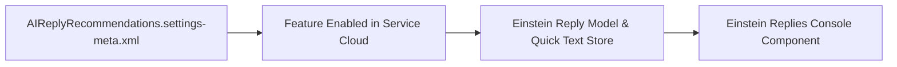

## Architectural Overview

Einstein Reply Recommendations analyzes past chat and messaging transcripts to suggest relevant Quick Text responses to Service Cloud agents in real time. The `AIReplyRecommendationsSettings` metadata type (`AIReplyRecommendations.settings-meta.xml`) governs the org-level feature switch for this capability.

By including `AIReplyRecommendationsSettings` in your SFDX repository, you ensure that Service Cloud sandboxes and scratch orgs have the feature enabled before deploying downstream Lightning Record Pages or Quick Text folders that depend on the Einstein Replies component.



## SFDX Directory & File Suffix

| Property | Value |
| :--- | :--- |
| **Metadata Type Name** | `AIReplyRecommendationsSettings` (`Settings:AIReplyRecommendations`) |
| **SFDX Directory** | `force-app/main/default/settings/` |
| **File Name & Suffix** | `AIReplyRecommendations.settings-meta.xml` |
| **API Version Introduced** | `50.0` (Verified on `68.0` / Winter '27) |

## Key Metadata Fields

| Field Name | Type | Required | Architectural Purpose |
| :--- | :--- | :--- | :--- |
| `enableReplyRecommendations` | `boolean` | No | Enables (`true`) or disables (`false`) Einstein Reply Recommendations across the org. |

> [!NOTE]
> The target org must have the Service Cloud Einstein or Einstein Reply Recommendations add-on license provisioned, or deploying `<enableReplyRecommendations>true</enableReplyRecommendations>` will fail.

## Declarative XML & `package.xml` Examples

### Sample `AIReplyRecommendations.settings-meta.xml`

```xml title="force-app/main/default/settings/AIReplyRecommendations.settings-meta.xml"
<?xml version="1.0" encoding="UTF-8"?>
<AIReplyRecommendationsSettings xmlns="http://soap.sforce.com/2006/04/metadata">
    <enableReplyRecommendations>true</enableReplyRecommendations>
</AIReplyRecommendationsSettings>
```

### Sample `package.xml` Manifest

```xml title="manifest/package.xml"
<?xml version="1.0" encoding="UTF-8"?>
<Package xmlns="http://soap.sforce.com/2006/04/metadata">
    <types>
        <members>AIReplyRecommendations</members>
        <name>Settings</name>
    </types>
    <version>68.0</version>
</Package>
```

## SFDX CLI Retrieval & Deployment

Retrieve and deploy `AIReplyRecommendationsSettings` via the Salesforce CLI:

```bash
# Retrieve Einstein Reply Recommendations settings
sf project retrieve start --metadata "Settings:AIReplyRecommendations"

# Deploy the settings to enable Einstein Reply Recommendations
sf project deploy start --metadata "Settings:AIReplyRecommendations"
```

## Senior Architect Best Practices & Gotchas

- **Quick Text Folder Sharing:** Recommended replies are stored as standard `QuickText` records. After enabling `AIReplyRecommendationsSettings`, ensure your support agents have read access to the published Quick Text folder and the `Einstein Reply Recommendations` system permission via a [PermissionSet](/docs/metadata/permission-set-metadata-type/).
- **Transcript Volume Prerequisite:** Predictive reply models require at least 1,000 closed chat/messaging transcripts with 4+ turns to train in a new org; for orgs with lower transcript history, consider generative Einstein Service Replies instead.

> [!TIP]
> Deploy `Settings:AIReplyRecommendations` prior to deploying Service Console FlexiPages that embed the `Einstein Replies` standard component so page activation does not fail in CI.
