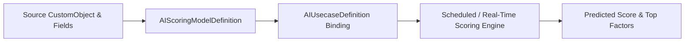

## Architectural Overview

Predictive scoring across Industry Clouds and core CRM relies on reusable model blueprints that specify which historical fields and related records contribute to a propensity or risk score. The `AIScoringModelDefinition` metadata type captures this model configuration in a portable XML structure.

By storing `AIScoringModelDefinition` in source control alongside `AIUsecaseDefinition`, architects can version-control feature selection changes, promote scoring models across sandboxes, and maintain strict governance over which fields feed predictive AI algorithms.



## SFDX Directory & File Suffix

| Property | Value |
| :--- | :--- |
| **Metadata Type Name** | `AIScoringModelDefinition` |
| **SFDX Directory** | `force-app/main/default/aiScoringModelDefinitions/` |
| **File Suffix** | `.aiScoringModelDefinition-meta.xml` |
| **API Version Introduced** | `58.0` (Verified on `68.0` / Winter '27) |

## Key Metadata Fields

| Field Name | Type | Required | Architectural Purpose |
| :--- | :--- | :--- | :--- |
| `masterLabel` | `string` | Yes | Display name of the AI scoring model definition in Setup. |
| `developerName` | `string` | No | Unique API identifier used across Metadata API and SFDX deployments. |
| `description` | `string` | No | Documents the model's predictive objective, included features, and excluded bias fields. |
| `isActive` | `boolean` | No | Indicates whether the scoring model definition is active and eligible for scoring runs. |

> [!WARNING]
> Audit all input fields referenced by an `AIScoringModelDefinition` for Indirect Bias and PII compliance before promoting `<isActive>true</isActive>` to production.

## Declarative XML & `package.xml` Examples

### Sample `.aiScoringModelDefinition-meta.xml`

```xml title="force-app/main/default/aiScoringModelDefinitions/B2B_Renewal_Propensity_Model.aiScoringModelDefinition-meta.xml"
<?xml version="1.0" encoding="UTF-8"?>
<AIScoringModelDefinition xmlns="http://soap.sforce.com/2006/04/metadata">
    <description>Predictive scoring model evaluating 90-day B2B contract renewal likelihood based on usage telemetry and support cases.</description>
    <isActive>true</isActive>
    <masterLabel>B2B Renewal Propensity Model</masterLabel>
</AIScoringModelDefinition>
```

### Sample `package.xml` Manifest

```xml title="manifest/package.xml"
<?xml version="1.0" encoding="UTF-8"?>
<Package xmlns="http://soap.sforce.com/2006/04/metadata">
    <types>
        <members>B2B_Renewal_Propensity_Model</members>
        <name>AIScoringModelDefinition</name>
    </types>
    <version>68.0</version>
</Package>
```

## SFDX CLI Retrieval & Deployment

Retrieve and deploy `AIScoringModelDefinition` components via the Salesforce CLI:

```bash
# Retrieve all AIScoringModelDefinition files from the org
sf project retrieve start --metadata "AIScoringModelDefinition:*"

# Deploy a specific AIScoringModelDefinition
sf project deploy start --metadata "AIScoringModelDefinition:B2B_Renewal_Propensity_Model"
```

## Senior Architect Best Practices & Gotchas

- **Prevent Target Leakage (Hindsight Bias):** Never include [CustomField](/docs/metadata/custom-field-metadata-type/) inputs that are only populated *after* the outcome occurs (such as `Cancellation_Reason__c` or `Final_Settlement_Date__c`). Target leakage produces artificially high sandbox metrics that fail in production.
- **Coordinate with `AIUsecaseDefinition`:** Deploy `AIScoringModelDefinition` and its companion `AIUsecaseDefinition` in the same `package.xml` manifest so cross-references validate cleanly.

> [!TIP]
> Surface the output of your `AIScoringModelDefinition` inside a record-triggered [Flow](/docs/metadata/flow-metadata-type/) or Lightning Record Page so account executives can act on low renewal propensity scores immediately.
