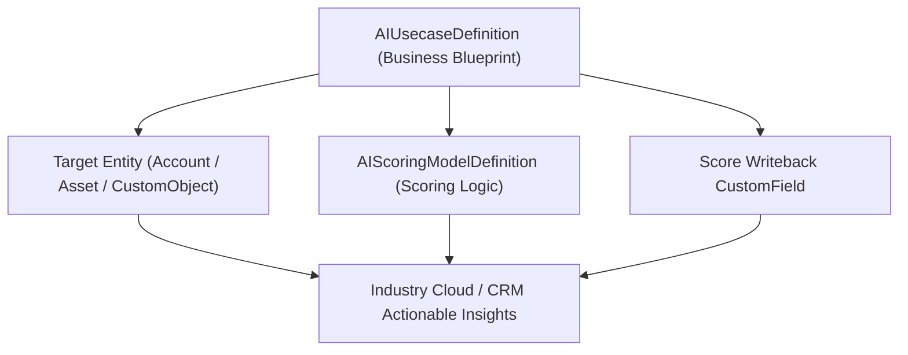

## Architectural Overview

Enterprise AI initiatives succeed when every machine learning model is anchored to a measurable business outcome and target entity. The `AIUsecaseDefinition` metadata type provides the declarative business wrapper for predictive and industry AI solutions—connecting the target [CustomObject](/docs/metadata/custom-object-metadata-type/) (such as `Account`, `Asset`, or `Claim`) with its underlying `AIScoringModelDefinition` and writeback fields.

Managing `AIUsecaseDefinition` in SFDX allows architects to package complete, domain-specific AI accelerators (e.g., *Subscriber Churn Risk*, *Warranty Claim Fraud Detection*, or *Donor Lapsed Likelihood*) and deploy them reproducibly across business units.



## SFDX Directory & File Suffix

| Property | Value |
| :--- | :--- |
| **Metadata Type Name** | `AIUsecaseDefinition` |
| **SFDX Directory** | `force-app/main/default/aiUsecaseDefinitions/` |
| **File Suffix** | `.aiUsecaseDefinition-meta.xml` |
| **API Version Introduced** | `58.0` (Verified on `68.0` / Winter '27) |

## Key Metadata Fields

| Field Name | Type | Required | Architectural Purpose |
| :--- | :--- | :--- | :--- |
| `masterLabel` | `string` | Yes | Human-readable name of the AI use case definition in Setup. |
| `developerName` | `string` | No | Unique API identifier for the use case definition. |
| `description` | `string` | No | Describes the business problem, target persona, and expected operational workflow. |
| `isActive` | `boolean` | No | Controls whether this AI use case definition is active in the org. |

> [!NOTE]
> Industry Cloud templates frequently ship prebuilt `AIUsecaseDefinition` records that you can clone, customize, and track in your SFDX repository.

## Declarative XML & `package.xml` Examples

### Sample `.aiUsecaseDefinition-meta.xml`

```xml title="force-app/main/default/aiUsecaseDefinitions/Enterprise_Contract_Renewal_Usecase.aiUsecaseDefinition-meta.xml"
<?xml version="1.0" encoding="UTF-8"?>
<AIUsecaseDefinition xmlns="http://soap.sforce.com/2006/04/metadata">
    <description>Identifies B2B accounts at high risk of non-renewal 90 days prior to contract expiration.</description>
    <isActive>true</isActive>
    <masterLabel>Enterprise Contract Renewal Usecase</masterLabel>
</AIUsecaseDefinition>
```

### Sample `package.xml` Manifest

```xml title="manifest/package.xml"
<?xml version="1.0" encoding="UTF-8"?>
<Package xmlns="http://soap.sforce.com/2006/04/metadata">
    <types>
        <members>Enterprise_Contract_Renewal_Usecase</members>
        <name>AIUsecaseDefinition</name>
    </types>
    <types>
        <members>B2B_Renewal_Propensity_Model</members>
        <name>AIScoringModelDefinition</name>
    </types>
    <version>68.0</version>
</Package>
```

## SFDX CLI Retrieval & Deployment

Retrieve and deploy `AIUsecaseDefinition` components using the Salesforce CLI:

```bash
# Retrieve all AIUsecaseDefinition records from the org
sf project retrieve start --metadata "AIUsecaseDefinition:*"

# Deploy a specific AIUsecaseDefinition
sf project deploy start --metadata "AIUsecaseDefinition:Enterprise_Contract_Renewal_Usecase"
```

## Senior Architect Best Practices & Gotchas

- **Bundle Schema, Model, and Automation:** An `AIUsecaseDefinition` is only valuable when its predictions drive action. Package the target [CustomField](/docs/metadata/custom-field-metadata-type/), `AIScoringModelDefinition`, `AIUsecaseDefinition`, and downstream [Flow](/docs/metadata/flow-metadata-type/) in the same SFDX package directory.
- **License Verification in CI:** Ensure your scratch org definition (`project-scratch-def.json`) includes the required Einstein or Industry Cloud add-on features before validating `AIUsecaseDefinition` deployments in automated pipelines.

> [!TIP]
> Link your `AIUsecaseDefinition` outputs to Agentforce [GenAiFunction](/docs/metadata/genai-function-metadata-type/) actions so autonomous agents can query the predicted score and recommended next steps during live customer conversations.
