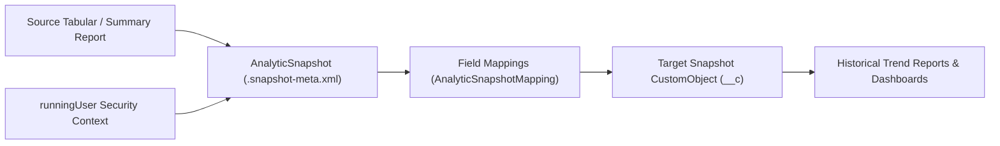

## Architectural Overview

Standard Salesforce reports show live transactional state, making it difficult to answer point-in-time questions like *"What was our open pipeline by stage every Monday at 6:00 AM over the past four quarters?"* without external data warehouses. The `AnalyticSnapshot` metadata type (known in the Setup UI as **Reporting Snapshots**) solves this declaratively.

An `AnalyticSnapshot` binds three components together:
1. A source tabular or summary [Report](/docs/metadata/report-metadata-type/).
2. A target [CustomObject](/docs/metadata/custom-object-metadata-type/) designed to hold historical snapshot rows.
3. Field-level `mappings` (`AnalyticSnapshotMapping`) that copy report columns or summary formulas into target [CustomField](/docs/metadata/custom-field-metadata-type/) columns under the security context of a specified `runningUser`.



## SFDX Directory & File Suffix

| Property | Value |
| :--- | :--- |
| **Metadata Type Name** | `AnalyticSnapshot` |
| **SFDX Directory** | `force-app/main/default/analyticSnapshots/` |
| **File Suffix** | `.snapshot-meta.xml` |
| **API Version Introduced** | `16.0` (Verified on `68.0` / Winter '27) |

## Key Metadata Fields

| Field Name | Type | Required | Architectural Purpose |
| :--- | :--- | :--- | :--- |
| `name` | `string` | Yes | Display name of the Reporting Snapshot in Setup. |
| `sourceReport` | `string` | Yes | Folder-qualified developer name of the source report (e.g., `Sales_Audit_Reports/Weekly_Open_Pipeline`). |
| `targetObject` | `string` | Yes | API name of the target custom object (`Pipeline_Snapshot__c`) receiving inserted rows. |
| `runningUser` | `string` | Yes | Username under whose data visibility and FLS context the source report executes. |
| `groupColumn` | `string` | No | Required when `sourceReport` is a summary report; specifies which grouping level to snapshot (`GRAND_SUMMARY` or a grouping field name). |
| `mappings` | `AnalyticSnapshotMapping[]` | No | Array of field mappings (`sourceField`, `sourceType`, `targetField`, `aggregateType`). |
| `description` | `string` | No | Documents the schedule, retention strategy, and business owner of the snapshot. |

### `AnalyticSnapshotMapping` Subfields

| Subfield | Type | Purpose |
| :--- | :--- | :--- |
| `sourceField` | `string` | API name of the report column, formula, or execution metadata (`JobName`, `ExecutionTime`, `RunningUser`). |
| `sourceType` | `ReportSummaryType` | Type of source value: `tabular` (detail rows), `summary` (grouped aggregates), or `snapshot` (execution metadata). |
| `aggregateType` | `ReportAggrType` | Required when `sourceType` is `summary` (`Sum`, `Average`, `Maximum`, `Minimum`, `RowCount`). |
| `targetField` | `string` | Qualified API name of the destination field on `targetObject` (e.g., `Pipeline_Snapshot__c.Total_Amount__c`). |

> [!WARNING]
> If the `targetObject` has active Validation Rules, Apex Triggers, or required fields not mapped in `AnalyticSnapshot`, snapshot rows that fail validation are silently dropped into the failure log rather than inserted. Never add complex triggers or validation rules to a dedicated snapshot custom object.

## Declarative XML & `package.xml` Examples

### Sample `.snapshot-meta.xml`

```xml title="force-app/main/default/analyticSnapshots/Weekly_Pipeline_Snapshot.snapshot-meta.xml"
<?xml version="1.0" encoding="UTF-8"?>
<AnalyticSnapshot xmlns="http://soap.sforce.com/2006/04/metadata">
    <description>Captures weekly summary opportunity pipeline totals by StageName every Monday morning.</description>
    <groupColumn>STAGE_NAME</groupColumn>
    <mappings>
        <sourceField>ExecutionTime</sourceField>
        <sourceType>snapshot</sourceType>
        <targetField>Pipeline_Snapshot__c.Snapshot_Timestamp__c</targetField>
    </mappings>
    <mappings>
        <sourceField>STAGE_NAME</sourceField>
        <sourceType>summary</sourceType>
        <targetField>Pipeline_Snapshot__c.Stage_Name__c</targetField>
    </mappings>
    <mappings>
        <aggregateType>Sum</aggregateType>
        <sourceField>AMOUNT</sourceField>
        <sourceType>summary</sourceType>
        <targetField>Pipeline_Snapshot__c.Total_Pipeline_Amount__c</targetField>
    </mappings>
    <mappings>
        <aggregateType>RowCount</aggregateType>
        <sourceField>RowCount</sourceField>
        <sourceType>summary</sourceType>
        <targetField>Pipeline_Snapshot__c.Opportunity_Count__c</targetField>
    </mappings>
    <name>Weekly Pipeline Snapshot</name>
    <runningUser>integration.analytics@acme.enterprise</runningUser>
    <sourceReport>Executive_Reports/Open_Pipeline_By_Stage</sourceReport>
    <targetObject>Pipeline_Snapshot__c</targetObject>
</AnalyticSnapshot>
```

### Sample `package.xml` Manifest

```xml title="manifest/package.xml"
<?xml version="1.0" encoding="UTF-8"?>
<Package xmlns="http://soap.sforce.com/2006/04/metadata">
    <types>
        <members>Pipeline_Snapshot__c</members>
        <name>CustomObject</name>
    </types>
    <types>
        <members>Executive_Reports</members>
        <members>Executive_Reports/Open_Pipeline_By_Stage</members>
        <name>Report</name>
    </types>
    <types>
        <members>Weekly_Pipeline_Snapshot</members>
        <name>AnalyticSnapshot</name>
    </types>
    <version>68.0</version>
</Package>
```

## SFDX CLI Retrieval & Deployment

Retrieve and deploy `AnalyticSnapshot` metadata via the Salesforce CLI:

```bash
# Retrieve all AnalyticSnapshot definitions
sf project retrieve start --metadata "AnalyticSnapshot:*"

# Retrieve a specific Reporting Snapshot alongside its target object and source report
sf project retrieve start --metadata "AnalyticSnapshot:Weekly_Pipeline_Snapshot" "CustomObject:Pipeline_Snapshot__c" "Report:Executive_Reports/Open_Pipeline_By_Stage"

# Deploy the AnalyticSnapshot
sf project deploy start --metadata "AnalyticSnapshot:Weekly_Pipeline_Snapshot"
```

## Senior Architect Best Practices & Gotchas

- **2,000 Row Ceiling per Run:** A single `AnalyticSnapshot` run inserts at most **2,000 rows**. Always use a **Summary Report** grouped by key dimensions (such as Stage, Region, or Product Family) rather than a detail-level Tabular Report so each weekly run inserts 20–50 aggregated rows instead of truncating at row 2,000.
- **CI/CD `runningUser` Replacement:** Because sandboxes append `.uat` or `.dev` to usernames, hardcoding `<runningUser>` breaks sandbox deployments. Use SFDX string replacements (`sfdx-project.json` `replacements`) to dynamically inject the target environment's integration username at deploy time.
- **Data Storage Governance:** Snapshot custom objects consume standard Data Storage (2 KB per record). Schedule a nightly or monthly batch job or Flow to purge or archive `Pipeline_Snapshot__c` records older than 24 months.

> [!TIP]
> Never use a personal admin's username as `<runningUser>`. If that admin leaves the company and their User record is deactivated, the `AnalyticSnapshot` silently stops executing on schedule. Always assign a dedicated integration or system user.
